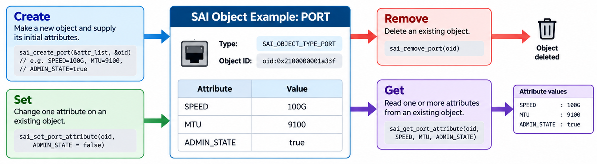
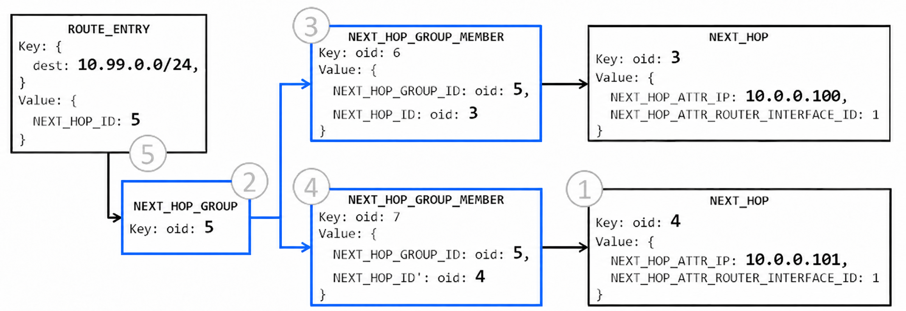

# The SAI Object Model

> **Prerequisite**: [SAI and Syncd](13_sai_and_syncd.md) — sairedis, syncd, the meta layer, and virtual IDs versus real IDs.

[SAI and Syncd](13_sai_and_syncd.md) showed how a SAI call travels from orchagent to the ASIC. This document covers the objects those calls act on: what a SAI object is, how it is named, what attributes it carries, and how objects reference each other. It also covers bulk operations, hardware counters, ASIC notifications, and the path packets take to reach the CPU. These patterns appear in every feature orchagent programs, from ports and routes to control-plane traps.


## Objects and the Four Operations

SAI models the ASIC as **objects**. A port, a VLAN, a next hop, an ACL table, and a queue are all objects. Each object has a type and a set of **attributes** — the properties that describe how the object is configured. For example, a port has speed, MTU, and admin state. A route has the next hop it forwards to.

SONiC interacts with an object through four operations:

| Operation  | What it does                  |
|------------|-------------------------------|
| **Create** | Makes a new object and supplies its initial attributes. |
| **Remove** | Deletes an object. |
| **Set**    | Changes one attribute on an object that already exists. |
| **Get**    | Reads one or more attributes. |

The diagram below uses a port to show how the four operations work together:

- **Create** builds the port with its initial attributes — speed, MTU, and admin state — and returns an object ID (`oid:0x2100000001a33f`). That OID is the handle every later call uses.
- **Set** changes a single attribute on the existing port, such as disabling it by writing `ADMIN_STATE = false`.
- **Get** reads one or more attributes back, returning their current values.
- **Remove** deletes the port entirely, using the same OID.

Every OID-based SAI object — VLAN, next hop, ACL table, queue — follows this same lifecycle.



Beyond the four operations, each type can also have **stats** (hardware counters) and **notifications** (events the ASIC pushes to SONiC). Both are covered later in this document.


## How an Object Is Named

SAI uses two kinds of names: **object IDs** and **entry keys**. Most objects receive an object ID when they are created. A few objects represent rows in hardware lookup tables and use entry keys instead — structs built from the fields the ASIC uses to find each row.

### Object IDs

An **object ID** (OID) is a 64-bit handle, `sai_object_id_t`. The create function returns it. Every later set, get, or remove on that object passes the same handle back:

```c
sai_object_id_t port_oid;

sai_port_api->create_port(&port_oid, switch_id, attr_count, attrs);
sai_port_api->set_port_attribute(port_oid, &attr);
```

Ports, next hops, next-hop groups, router interfaces, ACL tables, queues, and buffer profiles are all OID objects. The special value `SAI_NULL_OBJECT_ID` (zero) means "no object" — it is used when an optional OID attribute has no target.

The caller treats the OID as opaque — it is a handle, not a value to decode. In SONiC, orchagent never holds an OID from the vendor SAI directly. Instead, it holds a **virtual ID** (VID) allocated by sairedis. Syncd translates each VID to the corresponding **real ID** (RID) before the ASIC sees the call. That split — including how sairedis encodes each VID — is covered in [Virtual IDs and Real IDs](13_sai_and_syncd.md#virtual-ids-and-real-ids).

### Entry Keys

Some objects represent rows in a hardware lookup table. The ASIC finds each row by searching for a key, so the key itself serves as the object's name. SAI passes that key as a struct instead of returning an OID:

```c
sai_route_entry_t route_entry = {
    .switch_id   = switch_oid,
    .vr_id       = vr_oid,
    .destination = prefix          /* 10.1.0.0/24 — the lookup key */
};

sai_route_api->create_route_entry(&route_entry, attr_count, attrs);
```

The three entry types used on almost every SONiC switch:

| Entry | Key | What the ASIC matches |
|---|---|---|
| Route | Virtual router + destination prefix | Longest prefix match (LPM) on the destination. |
| Neighbor | Router interface + IP address | The adjacency for that IP on that interface. |
| FDB | Bridge or VLAN (`bv_id`) + MAC address | The MAC entry for that address on that bridge domain (the Layer 2 forwarding table). |

Other entry types include MPLS in-segment entries, NAT entries, multicast entries, SRv6 My-SID entries, and several DASH tables. The three above are the ones the rest of this series uses.

Because an entry has no OID, no other object can point at it with an OID attribute. A route can point at a next hop (an OID object), but nothing points back at the route.

### A Map of Object Types

The current SAI specification defines more than a hundred object types, plus extension types. The table below groups the most common ones — it is not a full catalog. Route, neighbor, and FDB in the routing and switching rows are the entry keys described above; every other name is an OID object.

| Group | Types you will meet |
|---|---|
| **Switching** | Port, VLAN, VLAN member, FDB, STP, LAG, LAG member |
| **Routing** | Virtual router, router interface, route, neighbor, next hop, next-hop group |
| **ACL** | ACL table, ACL entry, ACL counter |
| **QoS** | Queue, scheduler, scheduler group, buffer pool, buffer profile, WRED |
| **Tunneling** | Tunnel, tunnel map, tunnel termination entry |
| **Monitoring** | Mirror session, sample packet (sFlow), TAM (telemetry and monitoring) |
| **Control plane** | Host interface, trap group, trap |
| **Security** | MACsec, IPsec |


## Attributes

Create, set, and get all pass attributes. An attribute is a single `sai_attribute_t` value: an integer ID that names the property, plus a value. The value is stored in a C union, so the ID determines which union member is active.

```c
typedef union _sai_attribute_value_t {
    bool        booldata;       /* admin state */
    uint32_t    u32;            /* MTU */
    int32_t     s32;            /* enum, e.g. ACL stage */
    sai_object_id_t  oid;      /* reference to another object */
    sai_object_list_t objlist;  /* list of OIDs */
    sai_ip_address_t  ipaddr;  /* IP address */
    /* … many more members … */
} sai_attribute_value_t;

typedef struct _sai_attribute_t {
    sai_attr_id_t        id;       /* which attribute */
    sai_attribute_value_t value;   /* the value — only one union member is active */
} sai_attribute_t;
```

For example, setting a port's MTU to 9100:

```c
sai_attribute_t attr;
attr.id       = SAI_PORT_ATTR_MTU;   /* the ID selects the attribute */
attr.value.u32 = 9100;               /* the ID tells us to use the u32 member */

sai_port_api->set_port_attribute(port_oid, &attr);
```

The ID (`SAI_PORT_ATTR_MTU`) tells both the caller and the SAI implementation that `value.u32` is the active union member. Using the wrong member — for example, reading `value.oid` when the attribute is actually an integer — is undefined behavior in C. In practice, the [meta layer](13_sai_and_syncd.md#the-sai-meta-layer) catches type mismatches before they reach the ASIC.

### Anatomy of an Attribute Declaration

Every attribute ID is defined as an enum value in a SAI header file. A structured comment block above each enum value carries the metadata the [meta layer](13_sai_and_syncd.md#the-sai-meta-layer) uses to validate every call. Here are three port attributes from [`saiport.h`](https://github.com/opencomputeproject/SAI/blob/master/inc/saiport.h):

```c
    /**
     * @brief Hardware Lane list
     *
     * @type sai_u32_list_t                           ← value type (which union member)
     * @flags MANDATORY_ON_CREATE | CREATE_ONLY       ← writability rules
     */
    SAI_PORT_ATTR_HW_LANE_LIST,

    /**
     * @brief MTU
     *
     * @type sai_uint32_t                             ← value type
     * @flags CREATE_AND_SET                          ← writability rules
     * @default 1514                                  ← default if omitted at create
     */
    SAI_PORT_ATTR_MTU,

    /**
     * @brief Operational Status
     *
     * @type sai_port_oper_status_t                   ← value type
     * @flags READ_ONLY                               ← writability rules
     */
    SAI_PORT_ATTR_OPER_STATUS,
```

Each declaration carries three key annotations:

| Annotation | Purpose | Covered in |
|---|---|---|
| `@type` | Which `sai_attribute_value_t` union member to use | [Value Types](#value-types) below |
| `@flags` | When the attribute can be written (create, set, or read-only) | [Flags](#flags) below |
| `@default` | The value used when the attribute is omitted at create (only on non-mandatory attributes) | [Flags](#flags) below |

Some attributes also carry `@condition` or `@validonly`, which make them depend on the value of another attribute on the same object. Those are covered in [Conditional Attributes](#conditional-attributes).

### Value Types

The `@type` tag determines which member of the `sai_attribute_value_t` union to use. The most common types are:

| Kind of value | C type | Union member | Example |
|---|---|---|---|
| Boolean | `bool` | `booldata` | Admin state, enabled or disabled |
| Integer | `u8`, `u16`, `u32`, `u64` | `u8`, `u16`, `u32`, `u64` | MTU, weight, queue index |
| Enum | `s32` | `s32` | ACL stage, next-hop group type |
| OID | `sai_object_id_t` | `oid` | The next hop a route points at |
| OID list | `sai_object_list_t` | `objlist` | The members of a group, usually read-only |
| IP address | `sai_ip_address_t` | `ipaddr` | A neighbor or next-hop address |
| IP prefix | `sai_ip_prefix_t` | `ipprefix` | A route destination |
| MAC address | `sai_mac_t` | `mac` | A neighbor destination MAC |

The headers define additional types (ranges, ACL fields, QoS maps) not listed here.

Creating a next hop uses three of these types in a single call — an enum, an IP address, and an OID:

```c
sai_attribute_t nh_attrs[3];

nh_attrs[0].id        = SAI_NEXT_HOP_ATTR_TYPE;               /* @type sai_next_hop_type_t → value.s32 */
nh_attrs[0].value.s32 = SAI_NEXT_HOP_TYPE_IP;

nh_attrs[1].id           = SAI_NEXT_HOP_ATTR_IP;              /* @type sai_ip_address_t → value.ipaddr */
nh_attrs[1].value.ipaddr = ipv4_addr;

nh_attrs[2].id        = SAI_NEXT_HOP_ATTR_ROUTER_INTERFACE_ID; /* @type sai_object_id_t → value.oid */
nh_attrs[2].value.oid = rif_oid;

sai_next_hop_api->create_next_hop(&nh_oid, switch_id, 3, nh_attrs);
```

### Flags

The `@flags` tag controls when an attribute can be written. There are five flag names:

| Flag | Meaning |
|---|---|
| `MANDATORY_ON_CREATE` | The create call fails if this attribute is missing. Always paired with `CREATE_ONLY` or `CREATE_AND_SET`. A conditional attribute (see [below](#conditional-attributes)) is mandatory only when its condition is true. |
| `CREATE_ONLY` | Can be written at create, but `set` cannot change it afterward. If it is not mandatory, the header provides a default value. |
| `CREATE_AND_SET` | Can be written at create and changed later with `set`. If it is not mandatory, the header provides a default value. |
| `READ_ONLY` | Can only be read with `get`. Create and set cannot write it. |
| `KEY` | Part of the object's identity. Always combined with `MANDATORY_ON_CREATE` and `CREATE_ONLY`. Creating a second object with the same key value fails. Used on simple values such as a VLAN ID. |

These flags are combined to express an attribute's full writability rules, but not all combinations are valid. `CREATE_ONLY` and `CREATE_AND_SET` are mutually exclusive — an attribute is either frozen after create or mutable, not both. `READ_ONLY` is never combined with either of those or with `MANDATORY_ON_CREATE`. The [Combinations](#combinations-you-will-see) table below lists the six patterns you will encounter in practice.

The three port attributes in the [anatomy example](#anatomy-of-an-attribute-declaration) show these flags in action:
- `HW_LANE_LIST` — **mandatory and frozen** (`MANDATORY_ON_CREATE | CREATE_ONLY`). The lane mapping must be provided when the port is created, and it can never change afterward.
- `MTU` — **optional and mutable** (`CREATE_AND_SET`, `@default 1514`). It defaults to 1514 if omitted at create, and `set` can change it later.
- `OPER_STATUS` — **read-only** (`READ_ONLY`). The ASIC reports whether the link is up; SONiC cannot write this value.

The generated metadata enum adds two further flags that you may encounter in the source:

- `DYNAMIC` — combines only with `READ_ONLY`. It marks a value that can change without a `set` call, such as a counter or a membership list that grows when a member object is created.
- `SPECIAL` — stands alone. It marks an attribute that the generic meta path handles with extra logic.

### Combinations You Will See

| Combination | Flags | Meaning | Example |
|---|---|---|---|
| **Key** | `MANDATORY_ON_CREATE \| CREATE_ONLY \| KEY` | Required, identifies the object, never changes. | `SAI_VLAN_ATTR_VLAN_ID` |
| **Fixed at create** | `MANDATORY_ON_CREATE \| CREATE_ONLY` | Required and permanent, but not a unique key. | `SAI_ACL_TABLE_ATTR_ACL_STAGE` (ingress or egress) |
| **Required setting** | `MANDATORY_ON_CREATE \| CREATE_AND_SET` | Required at create, and `set` may change it later. | `SAI_BUFFER_PROFILE_ATTR_RESERVED_BUFFER_SIZE` |
| **Optional setting** | `CREATE_AND_SET` | Has a default. Pass it at create or change it later. | `SAI_PORT_ATTR_MTU` (default 1514) |
| **Optional, then frozen** | `CREATE_ONLY` | Has a default. If you pass it, you pass it at create, and it cannot change. | `SAI_BUFFER_POOL_ATTR_THRESHOLD_MODE` (default dynamic) |
| **Read-only** | `READ_ONLY` | The ASIC reports it. | `SAI_PORT_ATTR_OPER_STATUS` (link up or down); `SAI_SWITCH_ATTR_MAX_NUMBER_OF_SUPPORTED_PORTS` (a fixed limit) |

A port shows the typical split. MTU is an optional setting: omit it at create and the port defaults to 1514, or change it later with `set`. Operational status is read-only: the ASIC reports whether the link is up, and SONiC can only observe it.

### Conditional Attributes

Some attributes are valid only when another attribute on the same object has a particular value. The headers declare these dependencies with two annotations:

- `@condition` — the attribute becomes mandatory when the condition is true.
- `@validonly` — the attribute may be set only when the condition is true. Setting it otherwise is an error.

A buffer profile illustrates both annotations. The header [`saibuffer.h`](https://github.com/opencomputeproject/SAI/blob/master/inc/saibuffer.h) declares three related attributes — a threshold mode and two conditional thresholds, one for each mode:

```c
    /**
     * @brief Shared threshold mode for the buffer profile
     *
     * @type sai_buffer_profile_threshold_mode_t
     * @flags MANDATORY_ON_CREATE | CREATE_ONLY
     */
    SAI_BUFFER_PROFILE_ATTR_THRESHOLD_MODE,

    /**
     * @brief Dynamic threshold exponent
     *
     * The limit is 2^n of the pool's free space.
     *
     * @type sai_int8_t
     * @flags MANDATORY_ON_CREATE | CREATE_AND_SET
     * @condition SAI_BUFFER_PROFILE_ATTR_THRESHOLD_MODE == SAI_BUFFER_PROFILE_THRESHOLD_MODE_DYNAMIC
     */
    SAI_BUFFER_PROFILE_ATTR_SHARED_DYNAMIC_TH,

    /**
     * @brief Static threshold in bytes
     *
     * @type sai_uint32_t
     * @flags MANDATORY_ON_CREATE | CREATE_AND_SET
     * @condition SAI_BUFFER_PROFILE_ATTR_THRESHOLD_MODE == SAI_BUFFER_PROFILE_THRESHOLD_MODE_STATIC
     */
    SAI_BUFFER_PROFILE_ATTR_SHARED_STATIC_TH,
```

When `THRESHOLD_MODE` is set to `DYNAMIC`, the `@condition` on `SHARED_DYNAMIC_TH` becomes true, making it mandatory. At the same time, `SHARED_STATIC_TH` must not be set, because its condition is false. A create call that mixes attributes from both modes fails before it reaches the ASIC.


## API Method Tables

Each object type has a **method table**: a C struct of function pointers for that type's operations. A simplified port method table looks like this (the real struct also includes bulk calls and port sub-objects):

```c
typedef struct _sai_port_api_t {
    sai_create_port_fn          create_port;
    sai_remove_port_fn          remove_port;
    sai_set_port_attribute_fn   set_port_attribute;
    sai_get_port_attribute_fn   get_port_attribute;
    /* types with counters also have get/clear stats functions */
} sai_port_api_t;
```

For OID types, `set`, `get`, and `remove` take the object ID as a parameter. For entry types, they take the entry struct, because the struct *is* the name. Counter functions are covered under [Stats](#stats).

At startup, SONiC obtains each method table from the loaded SAI library once and keeps the pointer for the lifetime of the process:

```c
sai_api_initialize(0, &service_method_table);

sai_port_api_t *port_api;
sai_api_query(SAI_API_PORT, (void **)&port_api);

port_api->create_port(&port_oid, switch_id, attr_count, attrs);
port_api->set_port_attribute(port_oid, &attr);
```

`sai_api_query` returns the function pointers for a given type. The vendor `libsai.so` (or `libsaivs.so` on the virtual switch) fills them in. Because every vendor implements the same function signatures, orchagent calls the same function names on every platform.


## References Between Objects

An OID attribute can point at another object. This creates a **reference**: the object that holds the OID depends on the object it points at. The meta layer rejects a create that references an OID which does not exist, and rejects a remove while another object still holds a reference to the target. The vendor SAI enforces the same rules in hardware.

A member object must be created after its parent, because the member's attributes store the parent's OID.

### Parent and Member

A parent object defines the group. Each member object is a join object that links one child to the group — it stores the parent's OID and the child's OID as attributes.

The diagram below shows a route (`10.99.0.0/24`) that points at a next-hop group consisting of two members. The circled numbers show the creation order — objects that are referenced must exist before the objects that reference them:



Five objects are created in this order:

- **Next hops** (①) — the two independent destination objects (`10.0.0.100` and `10.0.0.101`), each pointing at a router interface. These are created first because the members will reference them.

- **Next-hop group** (②) — the parent object (`oid: 5`). It defines the group type but has no members yet.

- **Next-hop group members** (③④) — two join objects. Each stores the group's OID (`NEXT_HOP_GROUP_ID: 5`) and one next hop's OID (`NEXT_HOP_ID: 3` or `4`). Both the group and the next hop must already exist.

- **Route entry** (⑤) — the entry key (`10.99.0.0/24`). Its `NEXT_HOP_ID` attribute points at the group (`oid: 5`), completing the chain.

The code for steps ①–③ (creating one next hop, the group, and one member):

```c
/* 1. Create the next hop — must exist before anything references it */
sai_next_hop_api->create_next_hop(&nh_oid, switch_id, 3, nh_attrs);

/* 2. Create the next-hop group (the parent) */
sai_attribute_t group_attr;
group_attr.id        = SAI_NEXT_HOP_GROUP_ATTR_TYPE;
group_attr.value.s32 = SAI_NEXT_HOP_GROUP_TYPE_DYNAMIC_UNORDERED_ECMP;
sai_next_hop_group_api->create_next_hop_group(&group_oid, switch_id, 1, &group_attr);

/* 3. Create the member (join object — references both the group and the next hop) */
sai_attribute_t member_attrs[2];
member_attrs[0].id        = SAI_NEXT_HOP_GROUP_MEMBER_ATTR_NEXT_HOP_GROUP_ID;
member_attrs[0].value.oid = group_oid;       /* points at the parent */
member_attrs[1].id        = SAI_NEXT_HOP_GROUP_MEMBER_ATTR_NEXT_HOP_ID;
member_attrs[1].value.oid = nh_oid;          /* points at the next hop */
sai_next_hop_group_api->create_next_hop_group_member(&member_oid, switch_id, 2, member_attrs);
```

The same parent-and-member pattern appears across SAI:

| Parent | Child | What the child attaches |
|---|---|---|
| Next-hop group | Next-hop group member | A next hop, or another next-hop group |
| ACL table | ACL entry | One match/action rule. The entry stores the table OID. |
| LAG | LAG member | A physical port |
| VLAN | VLAN member | A bridge port, plus a tagging mode |

### Removal Order

Objects must be removed in **reverse order** of creation — remove the object that holds a reference before the object it points at. SAI rejects a remove call while another object still references the target.

Using the diagram above as an example, withdrawing the route requires removing the five objects in reverse: delete the route entry (⑤), then the members (④③), then the group (②), and then the next hops (①). A next hop cannot be removed while a member still points at it, and a router interface cannot be removed while a next hop still references it. Front-panel ports are created by the switch object at startup and are not torn down as part of withdrawing a route.


## Capability Queries

The SAI headers describe the full API, but a given ASIC may implement only a subset. Two query functions report what a particular ASIC supports. Both take the switch OID as a parameter.

> Capability queries answer *what* the ASIC supports. For a different question — *how many* table entries are still free — see [CRM](12_orchagent.md#crm--critical-resource-monitoring).

### Querying Supported Enum Values

`sai_query_attribute_enum_values_capability()` returns the enum values an attribute actually accepts:

```c
sai_s32_list_t values;
values.count = max_values;       /* how many values the array can hold */
values.list  = value_array;      /* the array to fill */

/* Ask the ASIC: which next-hop group types do you support? */
sai_query_attribute_enum_values_capability(
    switch_id,                              /* which ASIC */
    SAI_OBJECT_TYPE_NEXT_HOP_GROUP,         /* which object type */
    SAI_NEXT_HOP_GROUP_ATTR_TYPE,           /* which enum attribute */
    &values);                               /* filled with the supported values */
```

`SwitchOrch` calls this at startup and publishes the results in STATE_DB as `SWITCH_CAPABILITY_TABLE`. Other modules read that table before attempting to use a feature the ASIC might not support. For example, if the ASIC does not support a particular next-hop group type, orchagent falls back to a supported one instead of sending a call that would fail.

### Querying Attribute Support

`sai_query_attribute_capability()` checks whether a specific attribute is implemented, and for which operations:

```c
sai_attr_capability_t capability;

/* Ask the ASIC: is auto-negotiation supported, and for which operations? */
sai_query_attribute_capability(
    switch_id,                          /* which ASIC */
    SAI_OBJECT_TYPE_PORT,               /* which object type */
    SAI_PORT_ATTR_AUTO_NEG_MODE,        /* which attribute */
    &capability);                       /* result struct */

/* capability.create_implemented  — can it be set at create? */
/* capability.set_implemented     — can it be changed later? */
/* capability.get_implemented     — can it be read?          */
```

When an attribute is not implemented on the current ASIC, orchagent omits it from the create call.


## Bulk Operations

The calls shown so far act on one object at a time. Programming an entire table one row at a time incurs the sairedis, ASIC_DB, and syncd overhead on every entry. **Bulk functions** on the same method table accept multiple objects in a single call, significantly reducing that overhead. On the route table, the function pointer is `create_route_entries`:

```c
sai_status_t status = route_api->create_route_entries(
    object_count,       /* how many routes */
    route_entries,      /* array of route keys */
    attr_counts,        /* attribute count for each route */
    attrs,              /* attribute array for each route */
    mode,               /* stop on error, or keep going */
    statuses);          /* one status per route */
```

The `mode` parameter decides what happens when a single entry fails:

| Mode | Behavior |
|---|---|
| `SAI_BULK_OP_ERROR_MODE_STOP_ON_ERROR` | Stop at the first failure. Earlier objects are created. The rest are not, and their status is `SAI_STATUS_NOT_EXECUTED`. |
| `SAI_BULK_OP_ERROR_MODE_IGNORE_ERROR` | Try every object. Read `statuses` to see which ones failed. |

The same bulk pattern exists for remove and set, and for other types (neighbors, ACL entries, next-hop group members). How `RouteOrch` groups routes into bulk calls, including the `-b` and `-k` batch sizes, is covered in [Batch Processing and EntityBulker](12_orchagent.md#batch-processing-and-entitybulker).


## Stats

Attributes describe how an object is configured. **Stats** (statistics) count what the object has done — bytes transmitted, packets dropped, and so on. Stats are not part of the create or set calls; they are read separately. Each type that supports counters has a `sai_*_stat_t` enum and three functions on its method table:

| Function          | What it does |
|-------------------|--------------|
| `get_*_stats`     | Reads the selected counters. |
| `get_*_stats_ext` | Reads them, and can clear them in the same call. The mode is `SAI_STATS_MODE_READ` or `SAI_STATS_MODE_READ_AND_CLEAR`. |
| `clear_*_stats`   | Sets the selected counters back to zero. |

```c
sai_stat_id_t counters[] = {
    SAI_PORT_STAT_IF_IN_OCTETS,
    SAI_PORT_STAT_IF_OUT_OCTETS,
};
uint64_t values[2];

port_api->get_port_stats(port_oid, 2, counters, values);
```

Syncd's flex counter infrastructure polls these counters on its own thread and writes the values to COUNTERS_DB, keeping that polling off orchagent's main loop. [Flex Counters](15_flex_counters.md) covers the full mechanism: counter groups, polling configuration, and how results reach COUNTERS_DB.


## Notifications

A notification is an asynchronous event the ASIC pushes to SONiC without being asked — for example, a link going up or a MAC address being learned. SONiC registers a callback by setting a function-pointer attribute on the **switch** object:

```c
sai_attribute_t attr;
attr.id        = SAI_SWITCH_ATTR_PORT_STATE_CHANGE_NOTIFY;
attr.value.ptr = (void *)on_port_state_change;

sai_switch_api->set_switch_attribute(switch_oid, &attr);
```

The vendor SAI invokes that callback on its own thread whenever the event occurs. In SONiC, the callback runs inside syncd, which publishes the event on an ASIC_DB notification channel. Orchagent then handles it on the notification thread described in [The Notification Thread](12_orchagent.md#the-notification-thread).

| Notification            | What changed                 |
|-------------------------|------------------------------|
| Port state change       | A port's link (operational status) went up or down. |
| FDB event               | A MAC address was learned, aged, or flushed. |
| Port host Tx ready      | The port's host interface is ready to transmit. |
| Queue PFC deadlock      | Priority-flow-control (PFC) deadlock was detected on a queue. |
| BFD session state       | A Bidirectional Forwarding Detection (BFD) session came up or went down. |
| Switch shutdown request | The ASIC requested a controlled shutdown — for example, due to a thermal emergency. |


## Reading an Implementation

The SAI repository publishes only header files, not ASIC implementations. Here is where you can read actual implementation code:

**NVIDIA Spectrum.** [SAI-Implementation](https://github.com/Mellanox/SAI-Implementation) is a `libsai` for Spectrum ASICs, written against the SX SDK. Its README tracks SAI 1.10 headers, an older generation than the one current SONiC builds use. The kernel drivers are in [Spectrum-SDK-Drivers](https://github.com/Mellanox/Spectrum-SDK-Drivers).

**Broadcom and Marvell.** SONiC links prebuilt vendor packages (`libsaibcm`, `mrvl-sai`). Broadcom's [OpenBCM](https://github.com/Broadcom-Network-Switching-Software/OpenBCM) repository is the archived switch SDK. The SAI adapter in the SONiC image is the closed-source `libsaibcm` package.

**Virtual switch.** `libsaivs` implements SAI objects entirely in process memory, with no real ASIC. The source is [`vslib`](https://github.com/sonic-net/sonic-sairedis/tree/master/vslib) in sonic-sairedis. `VirtualSwitchSaiInterface.cpp` receives the calls, and `SwitchStateBase.cpp` stores objects and attributes. This is the best code to read when you want to follow a create, a reference check, or a bulk call without needing actual hardware.

---

**Previous**: [← SAI and Syncd](13_sai_and_syncd.md) · **Next**: [Flex Counters →](15_flex_counters.md)
