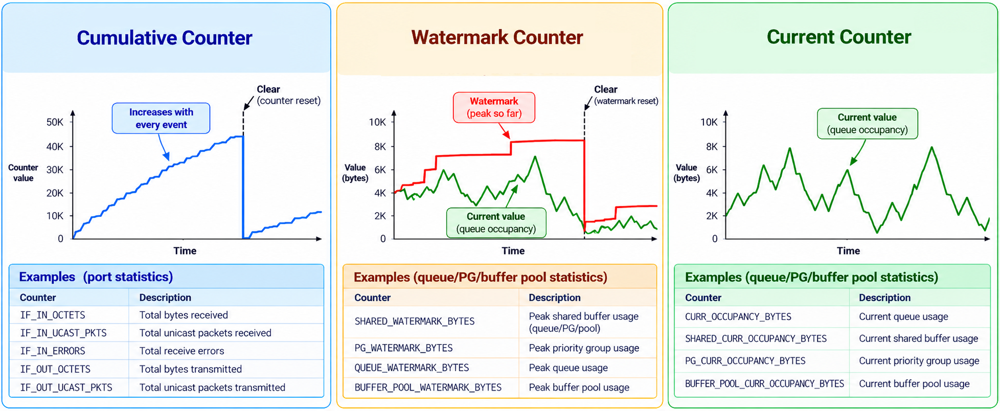
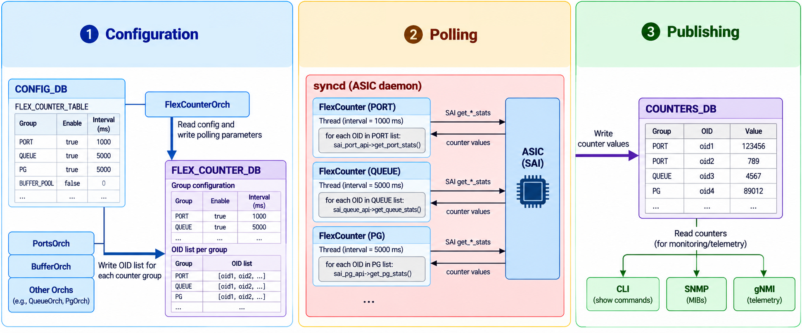

# Flex Counters

> **Prerequisites**: [SAI and Syncd](13_sai_and_syncd.md) (syncd's processing loop and the vendor SAI), [The SAI Object Model](14_sai_object_model.md) (stats and the `get_*_stats` calls), and [Core Redis Databases](08_redis_databases.md#counters_db) (COUNTERS_DB).

## What Are Counters?

Switching ASICs maintain **hardware counters** — registers that the chip updates automatically as it processes traffic. Every packet that enters or leaves a port, every packet dropped from a queue, every byte buffered — the ASIC tracks these events in dedicated counters without any software involvement. Not all counters behave the same way:

- **Cumulative counters** are the most common. They increment with every event (packet received, byte transmitted, error detected) and grow monotonically until cleared. Examples: `IF_IN_OCTETS`, `IF_IN_UCAST_PKTS`, `IF_IN_ERRORS`.

- **Watermark counters** track the *peak* value observed since the last clear. They do not increment with every event — they capture only the highest value seen, and reset when cleared. Examples: `SHARED_WATERMARK_BYTES` on queues, priority groups, and buffer pools.

- **Current counters** reflect an instantaneous value at the moment of the read. They can go up or down as conditions change. Examples: `CURR_OCCUPANCY_BYTES` on queues and buffer pools.



All three types are read through the same `get_*_stats` SAI calls described in [The SAI Object Model](14_sai_object_model.md#stats). The counter behavior is encoded in each stat's name and documented in the SAI headers: stats with `WATERMARK` in the name are peak values, stats with `CURR_OCCUPANCY` are instantaneous values, and all others — packets, bytes, drops, errors — are cumulative. The table below shows real examples from the SAI header files:

| SAI stat ID | Object type | Doxygen comment | Counter type |
|---|---|---|---|
| `SAI_PORT_STAT_IF_IN_OCTETS` | Port | "SAI port stat if in octets" | Cumulative |
| `SAI_PORT_STAT_IF_IN_ERRORS` | Port | "SAI port stat if in errors" | Cumulative |
| `SAI_PORT_STAT_IN_WATERMARK_BYTES` | Port | "Get in port watermark occupancy in bytes" | Watermark |
| `SAI_PORT_STAT_IN_CURR_OCCUPANCY_BYTES` | Port | "Get in port current occupancy in bytes" | Current |
| `SAI_QUEUE_STAT_PACKETS` | Queue | "Get/set tx packets count" | Cumulative |
| `SAI_QUEUE_STAT_DROPPED_PACKETS` | Queue | "Get/set dropped packets count" | Cumulative |
| `SAI_QUEUE_STAT_SHARED_WATERMARK_BYTES` | Queue | "Get watermark queue shared occupancy in bytes" | Watermark |
| `SAI_QUEUE_STAT_SHARED_CURR_OCCUPANCY_BYTES` | Queue | "Get current queue shared occupancy in bytes" | Current |
| `SAI_BUFFER_POOL_STAT_DROPPED_PACKETS` | Buffer pool | "Get count of packets dropped in this pool" | Cumulative |
| `SAI_BUFFER_POOL_STAT_WATERMARK_BYTES` | Buffer pool | "Get watermark pool occupancy in bytes" | Watermark |
| `SAI_BUFFER_POOL_STAT_CURR_OCCUPANCY_BYTES` | Buffer pool | "Get current pool occupancy in bytes" | Current |

## The Problem

A switch may have dozens of ports, hundreds of queues, and thousands of buffer entries — each with its own set of hardware counters. Polling all of them requires thousands of SAI `get_*_stats` calls per cycle. Two design constraints shape how SONiC handles this:

1. **Polling must not block orchagent.** Orchagent's main loop processes configuration and route changes. If it also polled counters, a burst of counter reads could delay route programming. Counter polling must happen on a separate thread.

2. **Polling must be configurable.** Different counter groups have different needs. Port counters are polled every second for real-time monitoring. Queue watermarks may be polled less frequently. An operator should be able to enable, disable, or change the interval for each group independently.

This document covers how SONiC calls those functions at scale: the **flex counter infrastructure**. "Flex" is short for **flexible** — the polling is not hardcoded but configurable at runtime: which counter groups to poll, how often, and whether each group is enabled or disabled. It runs inside syncd on dedicated threads, configured through a dedicated database.


## Counter Groups

A **counter group** is a named collection of counters that share the same polling interval and enable/disable state. Each group corresponds to a SAI object type and a set of stat IDs.

The common counter groups are:

| Group | SAI object type | What it counts | Default interval |
|---|---|---|---|
| `PORT_STAT` | Port | Bytes and packets in/out, errors, drops | 1 s |
| `QUEUE_STAT` | Queue | Per-queue packets, bytes, and drops | 10 s |
| `QUEUE_WATERMARK_STAT` | Queue | Peak queue depth since last clear | 60 s |
| `PG_WATERMARK_STAT` | Ingress priority group | Peak priority-group buffer usage | 60 s |
| `PG_DROP_STAT` | Ingress priority group | Per-PG packet drops | 10 s |
| `BUFFER_POOL_WATERMARK_STAT` | Buffer pool | Peak buffer pool usage | 60 s |
| `RIF_STAT` | Router interface | L3 bytes and packets in/out, errors | 1 s |
| `PORT_BUFFER_DROP` | Port | Per-port buffer drop counters | 60 s |
| `ACL` | ACL counter | Packets and bytes matching ACL rules | 10 s |
| `TUNNEL_STAT` | Tunnel | Tunnel encap/decap counters | 10 s |
| `MACSEC_SA` / `MACSEC_FLOW` | MACsec SA / MACsec flow | MACsec encryption/decryption counters | 10 s |
| `FLOW_CNT_TRAP` | Host interface trap | Per-trap packet counts | 10 s |

Operators can change these intervals through CONFIG_DB. The watermark and buffer drop groups default to longer intervals because the underlying counters change less frequently and their SAI calls can be more expensive on some platforms.

For the complete list of SAI stat IDs polled by each group, see [Flex Counter Groups — SAI Stat Reference](16_flex_counter_groups_reference.md).


## Architecture

The flex counter system spans three components:



The data flows in three steps:

1. **Configuration** — `FlexCounterOrch` reads the `FLEX_COUNTER_TABLE` in CONFIG_DB and writes polling parameters (interval, enable/disable) for each group to FLEX_COUNTER_DB. The orch that owns each object type writes the list of OIDs to poll — for example, `PortsOrch` writes OIDs for `PORT_STAT` and `BufferOrch` writes OIDs for `BUFFER_POOL_WATERMARK_STAT`.

2. **Polling** — Syncd's main loop reads FLEX_COUNTER_DB and configures one `FlexCounter` instance per group (one for `PORT_STAT`, one for `QUEUE_STAT`, and so on). Each instance runs its own thread, polling at the group's configured interval by calling the SAI `get_*_stats` functions for every OID in its list.

3. **Publishing** — After reading the counters from the ASIC, each polling thread writes the values to COUNTERS_DB, where consumers (CLI, SNMP, gNMI telemetry) read them.

The sections that follow examine each step in detail.


## Configuration Flow

### CONFIG_DB: The Operator's Interface

The operator configures counter groups through the `FLEX_COUNTER_TABLE` in CONFIG_DB. Each entry names a group and sets its polling interval and status:

```
admin@sonic:~$ sonic-db-cli CONFIG_DB HGETALL "FLEX_COUNTER_TABLE|PORT"
{'POLL_INTERVAL': '1000', 'FLEX_COUNTER_STATUS': 'enable'}
```

This tells the system: poll the `PORT_STAT` group every 1000 milliseconds. That group collects per-port traffic and error statistics from the ASIC — for example:

| SAI stat ID                      | What it measures         |
|----------------------------------|--------------------------|
| `SAI_PORT_STAT_IF_IN_OCTETS`     | Total bytes received     |
| `SAI_PORT_STAT_IF_OUT_OCTETS`    | Total bytes transmitted  |
| `SAI_PORT_STAT_IF_IN_UCAST_PKTS` | Unicast packets received |
| `SAI_PORT_STAT_IF_IN_ERRORS`     | Receive errors           |
| `SAI_PORT_STAT_IF_IN_DISCARDS`   | Ingress packets dropped  |
| `SAI_PORT_STAT_IF_OUT_DISCARDS`  | Egress packets dropped   |

The CLI command `counterpoll show` displays all groups:

```
admin@sonic:~$ counterpoll show
Type                        Interval (in ms)    Status
--------------------------  ------------------  --------
PORT_STAT                   1000                enable
PORT_BUFFER_DROP            60000               enable
QUEUE_STAT                  10000               enable
QUEUE_WATERMARK_STAT        60000               enable
PG_WATERMARK_STAT           60000               enable
PG_DROP_STAT                10000               enable
BUFFER_POOL_WATERMARK_STAT  60000               enable
ACL                         10000               enable
TUNNEL_STAT                 10000               enable
```

> **Naming note:** CONFIG_DB uses short key names (`PORT`, `QUEUE`), while the `counterpoll` CLI and FLEX_COUNTER_DB use suffixed names (`PORT_STAT`, `QUEUE_STAT`, `PORT_STAT_COUNTER`). These all refer to the same group — the naming differs by context, not by meaning.

Besides inspecting with `counterpoll show`, the operator can change intervals or enable/disable groups with `counterpoll` commands. Under the hood, these write to CONFIG_DB:

```bash
counterpoll port interval 2000       # change port polling to 2 seconds
counterpoll queue disable            # stop polling queue counters
```

### FlexCounterOrch: The Bridge

`FlexCounterOrch` subscribes to `FLEX_COUNTER_TABLE` in CONFIG_DB. When a group's interval or status changes, it writes the updated configuration to FLEX_COUNTER_DB, where syncd can pick it up. When a group is enabled, `FlexCounterOrch` also triggers the managing orch to populate the OID lists — for example, enabling the `PORT` group causes `PortsOrch` to call `generatePortCounterMap()`, which writes each port's OID and stat ID list to FLEX_COUNTER_DB.

> `FlexCounterOrch` does not poll any counters itself — it relays configuration and triggers OID registration.

### FLEX_COUNTER_DB: The Polling Contract

FLEX_COUNTER_DB holds two kinds of entries:

**1. Group configuration** — the polling parameters for each counter group:

```
admin@sonic:~$ sonic-db-cli FLEX_COUNTER_DB HGETALL "FLEX_COUNTER_GROUP_TABLE:PORT_STAT_COUNTER"
{'POLL_INTERVAL': '1000',
 'FLEX_COUNTER_STATUS': 'enable',
 'STATS_MODE': 'STATS_MODE_READ'}
```

`STATS_MODE` controls whether counters are just read (`STATS_MODE_READ`) or read and cleared in the same call (`STATS_MODE_READ_AND_CLEAR`). This maps directly to the SAI `get_*_stats_ext` mode described in [Stats](14_sai_object_model.md#stats).

**2. OID lists** — which objects to poll in each group:

```
admin@sonic:~$ sonic-db-cli FLEX_COUNTER_DB HGETALL "FLEX_COUNTER_TABLE:PORT_STAT_COUNTER:oid:0x1000000000003"
{'PORT_COUNTER_ID_LIST': 'SAI_PORT_STAT_IF_IN_OCTETS,SAI_PORT_STAT_IF_OUT_OCTETS,SAI_PORT_STAT_IF_IN_ERRORS,...'}
```

Each key identifies one SAI object (by OID). The value lists the specific stat IDs to read for that object. These entries are written by the orch that manages the object type — `PortsOrch` writes port counter OIDs, `BufferOrch` writes buffer pool OIDs, and so on. When a port is created, `PortsOrch` adds its OID to FLEX_COUNTER_DB. When a port is removed, the OID is deleted.


## Syncd's FlexCounter Threads

Syncd's main loop subscribes to FLEX_COUNTER_DB via [`ConsumerTable`](10_ipc_mechanisms.md#pattern-3-producertable--consumertable-queue-based). When it receives a group configuration or an OID list entry, it creates or updates a `FlexCounter` instance for that group. Each instance starts its own thread and stores the OID list and stat IDs in memory.

On each polling cycle, the thread:

1. **Iterates through its in-memory OID list** — the objects and stat IDs that were added by syncd's main loop when it processed FLEX_COUNTER_DB entries.
2. **Calls `getStats`** (or `getStatsExt`) on the vendor SAI for each OID, requesting the stat IDs for that object.
3. **Writes the results** to COUNTERS_DB.

The thread then sleeps for the configured interval using a condition variable, which allows the interval to be changed without restarting the thread.

### Thread Isolation

The FlexCounter threads and syncd's main loop share the same process but operate independently:

- The **main loop** handles ASIC_DB operations (creating, removing, and modifying SAI objects) and processes FLEX_COUNTER_DB events (adding or removing objects from the FlexCounter instances).
- The **FlexCounter threads** handle read-only stats polling — they never create or modify SAI objects.

Both call into the vendor SAI, so the vendor implementation must be thread-safe for concurrent `get_*_stats` and create/set/remove calls. All major SAI implementations (Broadcom, NVIDIA, the virtual switch) support this.


## COUNTERS_DB: Where Results Land

Each FlexCounter thread writes counter values to COUNTERS_DB using the SAI OID as the key:

```
admin@sonic:~$ sonic-db-cli COUNTERS_DB HGETALL "COUNTERS:oid:0x1000000000003"
{'SAI_PORT_STAT_IF_IN_OCTETS': '4829174021',
 'SAI_PORT_STAT_IF_OUT_OCTETS': '3918264553',
 'SAI_PORT_STAT_IF_IN_UCAST_PKTS': '12847291',
 'SAI_PORT_STAT_IF_IN_ERRORS': '0'}
```

These are raw values from the ASIC. Each field is a SAI stat ID and each value is a 64-bit number. For cumulative counters like the ones shown above, the value has been incrementing since the port was created (or since the last clear). For watermark counters the value represents the peak since the last clear, and for current counters it reflects the instantaneous state at the time of the read.

### Name Maps

The counter keys use SAI OIDs, which are not human-readable. To bridge between OIDs and friendly names, SONiC maintains **name map** tables in COUNTERS_DB:

```
admin@sonic:~$ sonic-db-cli COUNTERS_DB HGETALL "COUNTERS_PORT_NAME_MAP"
{'Ethernet0': 'oid:0x1000000000003',
 'Ethernet4': 'oid:0x1000000000004'}
```

The CLI and telemetry consumers look up the OID from the name map, then read the counter values using that OID. Common name maps include:

| Map table | Maps from | Maps to |
|---|---|---|
| `COUNTERS_PORT_NAME_MAP` | Port name (`Ethernet0`) | Port OID |
| `COUNTERS_QUEUE_NAME_MAP` | Queue name (`Ethernet0:0`) | Queue OID |
| `COUNTERS_RIF_NAME_MAP` | Router interface name | RIF OID |
| `COUNTERS_BUFFER_POOL_NAME_MAP` | Buffer pool name | Buffer pool OID |

These maps are populated by the orchs when they create the SAI objects. For example, `PortsOrch` adds an entry to `COUNTERS_PORT_NAME_MAP` after creating each port.

## Rate Computation: Lua Plugins

The counter groups described above poll raw values from the ASIC — totals like "bytes received" or "packets dropped." But operators often need derived metrics that require math on top of those raw values: a traffic rate (how many bytes per second?), a utilization percentage (what fraction of link capacity is in use?), or a Bit Error Rate (how many FEC-corrected bits relative to the total bits on the wire?). None of these exist as hardware registers — they must be calculated from the raw counters.

An external script could do this — read the raw counters from Redis, compute the rate, write the result back. But that approach has drawbacks:

- **Multiple round-trips.** Each Redis command (read current value, read previous value, write result) is a separate network call between the script and the Redis server. For hundreds of ports polled every second, these round-trips add up.
- **No atomicity.** Between reading the current counter and the previous counter, another client could modify the data. The script could compute a rate from inconsistent values.
- **Extra process to manage.** A separate daemon or cron job needs to be started, monitored, and kept in sync with the polling interval.

SONiC avoids all three problems by using **Redis server-side Lua scripting**. Redis has a built-in Lua interpreter: a client sends a Lua script to Redis via [`EVALSHA`](https://github.com/ManiAm/sonic-lab-redis/blob/master/docs/08_redis_lua_scripting.md), and Redis executes it **inside the server process**. While a Lua script runs, no other client can read or write — the entire script is atomic. All data access happens in-memory with no network round-trips.

Each FlexCounter thread loads its Lua plugin into Redis at startup (via `SCRIPT LOAD`, which returns a SHA hash). On each polling cycle, after writing the raw counters to COUNTERS_DB, the thread calls `EVALSHA` to run the plugin. The plugin reads the current and previous counter values, computes the derived metrics, and writes the results to a separate `RATES` table — all in a single atomic operation inside Redis.

The following Lua plugins are registered as FlexCounter plugins:

| Lua script | Registered by | Counter group | Purpose |
|---|---|---|---|
| `port_rates.lua` | PortsOrch | PORT_STAT | Computes per-port TX/RX rates (BPS, PPS) and FEC Bit Error Rates |
| `port_flr.lua` | PortsOrch | PORT_STAT | Computes Frame Loss Ratio per port |
| `rif_rates.lua` | IntfsOrch | RIF_STAT | Computes per-RIF TX/RX rates |
| `tunnel_rates.lua` | VxlanOrch | TUNNEL_STAT | Computes per-tunnel TX/RX rates |
| `trap_rates.lua` | CoppOrch | FLOW_CNT_TRAP | Computes per-trap TX/RX rates |
| `watermark_queue.lua` | PortsOrch | QUEUE_WATERMARK | Tracks peak queue occupancy since last clear |
| `watermark_pg.lua` | PortsOrch | PG_WATERMARK | Tracks peak priority-group occupancy since last clear |
| `watermark_bufferpool.lua` | BufferOrch | BUFFER_POOL_WATERMARK | Tracks peak buffer-pool occupancy since last clear |
| `pfc_detect_<platform>.lua` | PfcWdOrch | PFC_WD | Detects PFC storm conditions (platform-specific logic) |
| `pfc_restore.lua` | PfcWdOrch | PFC_WD | Detects PFC storm recovery |
| `drop_monitor.lua` | DebugCounterOrch | DEBUG_COUNTER | Monitors debug counter drop events |

> **Note:** Some plugins are vendor-specific. For example, `nvda_port_trim_drop.lua` (NVIDIA trim-packet drop calculation) and `pfc_detect_mellanox.lua` are loaded only on their respective platforms.

### Example: `port_rates.lua`

As a concrete example, the `port_rates.lua` plugin computes the following fields and writes them to `RATES:<port_oid>` in COUNTERS_DB:

| Computed field | Description | How it is derived |
|---|---|---|
| `RX_BPS` | Receive bytes per second | Delta of `SAI_PORT_STAT_IF_IN_OCTETS` × (1000 / interval), EWMA-smoothed |
| `TX_BPS` | Transmit bytes per second | Delta of `SAI_PORT_STAT_IF_OUT_OCTETS` × (1000 / interval), EWMA-smoothed |
| `RX_PPS` | Receive packets per second | Delta of (`IF_IN_UCAST_PKTS` + `IF_IN_NON_UCAST_PKTS`) × (1000 / interval), EWMA-smoothed |
| `TX_PPS` | Transmit packets per second | Delta of (`IF_OUT_UCAST_PKTS` + `IF_OUT_NON_UCAST_PKTS`) × (1000 / interval), EWMA-smoothed |
| `FEC_PRE_BER` | Pre-FEC Bit Error Rate | Delta of `SAI_PORT_STAT_IF_IN_FEC_CORRECTED_BITS` / (lanes × serdes speed × interval) |
| `FEC_POST_BER` | Post-FEC Bit Error Rate | Delta of `SAI_PORT_STAT_IF_IN_FEC_NOT_CORRECTABLE_FRAMES` × statistical average / (lanes × serdes speed × interval) |
| `FEC_PRE_BER_MAX` | Peak pre-FEC BER since boot | High-water mark of `FEC_PRE_BER` |
| `FEC_MAX_T` | Highest non-zero FEC codeword error bin (S0–S15) | Scans `SAI_PORT_STAT_IF_IN_FEC_CODEWORD_ERRORS_S0`–`S15` |

The EWMA (Exponentially Weighted Moving Average) smoothing factor `alpha` is configured via `RATES:PORT:PORT_ALPHA` in COUNTERS_DB. Rate values are smoothed as: `rate = alpha × new_rate + (1 − alpha) × old_rate`. The other rate plugins (`rif_rates.lua`, `tunnel_rates.lua`, `trap_rates.lua`) follow the same pattern: read raw counters, compute deltas, apply EWMA smoothing, and write derived values.

## Consumers

Multiple components read COUNTERS_DB:

| Consumer                                 | How it uses counters                   |
|------------------------------------------|----------------------------------------|
| **CLI** (`show interfaces counters`)     | Reads raw counters from COUNTERS_DB and pre-computed rates from the [RATES](#rate-computation-lua-plugins) table. |
| **SNMP** (`docker-snmp`)                 | Maps SNMP MIB OIDs (like `ifInOctets`) to SAI stat IDs in COUNTERS_DB. |
| **gNMI telemetry** (`docker-sonic-gnmi`) | Streams counter values to external collectors at the configured interval. |
| **WatermarkOrch**                        | Reads watermark counters from COUNTERS_DB and writes user/persistent watermark tables. |
| **PfcWdOrch**                            | Reads PFC counters to detect priority-flow-control storms. |

None of these consumers call SAI directly. They all read from COUNTERS_DB, which decouples counter consumption from counter collection.

### `show interfaces counters` — Column Breakdown

Each column in the `show interfaces counters` output maps to a specific source in COUNTERS_DB:

| Column | What it shows | Source table | SAI stat ID or computed field |
|---|---|---|---|
| `IFACE` | Port name (e.g. `Ethernet0`) | `COUNTERS_PORT_NAME_MAP` | Key lookup — maps name to OID |
| `STATE` | Admin/oper state (`U` = up, `D` = down) | APPL_DB `PORT_TABLE` | `admin_status`, `oper_status` |
| `RX_OK` | Total packets received | `COUNTERS:oid:...` | `SAI_PORT_STAT_IF_IN_UCAST_PKTS` + `SAI_PORT_STAT_IF_IN_NON_UCAST_PKTS` |
| `RX_BPS` | Receive rate (bytes/sec) | `RATES:oid:...` | `RX_BPS` — computed by `port_rates.lua` |
| `RX_UTIL` | Receive utilization (%) | `RATES:oid:...` | `RX_UTIL` — computed by `port_rates.lua` |
| `RX_ERR` | Receive errors | `COUNTERS:oid:...` | `SAI_PORT_STAT_IF_IN_ERRORS` |
| `RX_DRP` | Ingress packets dropped | `COUNTERS:oid:...` | `SAI_PORT_STAT_IF_IN_DISCARDS` |
| `RX_OVR` | Receive oversize packets | `COUNTERS:oid:...` | `SAI_PORT_STAT_ETHER_RX_OVERSIZE_PKTS` |
| `TX_OK` | Total packets transmitted | `COUNTERS:oid:...` | `SAI_PORT_STAT_IF_OUT_UCAST_PKTS` + `SAI_PORT_STAT_IF_OUT_NON_UCAST_PKTS` |
| `TX_BPS` | Transmit rate (bytes/sec) | `RATES:oid:...` | `TX_BPS` — computed by `port_rates.lua` |
| `TX_UTIL` | Transmit utilization (%) | `RATES:oid:...` | `TX_UTIL` — computed by `port_rates.lua` |
| `TX_ERR` | Transmit errors | `COUNTERS:oid:...` | `SAI_PORT_STAT_IF_OUT_ERRORS` |
| `TX_DRP` | Egress packets dropped | `COUNTERS:oid:...` | `SAI_PORT_STAT_IF_OUT_DISCARDS` |
| `TX_OVR` | Transmit oversize packets | `COUNTERS:oid:...` | `SAI_PORT_STAT_ETHER_TX_OVERSIZE_PKTS` |

Columns sourced from the `COUNTERS:oid:...` table (raw SAI stats) show **deltas**, not ever-growing totals. The CLI achieves this by saving a snapshot of all counter values to a local JSON file when the user runs `show interfaces counters -c` (clear). On subsequent runs, it loads that saved snapshot and subtracts it from the current values. If no snapshot file exists, the deltas are calculated against zero (i.e., the raw totals are displayed). The CLI also supports a `-p` (period) flag, which takes two live readings separated by the specified number of seconds and displays the difference. Columns sourced from the `RATES:oid:...` table show pre-computed values written by `port_rates.lua` — no snapshot subtraction is needed for these. Both tables live in COUNTERS_DB.


## Counter Width

SAI returns all stat values as `uint64_t` — every `get_*_stats` call writes into an array of 64-bit unsigned integers.

The underlying ASIC hardware may use narrower registers. Many packet and byte counters in port-level blocks are 32 bits wide on the hardware. A 32-bit byte counter on a 100 Gbps port wraps around in about 0.34 seconds. The vendor SAI SDK is responsible for polling the hardware registers frequently enough to detect wraps and accumulate them into the 64-bit values that SAI returns. This happens inside the vendor SDK, invisible to SONiC.

A 64-bit counter wraps after approximately 1.8 × 10¹⁹ — at 100 Gbps, that takes roughly 46 years. For practical purposes, 64-bit counters do not wrap.

SNMP is the one place where 32-bit widths resurface. The original SNMP `ifTable` (RFC 1213) defines counters like `ifInOctets` as `Counter32`. On high-speed interfaces these wrap in seconds, so RFC 2863 added 64-bit versions in the `ifXTable` (`ifHCInOctets`, `ifHCInUcastPkts`, etc.). SONiC's SNMP agent reads from COUNTERS_DB and applies a 32-bit mask (`0xFFFFFFFF`) for the legacy MIB objects and a 64-bit mask for the HC (high-capacity) variants.


## Putting It All Together

Here is the full lifecycle of a port counter, from operator configuration to CLI display:

1. The operator runs `counterpoll port interval 1000` → writes `POLL_INTERVAL: 1000` to CONFIG_DB `FLEX_COUNTER_TABLE|PORT`.

2. `FlexCounterOrch` picks up the change and writes the interval to FLEX_COUNTER_DB `FLEX_COUNTER_GROUP_TABLE:PORT_STAT_COUNTER`.

3. When `PortsOrch` creates a port, it writes the port's OID and the list of stat IDs to poll to FLEX_COUNTER_DB.

4. Syncd's main loop processes the FLEX_COUNTER_DB entries and configures the `FlexCounter` instance for the PORT group with the OID list and a 1-second interval.

5. Every second, the FlexCounter thread iterates through its in-memory port OID list, calls `sai_port_api->get_port_stats()` for each one, and writes the results to COUNTERS_DB.

6. The operator runs `show interfaces counters` → the CLI reads `COUNTERS_PORT_NAME_MAP` to find the OID for each port, reads the counter values from COUNTERS_DB, computes deltas from the previous snapshot, and displays the result.

---

**Previous**: [← The SAI Object Model](14_sai_object_model.md) · **Next**: [Flex Counter Groups Reference →](16_flex_counter_groups_reference.md)
