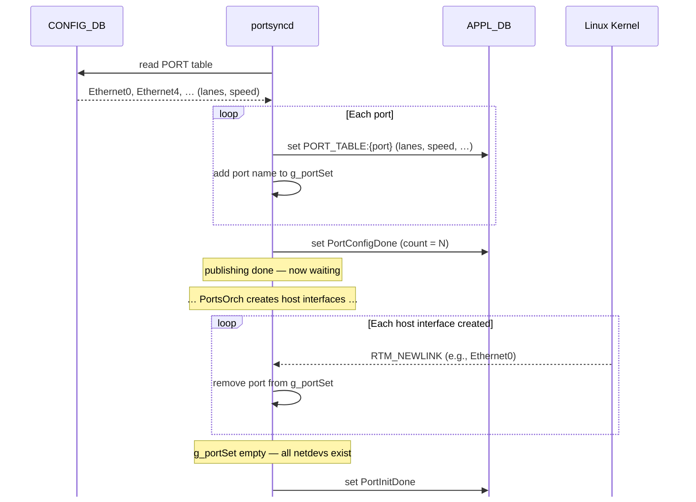
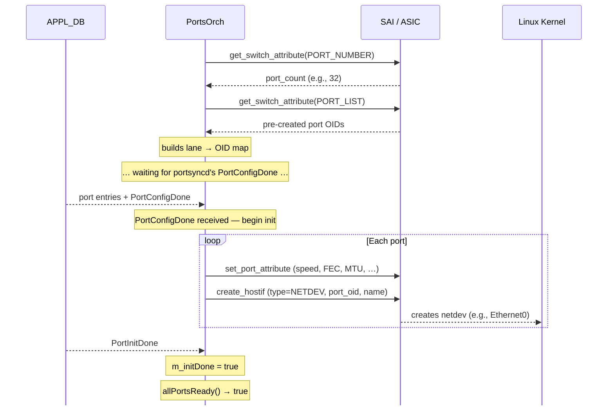
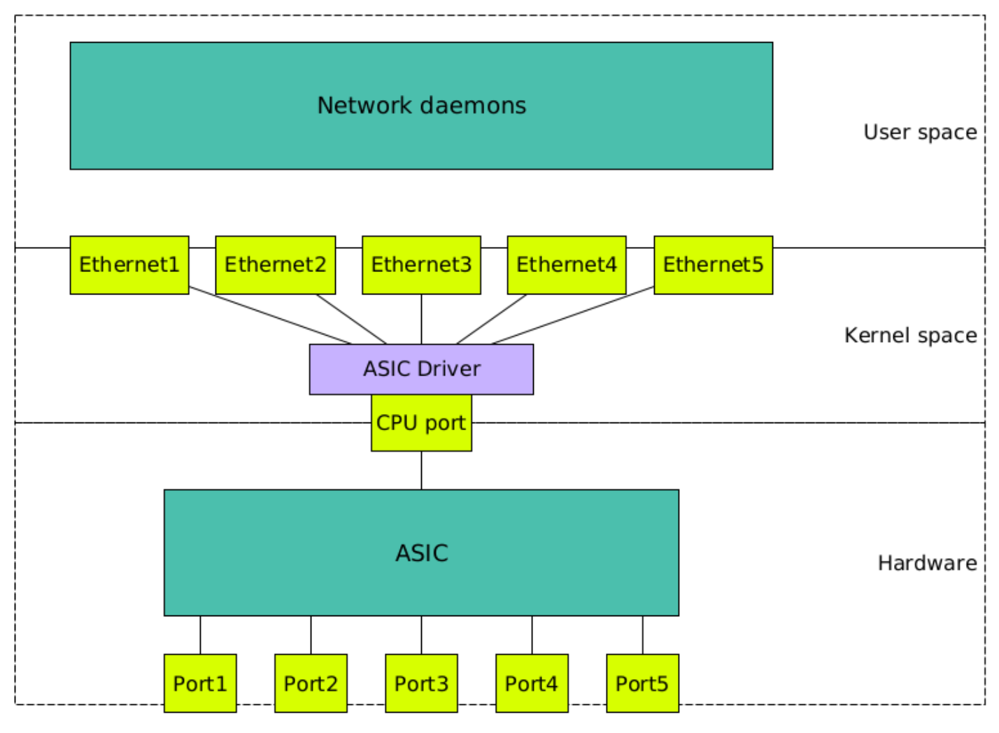
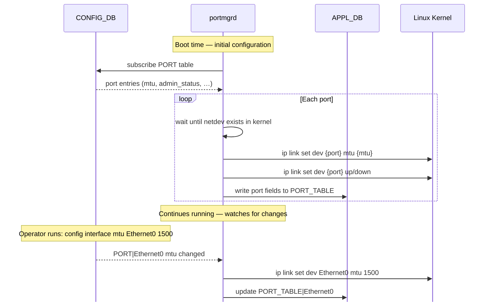

# Ports and Host Interfaces

> **Prerequisites**: [Orchagent Deep Dive](12_orchagent.md) — the select loop, `m_orchList` ordering, and `doTask()`. [The SAI Object Model](14_sai_object_model.md) — object IDs, entry keys, and the four operations.

Before the switch can do anything useful, it must first initialize its physical ports and create the Linux network devices (**netdevs**) that let the CPU communicate with the ASIC. Three processes inside the SWSS container coordinate this work, starting in a strict order enforced by `supervisord`:

| Process                   | Supervisord Priority | Waits For           | Role                         |
|---------------------------|----------------------|---------------------|------------------------------|
| `portsyncd`               | 3                    | —                   | Reads port config from CONFIG_DB, publishes it to APPL_DB |
| `orchagent` (`PortsOrch`) | 4                    | `portsyncd:running` | Configures SAI port objects and creates host interfaces |
| `portmgrd`                | 10                   | `orchagent:running` | Applies MTU and admin state in the Linux kernel |


## portsyncd — The Configuration Bridge

`portsyncd` is the first process to start. Its job is simple but critical: read the port definitions from **CONFIG_DB** and republish them to **APPL_DB** so that `PortsOrch` can consume them.

> The PORT table in CONFIG_DB is populated at boot time from the saved configuration file — see [How CONFIG_DB Is Populated at Boot](27_configuration_management.md#how-config_db-is-populated-at-boot).



1. **Reads** the `PORT` table from CONFIG_DB. Each entry describes one physical port — its lane mapping, speed, alias, and index.

2. **Writes** each port as a `PORT_TABLE:{name}` entry in APPL_DB (lanes, speed, alias, index, etc.).

3. **Sends `PortConfigDone`** — after writing all ports, it sets a special `PortConfigDone` key in APPL_DB. This signals to `PortsOrch` that the full port configuration is available.

4. **Waits for host interfaces** — at this point, `portsyncd` has done its publishing work and enters a waiting state. It needs `PortsOrch` to create a [host interface](#host-interfaces) for every port. It tracks a set called `g_portSet` containing every port name it published and subscribes to kernel **netlink** events (the Linux kernel's mechanism for notifying user-space programs about network device changes) to detect when each host interface appears.

5. **Detects each netdev and sends `PortInitDone`** — as `PortsOrch` creates each host interface, the kernel emits an `RTM_NEWLINK` netlink event. `portsyncd` receives it and removes that port from `g_portSet`. When the set is empty — meaning every port has a corresponding netdev in the kernel — it sends the `PortInitDone` signal, telling the system that port initialization is complete.


## PortsOrch — SAI Port Configuration

`orchagent` starts second. Its `PortsOrch` module handles port objects and host interfaces.



1. **Discovers pre-created ports** — unlike most SAI objects that `orchagent` creates on demand, port objects **already exist** when the switch initializes. During `sai_switch_api->create_switch()`, the SAI implementation discovers the ASIC's physical ports and pre-creates a `SAI_OBJECT_TYPE_PORT` for each one. `PortsOrch` retrieves the full list immediately on startup:

    ```c
    sai_attribute_t attr;
    attr.id = SAI_SWITCH_ATTR_PORT_LIST;
    attr.value.objlist.count = port_count;
    attr.value.objlist.list  = port_oid_array;
    sai_switch_api->get_switch_attribute(switch_id, 1, &attr);
    ```

2. **Builds lane→OID map** — maps each physical SerDes (serializer/deserializer) lane to its SAI port OID (Object Identifier), so that when port entries arrive from APPL_DB (keyed by lane mapping), `PortsOrch` can match them to the correct hardware port.

3. **Waits for `PortConfigDone`** — at this point, `PortsOrch` has its SAI port inventory but no configuration yet. It waits until `portsyncd` has published all port entries and sent the `PortConfigDone` signal via APPL_DB.

4. **Configures each port** — on receiving `PortConfigDone`, `PortsOrch` applies the desired attributes to each pre-existing SAI port:

    | SAI Attribute | Purpose | Example |
    |---|---|---|
    | `SAI_PORT_ATTR_ADMIN_STATE` | Enable or disable the port | `true` |
    | `SAI_PORT_ATTR_SPEED` | Link speed in Mbps | `100000` (100G) |
    | `SAI_PORT_ATTR_MTU` | Maximum transmission unit | `9100` |
    | `SAI_PORT_ATTR_FEC_MODE` | Forward error correction | `RS` |
    | `SAI_PORT_ATTR_HW_LANE_LIST` | Physical SerDes lanes | `{0, 1, 2, 3}` |

5. **Creates host interfaces** — for each port, `PortsOrch` creates a [host interface](#host-interfaces). These are the netdevs that `portsyncd` is waiting for in step 4 above.

6. **Receives `PortInitDone`** — once `portsyncd` confirms all netdevs exist, `PortsOrch` sets `m_initDone = true` and `allPortsReady()` returns `true`, unblocking all downstream Orchs (IntfsOrch, NeighOrch, RouteOrch, etc.).


## Host Interfaces

A **host interface** is a SAI object (`SAI_OBJECT_TYPE_HOSTIF`) that connects a physical ASIC port to the Linux kernel. It involves two distinct components, and it is important to distinguish between them:

| Term               | What it is                                 | Where it lives |
|--------------------|--------------------------------------------|---|
| **Host interface** | A SAI object — the ASIC-side handle        | SAI / ASIC layer |
| **Netdev**         | A Linux network device (e.g., `Ethernet8`) | Linux kernel |

Creating the SAI host interface *causes* the kernel netdev to appear — they are two views of the same thing. The host interface is the ASIC's side of the channel; the netdev is the Linux side.



The diagram shows the three layers involved. User-space daemons (BGP, LLDP, etc.) communicate through the kernel netdevs. The ASIC driver and a dedicated **CPU port** bridge the kernel and the hardware. Each physical ASIC port has a corresponding netdev, but all control-plane traffic funnels through the single CPU port.

### How PortsOrch Creates Them

For each physical port, `PortsOrch` calls `sai_hostif_api->create_hostif()` with three attributes:

```c
sai_attribute_t hostif_attrs[3];

hostif_attrs[0].id        = SAI_HOSTIF_ATTR_TYPE;
hostif_attrs[0].value.s32 = SAI_HOSTIF_TYPE_NETDEV;   /* create a Linux netdev */

hostif_attrs[1].id        = SAI_HOSTIF_ATTR_OBJ_ID;
hostif_attrs[1].value.oid = port_oid;                  /* link to the SAI port */

hostif_attrs[2].id        = SAI_HOSTIF_ATTR_NAME;
strncpy(hostif_attrs[2].value.chardata, "Ethernet8", SAI_HOSTIF_NAME_SIZE);

sai_hostif_api->create_hostif(&hostif_oid, switch_id, 3, hostif_attrs);
```

After this call, a Linux netdev named `Ethernet8` appears in the kernel. The result is a one-to-one mapping: every physical ASIC port gets a corresponding Linux netdev.

### Seeing Host Interfaces on a Running Switch

On a running switch, you can see all host-interface netdevs with `ip addr show`. Every `EthernetX` interface in the output is a netdev created by `PortsOrch` via SAI:

```
admin@sonic:~$ ip addr show Ethernet96
12: Ethernet96: <BROADCAST,MULTICAST,UP,LOWER_UP> mtu 9100 qdisc fq_codel state UP group default qlen 1000
    link/ether 0c:48:c6:80:4d:1a brd ff:ff:ff:ff:ff:ff
    inet 10.0.0.48/31 scope global Ethernet96
       valid_lft forever preferred_lft forever
```

Other interfaces in `ip addr show` — such as `lo`, `eth0` (management), `docker0`, and `Bridge` — are standard Linux interfaces, not SAI host interfaces.

### What You Can Do With a Host-Interface Netdev

Because the netdev looks like a normal Linux network interface, standard Linux tools work on it:

- **Set MTU** — `ip link set dev Ethernet96 mtu 9100` (done by `portmgrd`)
- **Bring up/down** — `ip link set dev Ethernet96 up` (done by `portmgrd`)
- **Assign an IP address** — `ip addr add 10.0.0.48/31 dev Ethernet96` (done by `intfmgrd` — covered in [The Forwarding Chain](18_forwarding_chain.md))
- **Open sockets** — user-space processes like BGP can bind to these interfaces
- **Run tcpdump** — `tcpdump -i Ethernet96` captures traffic on this interface

However, there is a critical distinction between what *appears* on the netdev and what the ASIC actually forwards.

### What Flows Through a Host Interface

**Data-plane traffic never touches host interfaces.** When the ASIC forwards packets at line rate — millions of packets per second — it does so entirely in hardware. Packets are matched against route entries, rewritten, and sent out egress ports without ever reaching the CPU or the Linux kernel.

Only **control-plane traffic** — packets the ASIC deliberately redirects to the CPU — flows through the netdev. This includes ARP requests, BGP messages, LLDP, ICMP, and similar protocols that the switch must process locally. How the ASIC decides which packets to redirect, and how SONiC rate-limits them to protect the CPU, is covered in [Punting](19_punting.md).

This means `tcpdump -i Ethernet96` captures **only control-plane traffic** — the millions of data-plane packets being forwarded at line rate through the same physical port are invisible because they never leave the ASIC.

| Traffic type | Path | Visible to `tcpdump`? |
|---|---|---|
| Data plane (forwarded at line rate) | Ingress port → ASIC → egress port | No |
| Control plane (punted to CPU) | ASIC → host interface → kernel | Yes |
| CPU-originated (e.g., BGP update) | Kernel → host interface → ASIC → wire | Yes |


## portmgrd — Kernel-Level Configuration

While `PortsOrch` programs the ASIC, `portmgrd` handles the **Linux kernel side** of port configuration. `portmgrd` is a **reactive daemon** that runs continuously. It subscribes to CONFIG_DB's `PORT` table and reacts whenever something changes — both at boot time (initial configuration) and at runtime (operator changes).



1. **Subscribes to CONFIG_DB** — watches the `PORT` table for MTU and admin-state values.
2. **Waits for netdevs** — before it can apply kernel settings, the host-interface netdev must exist (created by `PortsOrch` in the previous step).
3. **Applies MTU** — `ip link set dev Ethernet0 mtu 9100`
4. **Applies admin state** — `ip link set dev Ethernet0 up` or `down`
5. **Writes to APPL_DB** — publishes the port fields so `orchagent` can track the state.
6. **Keeps watching** — if the operator later changes a setting (e.g., `config interface mtu Ethernet0 1500`), `portmgrd` detects the CONFIG_DB update and applies the new value to the kernel immediately.

These are kernel operations, not SAI operations. The ASIC's MTU and admin state are configured separately by `PortsOrch` through SAI attributes. `portmgrd` ensures the Linux side matches, so that control-plane traffic flowing through the host interface respects the same MTU and admin state as the data plane.


## Summary

| SAI Object     | Created By                         | Triggered When | Key Attributes |
|----------------|------------------------------------|----------------|---|
| Port           | ASIC init + `PortsOrch` configures | Switch boot    | Speed, MTU, admin state, lanes |
| Host Interface | `PortsOrch`                        | Switch boot    | Type (netdev), port OID, name |

At this point, the switch's physical ports are initialized and the CPU can exchange control-plane traffic with the ASIC through host interfaces. But the ports are still Layer 2 (L2) objects — they can bridge traffic but cannot route IP packets. The next document, [The Forwarding Chain](18_forwarding_chain.md), covers how SONiC promotes ports to Layer 3 and programs the ASIC to route packets hop by hop.

---

**Previous**: [← Flex Counter Groups Reference](16_flex_counter_groups_reference.md) · **Next**: [The Forwarding Chain →](18_forwarding_chain.md)
