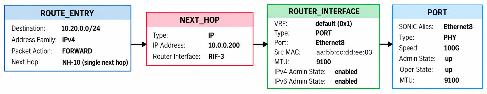
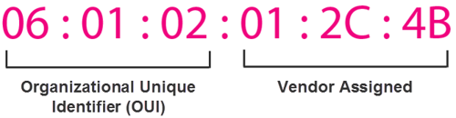

# Ports, Interfaces, and Neighbors

> **Prerequisites**: [Orchagent Deep Dive](12_orchagent.md) — the select loop, `m_orchList` ordering, and `doTask()`. [The SAI Object Model](14_sai_object_model.md) — object IDs, entry keys, and the four operations.

To forward a packet, the ASIC needs a chain of SAI objects — each one references the next:



A **port** is the starting point — it represents a physical (or logical) Ethernet interface on the switch (e.g., `Ethernet8` at 100G). At boot time, ports are Layer 2 (L2) objects: they can bridge traffic but cannot route IP packets.

A **router interface (RIF)** promotes a port to Layer 3 (L3). When an operator assigns an IP address to a port, SONiC creates a RIF on top of it, giving the port an identity in the IP forwarding engine.

A **neighbor entry** records the MAC address of a device one hop away, learned through ARP (IPv4) or NDP (IPv6). When the ASIC routes a packet toward a neighbor, it uses this MAC as the destination in the rewritten L2 header.

A **next hop** is the forwarding target that route entries point to. It combines a neighbor's IP address with the RIF it is reachable through, giving the ASIC everything it needs to forward and rewrite in a single lookup. `NeighOrch` creates a next hop alongside every neighbor entry.

A **route entry** ties it all together: it maps a destination prefix (e.g., `10.20.0.0/24`) to a next-hop object, telling the ASIC "packets matching this prefix should be forwarded through this next hop." When a route has **multiple equal-cost paths**, the route entry points to a next-hop group instead of a single next hop — that is covered in [Load Balancing](21_load_balancing.md).

Each object must exist before the objects above it can be created. This bottom-up dependency is enforced by the [`m_orchList`](12_orchagent.md#the-main-select-loop) ordering — each module runs only after the modules it depends on:

```
SwitchOrch → PortsOrch → IntfsOrch → NeighOrch → NhgOrch → RouteOrch
```

This document covers the three modules and objects in the lower half of the chain: `PortsOrch` (ports), `IntfsOrch` (router interfaces), and `NeighOrch` (neighbors and next hops).


## Ports (PortsOrch)

### Port Objects in SAI

Unlike most SAI objects that orchagent creates on demand, port objects **already exist** when the switch initializes. During `sai_switch_api->create_switch()`, the SAI implementation discovers the ASIC's physical ports and pre-creates a `SAI_OBJECT_TYPE_PORT` for each one. `PortsOrch` retrieves the full list via `SAI_SWITCH_ATTR_PORT_LIST`:

```c
sai_attribute_t attr;
attr.id = SAI_SWITCH_ATTR_PORT_LIST;
attr.value.objlist.count = port_count;
attr.value.objlist.list  = port_oid_array;
sai_switch_api->get_switch_attribute(switch_id, 1, &attr);
```

`PortsOrch` then configures each pre-existing port with the desired attributes:

| SAI Attribute | Purpose | Example |
|---|---|---|
| `SAI_PORT_ATTR_ADMIN_STATE` | Enable or disable the port | `true` |
| `SAI_PORT_ATTR_SPEED` | Link speed in Mbps | `100000` (100G) |
| `SAI_PORT_ATTR_MTU` | Maximum transmission unit | `9100` |
| `SAI_PORT_ATTR_FEC_MODE` | Forward error correction | `RS` |
| `SAI_PORT_ATTR_HW_LANE_LIST` | Physical SerDes lanes | `{0, 1, 2, 3}` |

### Port Initialization Pipeline

Port configuration flows through a multi-stage pipeline before reaching the ASIC:

```
CONFIG_DB                    APPL_DB                      ASIC
PORT|Ethernet8               PORT_TABLE:Ethernet8
  speed: 100000     ──►        speed: 100000      ──►    SAI port configured
  mtu: 9100        portmgrd    mtu: 9100          PortsOrch  (admin_state, speed,
  admin_status: up  portsyncd  admin_status: up              mtu, fec, lanes)
```

Two processes participate in this stage:

- **`portmgrd`** (manager daemon) — subscribes to CONFIG_DB's `PORT` table, applies admin state and MTU to the Linux kernel, and writes processed state to APPL_DB.
- **`portsyncd`** (sync daemon) — reads the `PORT` table from CONFIG_DB and publishes it to APPL_DB's `PORT_TABLE`. It also listens for kernel netlink events to track port state changes.

`PortsOrch` consumes `PORT_TABLE` from APPL_DB and calls `sai_port_api->set_port_attribute()` to configure each port in the ASIC.

### The PortInitDone Signal

Orchagent cannot process routes, interfaces, or neighbors until all ports are ready. The initialization handshake works as follows:

1. `portsyncd` reads every entry from the CONFIG_DB `PORT` table and writes them to APPL_DB.
2. Once all ports have been written, `portsyncd` publishes a **`PortInitDone`** flag to APPL_DB.
3. Orchagent's main thread blocks until it sees `PortInitDone`, then begins processing all other APPL_DB tables.

This guarantees that port OIDs are available before any downstream Orch (IntfsOrch, NeighOrch, etc.) tries to reference them.

### Host Interfaces

For each physical port, `PortsOrch` creates a **host interface** (`SAI_OBJECT_TYPE_HOSTIF`). This SAI object creates a Linux network device (netdev) in the kernel and links it to the corresponding ASIC port:

```c
sai_attribute_t hostif_attrs[3];
hostif_attrs[0].id        = SAI_HOSTIF_ATTR_TYPE;
hostif_attrs[0].value.s32 = SAI_HOSTIF_TYPE_NETDEV;
hostif_attrs[1].id        = SAI_HOSTIF_ATTR_OBJ_ID;
hostif_attrs[1].value.oid = port_oid;             /* link to the SAI port */
hostif_attrs[2].id        = SAI_HOSTIF_ATTR_NAME;
strncpy(hostif_attrs[2].value.chardata, "Ethernet8", SAI_HOSTIF_NAME_SIZE);
sai_hostif_api->create_hostif(&hostif_oid, switch_id, 3, hostif_attrs);
```

After this call, a Linux netdev named `Ethernet8` appears in the kernel. It looks like a normal network interface — it has a MAC address, an MTU, you can assign IP addresses to it, and user-space processes can open sockets on it. But it is **not** a traditional NIC driver interface. It is a virtual netdev created by SAI to bridge between the ASIC and the CPU.

#### What Flows Through a Host Interface

**Data-plane traffic never touches host interfaces.** When the ASIC forwards packets at line rate — millions of packets per second — it does so entirely in hardware. Packets are matched against route entries, rewritten, and sent out egress ports without ever reaching the CPU or the Linux kernel.

Only **control-plane traffic** — packets the ASIC deliberately redirects to the CPU — flows through host interfaces. How the ASIC decides which packets to redirect, and how SONiC rate-limits them to protect the CPU, is covered in the [Punting](18_punting.md) document.

#### What This Means for tcpdump

Because only punted packets reach the kernel, running `tcpdump -i Ethernet8` captures **only control-plane traffic** — ARP, BGP, LLDP, ICMP, and similar. The data-plane packets being forwarded at line rate through the same physical port are invisible to `tcpdump` because they never leave the ASIC.

| Traffic type | Path | Visible to `tcpdump`? |
|---|---|---|
| Data plane (forwarded at line rate) | Ingress port → ASIC → egress port | No |
| Control plane (punted to CPU) | ASIC → host interface → kernel | Yes |
| CPU-originated (e.g., BGP update) | Kernel → host interface → ASIC → wire | Yes |


## Router Interfaces (IntfsOrch)

### The L2-to-L3 Transition

Creating a `SAI_OBJECT_TYPE_ROUTER_INTERFACE` on top of an L2 port promotes it to L3. The RIF connects the port to the IP forwarding engine: it carries a source MAC address that the ASIC writes into every routed packet's L2 header on egress, belongs to a virtual router (VRF), and can have IPv4 and IPv6 routing enabled independently.

### What Triggers RIF Creation

When an operator runs:

```bash
config interface ip add Ethernet8 10.0.0.201/31
```

This writes to CONFIG_DB's `INTERFACE` table. The `intfmgrd` manager daemon picks up the change, assigns the IP address in the Linux kernel, and writes the interface entry to APPL_DB's `INTF_TABLE`. `IntfsOrch` then creates the RIF in the ASIC:

```
CONFIG_DB                         APPL_DB                        ASIC
INTERFACE|Ethernet8|10.0.0.201/31   INTF_TABLE:Ethernet8
                          ──►       → IntfsOrch creates RIF     ──►  SAI_OBJECT_TYPE_ROUTER_INTERFACE
 intfmgrd                                                              type: PORT
                                                                       port_id: <port_oid>
                                                                       vr_id: <default_vr_oid>
```

### RIF Types

`IntfsOrch` creates RIFs using the following SAI types, depending on the underlying interface:

| SAI RIF Type | Underlying Object | When It Is Used |
|---|---|---|
| `PORT` | A physical port OID | IP address assigned to a physical interface (e.g., `Ethernet0`). |
| `PORT` | A LAG OID | IP address assigned to a LAG interface (e.g., `PortChannel1`). SAI uses the same `PORT` type — the `PORT_ID` attribute simply points to the LAG OID instead of a physical port OID. |
| `VLAN` | A VLAN OID | IP address assigned to a VLAN interface (e.g., `Vlan100`). The RIF enables routing between the VLAN and other L3 domains. |
| `SUB_PORT` | A port OID + VLAN tag | A sub-interface (e.g., `Ethernet0.100`). Isolates traffic by VLAN tag on a single physical port. |

> **Loopback interfaces** (e.g., `Loopback0`) are handled differently. `IntfsOrch` does **not** create a SAI RIF for them — it only tracks them in software and adds IP-to-me routes (local routes that direct packets addressed to the switch's own IP to the CPU). The `SAI_ROUTER_INTERFACE_TYPE_LOOPBACK` type exists in SAI but is used only by tunnel modules (`tunneldecaporch`, `srv6orch`, `muxorch`) for overlay interfaces, not for `Loopback0`.

### RIF Attributes

The attributes below are defined in `sairouterinterface.h`. Mandatory attributes must be supplied at creation; conditional attributes are mandatory only when the RIF type requires them; optional attributes have defaults.

**Mandatory (all RIF types)**:

| Attribute | Type | Flags | Purpose |
|---|---|---|---|
| `VIRTUAL_ROUTER_ID` | OID | Create-only | The VRF this RIF belongs to. Every RIF must reference a virtual router. |
| `TYPE` | Enum | Create-only | The RIF type (`PORT`, `VLAN`, `SUB_PORT`, `LOOPBACK`, `BRIDGE`, `QINQ_PORT`). |

**Conditional (mandatory for specific types)**:

| Attribute | Type | Flags | Required When |
|---|---|---|---|
| `PORT_ID` | OID | Create-only | TYPE is `PORT` or `SUB_PORT`. References a port, LAG, or system port OID. |
| `VLAN_ID` | OID | Create-only | TYPE is `VLAN`. References a VLAN OID. |
| `OUTER_VLAN_ID` | uint16 | Create-only | TYPE is `SUB_PORT` or `QINQ_PORT`. The outer VLAN tag. |
| `INNER_VLAN_ID` | uint16 | Create-only | TYPE is `QINQ_PORT`. The inner VLAN tag. |
| `BRIDGE_ID` | OID | Create-only | TYPE is `BRIDGE`. References a 1D bridge OID. |

**Optional (with defaults)**:

| Attribute | Type | Default | Purpose |
|---|---|---|---|
| `SRC_MAC_ADDRESS` | MAC | Inherited from VR | Source MAC written into routed packets leaving this RIF. |
| `MTU` | uint32 | 1514 | Maximum transmission unit for this RIF. |
| `ADMIN_V4_STATE` | bool | true | Enable/disable IPv4 routing on this RIF. |
| `ADMIN_V6_STATE` | bool | true | Enable/disable IPv6 routing on this RIF. |
| `LOOPBACK_PACKET_ACTION` | enum | FORWARD | Action when a packet is routed back out the same RIF it arrived on. |
| `NEIGHBOR_MISS_PACKET_ACTION` | enum | TRAP | Action when no neighbor entry matches (send to CPU by default). |
| `INGRESS_ACL` / `EGRESS_ACL` | OID | null | Bind an ACL table or group to this RIF. |
| `V4_MCAST_ENABLE` / `V6_MCAST_ENABLE` | bool | false | Enable multicast routing on this RIF. |
| `NAT_ZONE_ID` | uint8 | 0 | NAT zone for this RIF. |
| `DISABLE_DECREMENT_TTL` | bool | false | Skip TTL decrement for routed packets. |
| `ADMIN_MPLS_STATE` | bool | false | Enable MPLS on this RIF. |

### SAI Calls

For a port-type RIF, the two mandatory attributes (`VIRTUAL_ROUTER_ID`, `TYPE`) plus the conditional `PORT_ID` and the optional `SRC_MAC_ADDRESS` are the typical set:

```c
sai_attribute_t rif_attrs[4];
rif_attrs[0].id        = SAI_ROUTER_INTERFACE_ATTR_VIRTUAL_ROUTER_ID;
rif_attrs[0].value.oid = default_vr_oid;           /* mandatory: the VRF */
rif_attrs[1].id        = SAI_ROUTER_INTERFACE_ATTR_TYPE;
rif_attrs[1].value.s32 = SAI_ROUTER_INTERFACE_TYPE_PORT;  /* mandatory: RIF type */
rif_attrs[2].id        = SAI_ROUTER_INTERFACE_ATTR_PORT_ID;
rif_attrs[2].value.oid = port_oid;                 /* conditional: required for PORT type */
rif_attrs[3].id        = SAI_ROUTER_INTERFACE_ATTR_SRC_MAC_ADDRESS;
memcpy(rif_attrs[3].value.mac, switch_mac, 6);     /* optional: defaults to VR's MAC */
sai_router_intfc_api->create_router_interface(&rif_oid, switch_id, 4, rif_attrs);
```

The `SRC_MAC_ADDRESS` attribute is important: when the ASIC routes a packet out through this RIF, it rewrites the packet's source MAC to this value (and the destination MAC to the next hop's MAC, learned via ARP/NDP). This is the standard IP routing behavior — each hop rewrites the L2 header while preserving the L3 header.

### Where the Source MAC Comes From

Every Ethernet frame carries a 48-bit (6-byte) source and destination MAC address. To guarantee that every network interface in the world has a globally unique address, the IEEE splits the 48 bits into two halves:

- **First 3 bytes** — the **OUI** (Organizationally Unique Identifier). Any vendor that builds Ethernet devices must register with the IEEE, which assigns them one or more OUIs (e.g., Arista, Mellanox, and Broadcom each have their own).

- **Last 3 bytes** — a device identifier, assigned by the manufacturer to each unit during production, ensuring no two interfaces share the same address.



The manufacturer programs a **base MAC address** and a **MAC range** into the switch's system EEPROM at the factory — before the switch ever runs an operating system. You can inspect both with `show platform syseeprom`:

```
admin@sonic:~$ show platform syseeprom

TLV Name             Code      Len  Value
-------------------  ------  -----  ----------------------
Product Name         0x21        5  DX010
Base MAC Address     0x24        6  0C:48:C6:80:4D:1A
MAC Addresses        0x2A        2  131
Manufacturer         0x2B        9  CELESTICA
...
```

This Celestica DX010 has a base MAC of `0C:48:C6:80:4D:1A` with a range of 131 addresses.

### Factory MAC vs Active MAC

Linux network interfaces can have **two** MAC addresses:

| Field | What it is | Mutable? |
|---|---|---|
| **`permaddr`** (permanent address) | A unique per-port MAC allocated from the EEPROM range at the factory | No — read-only, burned into hardware |
| **`link/ether`** (active address) | The MAC currently in use on the wire | Yes — software can override it |

On some platforms and drivers, `ip -d link show` displays both (e.g., `link/ether ... permaddr ...`). On SONiC, the Ethernet netdevs are **hostif interfaces** created by SAI — not traditional NIC interfaces — so `permaddr` is not always separately exposed. What you can always verify is the active MAC:

```
admin@sonic:~$ ip -d link show Ethernet8

26: Ethernet8: <NO-CARRIER,BROADCAST,MULTICAST,UP> mtu 9100 ...
    link/ether 0c:48:c6:80:4d:1a brd ff:ff:ff:ff:ff:ff ...
```

Every port on the switch uses the same active MAC — the base MAC from the EEPROM:

```
admin@sonic:~$ for port in Ethernet0 Ethernet4 Ethernet8 Ethernet12 Ethernet120 Ethernet124; do
>   echo "$port: $(cat /sys/class/net/$port/address)"
> done

Ethernet0: 0c:48:c6:80:4d:1a
Ethernet4: 0c:48:c6:80:4d:1a
Ethernet8: 0c:48:c6:80:4d:1a
Ethernet12: 0c:48:c6:80:4d:1a
Ethernet120: 0c:48:c6:80:4d:1a
Ethernet124: 0c:48:c6:80:4d:1a
```

All identical — `0c:48:c6:80:4d:1a`. This is the MAC that gets programmed as `SAI_ROUTER_INTERFACE_ATTR_SRC_MAC_ADDRESS` on every RIF. The EEPROM's MAC range provides additional addresses for other uses (management port, CPU port), but SONiC does not allocate unique MACs per front-panel port.

### How SONiC Programs the Source MAC

The base MAC flows from hardware to every RIF through a chain where each level inherits from the one above by default:

```
System EEPROM (factory-programmed)
    │  read at first boot by sonic-cfggen
    ▼
DEVICE_METADATA|localhost.mac           (CONFIG_DB)
    │  read by SwitchOrch at startup
    ▼
SAI_SWITCH_ATTR_SRC_MAC_ADDRESS
    │  inherited by default
    ▼
SAI_VIRTUAL_ROUTER_ATTR_SRC_MAC_ADDRESS
    │  inherited by default
    ▼
SAI_ROUTER_INTERFACE_ATTR_SRC_MAC_ADDRESS
```

You can verify the CONFIG_DB end of this chain:

```
admin@sonic:~$ sonic-cfggen -d -v 'DEVICE_METADATA["localhost"]["mac"]'

0c:48:c6:80:4d:1a
```

This matches the EEPROM — confirming the full path from hardware to software.

Unless explicitly overridden at any level, **every RIF on the switch shares the same source MAC**. This is standard for IP routing: each hop is identified by its IP address, not its MAC, so a single shared MAC is sufficient.

> [`syseepromd`](23_pmon_container.md#syseepromd--system-eeprom-daemon) also reads the EEPROM at boot and publishes the base MAC and other TLV fields (serial number, platform name, vendor) to the `EEPROM_INFO` table in STATE_DB — this path is for monitoring and CLI display (`show platform syseeprom`), not for programming the ASIC. For how `DEVICE_METADATA` is populated during first boot, see [Platform Configuration](24_platform_configuration.md).


## Neighbors and Next Hops (NeighOrch)

### What a Neighbor Is

A **neighbor** is a device directly reachable on a connected link — one IP hop away. The IP-to-MAC binding that the switch needs for L2 header rewriting is called an **adjacency**, discovered at runtime:

- **IPv4** — ARP (Address Resolution Protocol)
- **IPv6** — NDP (Neighbor Discovery Protocol)

### How Neighbors Are Learned

Neighbors reach `NeighOrch` through two paths:

**Dynamic neighbors** (the common case) — The Linux kernel learns a neighbor through ARP or NDP. The `neighsyncd` sync daemon (in the SWSS container) listens for kernel neighbor netlink events and writes each learned neighbor to APPL_DB:

```
Kernel ARP table                     APPL_DB
10.0.0.200 → bb:cc:dd:ee:ff:01        NEIGH_TABLE:Ethernet8:10.0.0.200
  (learned via ARP)      ──►           family: IPv4
                        neighsyncd     neigh: bb:cc:dd:ee:ff:01
```

**Static neighbors** — An operator configures a fixed neighbor entry in CONFIG_DB's `NEIGH` table. The `nbrmgrd` manager daemon processes it and writes it to APPL_DB's `NEIGH_TABLE`, following the same path as dynamic entries from that point on.

### SAI Objects: Neighbor Entry and Next Hop

`NeighOrch` creates **two** SAI objects for each neighbor — this is a critical detail for understanding the forwarding chain:

1. **Neighbor Entry** (`SAI_OBJECT_TYPE_NEIGHBOR_ENTRY`) — Tells the ASIC the MAC address to use when sending packets to this IP on this RIF. This is an entry-key object (not OID-based), keyed by `{switch_id, rif_oid, ip_address}`.

2. **Next Hop** (`SAI_OBJECT_TYPE_NEXT_HOP`) — An OID-based object that represents a forwarding destination. Routes and next-hop group members reference this object. Its key attributes are the neighbor's IP address and the RIF it is reachable through.

Why two objects? Because they serve different purposes in the ASIC:
- The **neighbor entry** populates the ASIC's **adjacency table** — it answers "what MAC do I rewrite the packet with?"
- The **next hop** is a **forwarding target** — it answers "where do I send packets?" and is what route entries and next-hop group members point to.

### SAI Calls

```c
/* 1. Create the neighbor entry — programs the adjacency table */
sai_neighbor_entry_t nbr_entry;
nbr_entry.switch_id        = switch_id;
nbr_entry.rif_id           = rif_oid;               /* the RIF on Ethernet8 */
nbr_entry.ip_address       = sai_ip(10.0.0.200);      /* neighbor IP */

sai_attribute_t nbr_attr;
nbr_attr.id                = SAI_NEIGHBOR_ENTRY_ATTR_DST_MAC_ADDRESS;
memcpy(nbr_attr.value.mac, "bb:cc:dd:ee:ff:01", 6); /* learned via ARP */
sai_neighbor_api->create_neighbor_entry(&nbr_entry, 1, &nbr_attr);

/* 2. Create the next hop — a target that routes can point to */
sai_attribute_t nh_attrs[3];
nh_attrs[0].id        = SAI_NEXT_HOP_ATTR_TYPE;
nh_attrs[0].value.s32 = SAI_NEXT_HOP_TYPE_IP;
nh_attrs[1].id        = SAI_NEXT_HOP_ATTR_IP;
nh_attrs[1].value.ipaddr = sai_ip(10.0.0.200);        /* same neighbor IP */
nh_attrs[2].id        = SAI_NEXT_HOP_ATTR_ROUTER_INTERFACE_ID;
nh_attrs[2].value.oid = rif_oid;                     /* same RIF */
sai_next_hop_api->create_next_hop(&nh_oid, switch_id, 3, nh_attrs);
```

The `nh_oid` returned by the second call is the forwarding target that the rest of the system references. For a single-path route, `RouteOrch` sets `SAI_ROUTE_ENTRY_ATTR_NEXT_HOP_ID` directly to this OID. For multi-path Equal-Cost Multi-Path (ECMP) routes, `RouteOrch` or `NhgOrch` creates a next-hop group member with `SAI_NEXT_HOP_GROUP_MEMBER_ATTR_NEXT_HOP_ID` pointing to this OID — the member is the join object that attaches the next hop to the group (see the [next-hop group diagram](21_load_balancing.md)).


## Putting It All Together

To see how the entire chain is built, consider a concrete scenario: an operator configures `Ethernet8` with IP `10.0.0.201/31`, the switch learns neighbor `10.0.0.200` via ARP, and BGP advertises a route to `10.20.0.0/24` via `10.0.0.200`.

**Step 1 — Port** (boot time, `PortsOrch`):

The ASIC's physical port for `Ethernet8` is configured with speed, MTU, and admin state. A host interface is created so the CPU can send and receive control traffic on this port. At this point, the port is L2 only.

**Step 2 — Router Interface** (IP assignment, `IntfsOrch`):

The operator runs `config interface ip add Ethernet8 10.0.0.201/31`. This triggers `intfmgrd` → APPL_DB → `IntfsOrch`, which creates a `SAI_OBJECT_TYPE_ROUTER_INTERFACE` of type `PORT` on the port's OID. The port is now L3 — the ASIC will route IP packets through it.

**Step 3 — Neighbor + Next Hop** (ARP resolution, `NeighOrch`):

The kernel sends an ARP request for `10.0.0.200` and receives a reply with MAC `bb:cc:dd:ee:ff:01`. `neighsyncd` writes this to APPL_DB. `NeighOrch` creates a `SAI_OBJECT_TYPE_NEIGHBOR_ENTRY` (for MAC rewriting) and a `SAI_OBJECT_TYPE_NEXT_HOP` (as a forwarding target).

**Step 4 — Route** (BGP update, `RouteOrch`):

FRR receives a BGP update for `10.20.0.0/24` via `10.0.0.200`. `fpmsyncd` writes it to APPL_DB. `RouteOrch` looks up the next-hop OID for `10.0.0.200` (created in step 3) and creates a `SAI_OBJECT_TYPE_ROUTE_ENTRY` pointing to it.

The resulting SAI object chain in the ASIC:

```
SAI_ROUTE_ENTRY { dest: 10.20.0.0/24 }
    NEXT_HOP_ID ──► SAI_NEXT_HOP { ip: 10.0.0.200, rif: rif_oid }
                                          │
                         ┌────────────────┘
                         ▼
               SAI_ROUTER_INTERFACE { type: PORT, port: port_oid }
                         │
                         ▼
               SAI_PORT { speed: 100G, admin: up }

SAI_NEIGHBOR_ENTRY { rif: rif_oid, ip: 10.0.0.200 }
    DST_MAC ──► bb:cc:dd:ee:ff:01   (used to rewrite L2 header on egress)
```

When a packet destined for `10.20.0.0/24` arrives at the switch, the ASIC:
1. Matches the destination IP against the route entry → finds the next-hop OID.
2. Follows the next hop to the RIF → determines the egress port.
3. Looks up the neighbor entry for `10.0.0.200` on that RIF → gets the destination MAC.
4. Rewrites the L2 header (source MAC from the RIF, destination MAC from the neighbor), decrements the TTL, and sends the packet out `Ethernet8`.


## Summary

| SAI Object | Created By | Triggered When | Key Attributes |
|---|---|---|---|
| Port | ASIC init + `PortsOrch` configures | Switch boot | Speed, MTU, admin state, lanes |
| Host Interface | `PortsOrch` | Switch boot | Type (netdev), port OID, name |
| Router Interface | `IntfsOrch` | IP address assigned to interface | Type, port/VLAN OID, virtual router, source MAC |
| Neighbor Entry | `NeighOrch` | ARP/NDP learned or static config | RIF, IP address, destination MAC |
| Next Hop | `NeighOrch` | Same as neighbor | Type (IP), IP address, RIF |

The dependency chain flows strictly downward: removing a port requires first removing its RIF, which requires first removing all neighbors on it, which requires first removing all next hops (and by extension, all next-hop group members and routes that reference them). This bottom-up creation and top-down teardown order is fundamental to SAI programming.

---

**Previous**: [← Flex Counter Groups Reference](16_flex_counter_groups_reference.md) · **Next**: [Punting →](18_punting.md)
