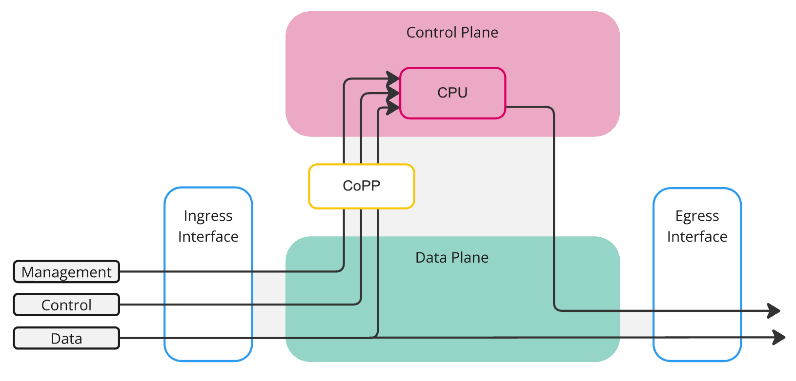

# Punting — Sending Packets from the ASIC to the CPU

> **Prerequisites**: [Ports and Host Interfaces](17_ports_and_host_interfaces.md) — host interfaces and why data-plane traffic never reaches the CPU. [The Forwarding Chain](18_forwarding_chain.md) — the SAI forwarding object chain.

[Ports and Host Interfaces](17_ports_and_host_interfaces.md#what-flows-through-a-host-interface) introduced host interfaces and the key distinction: data-plane traffic is forwarded entirely in the ASIC at line rate, while control-plane traffic is **punted** — redirected from the ASIC to the CPU through host interfaces. This document covers the punt mechanism in detail: how the ASIC decides which packets to send to the CPU, how those decisions are programmed through SAI, and how CoPP (Control Plane Policing) rate-limits punted traffic to protect the CPU.


## Fast Path vs Slow Path

Every packet arriving at a switch port takes one of two paths:

- **Fast path** (data plane) — The ASIC matches the packet against its forwarding tables (routes, ACLs, MAC table) and forwards it out an egress port — entirely in hardware, at line rate, with no CPU involvement. This is the path that millions of packets per second take.

- **Slow path** (control plane) — The ASIC determines that the packet requires software processing and sends it to the CPU through a host interface. The Linux kernel receives the packet, and a user-space daemon handles it. This path is orders of magnitude slower than the fast path — a CPU can process thousands to tens of thousands of packets per second, compared to the ASIC's millions.

The slow path exists because certain packets **cannot** be handled in hardware. The ASIC has no BGP implementation, no ARP state machine, no LLDP agent. These protocols run as software daemons on the CPU, and the only way they can receive packets is if the ASIC forwards those packets to the CPU.



The diagram above shows the three traffic types flowing through a switch. **Data** traffic passes straight through the data plane (teal) from ingress to egress — the CPU never sees it. **Control** and **Management** traffic are redirected upward to the CPU (pink), passing through the **CoPP** policer (yellow) that rate-limits what reaches the control plane. This is the architectural boundary that the rest of this document explores in detail.


## What Gets Punted

The ASIC does not punt packets arbitrarily. Every punt decision is driven by a **trap rule** that SONiC explicitly programs into the ASIC. Without a matching trap rule, the ASIC either forwards the packet in the fast path or drops it — the CPU never sees it.

Common categories of punted traffic:

| Category | Examples | Why the CPU needs it |
|---|---|---|
| **Routing protocols** | BGP (TCP/179), OSPF, PIM, BFD | Protocol daemons in FRR must process updates |
| **Address resolution** | ARP requests/replies, IPv6 NDP | The kernel must learn or respond to neighbors |
| **Link-layer discovery** | LLDP, LACP, STP BPDUs | Protocol daemons must manage link state |
| **ICMP** | Ping (echo request), traceroute (TTL expired) | The kernel must generate replies or error messages |
| **Packets addressed to the switch** | IP packets with destination = switch's own IP | The kernel must deliver them to the local socket |
| **Exception packets** | TTL = 1, IP options, MTU exceeded | The kernel must generate ICMP error responses |
| **No forwarding match** | Packets with no route, or a route pointing to CPU | The ASIC has no hardware entry, so it falls back to the CPU |

> Not all categories are punted the same way. Some packets are **trapped** (removed from the fast path and sent only to the CPU), while others are **copied** (forwarded normally in hardware AND a copy is sent to the CPU). The packet action determines which behavior applies — see [Packet Actions](#packet-actions) below.


## SAI Trap Objects

SONiC programs punt behavior through three SAI object types that work together:

### Trap (`SAI_OBJECT_TYPE_HOSTIF_TRAP`)

A trap object tells the ASIC: "when you see a packet matching this type, perform this action." Each trap is identified by a **trap type** — a predefined enum in SAI that covers every protocol and exception the ASIC can recognize:

```c
sai_attribute_t trap_attrs[3];
trap_attrs[0].id        = SAI_HOSTIF_TRAP_ATTR_TRAP_TYPE;
trap_attrs[0].value.s32 = SAI_HOSTIF_TRAP_TYPE_BGP;       /* match BGP packets */
trap_attrs[1].id        = SAI_HOSTIF_TRAP_ATTR_PACKET_ACTION;
trap_attrs[1].value.s32 = SAI_PACKET_ACTION_TRAP;          /* punt to CPU */
trap_attrs[2].id        = SAI_HOSTIF_TRAP_ATTR_TRAP_GROUP;
trap_attrs[2].value.oid = trap_group_oid;                   /* rate-limit group */
sai_hostif_api->create_hostif_trap(&trap_oid, switch_id, 3, trap_attrs);
```

### Packet Actions

The `PACKET_ACTION` attribute on a trap determines what the ASIC does with the matched packet:

| Action | Data-plane behavior | CPU behavior |
|---|---|---|
| `TRAP` | Packet is **removed** from the forwarding pipeline | Sent to CPU |
| `COPY` | Packet is forwarded **normally** in hardware | A copy is also sent to CPU |
| `LOG` | Packet is forwarded normally | A copy is sent to CPU (similar to COPY, used with logging) |
| `DROP` | Packet is **dropped** | CPU never sees it |
| `FORWARD` | Packet is forwarded normally | CPU never sees it (effectively disables the trap) |

For example, ARP requests are typically **trapped** — they must reach the kernel and should not be forwarded. BGP packets destined to the switch are also **trapped**. ICMP echo requests might be **copied** — the ASIC can forward them while the CPU also prepares a reply.

### Trap Group (`SAI_OBJECT_TYPE_HOSTIF_TRAP_GROUP`)

A trap group bundles multiple traps together and assigns shared properties — most importantly, a **policer** (rate limiter) and a **CPU queue**. This is the mechanism that prevents punted traffic from overwhelming the CPU:

```c
sai_attribute_t group_attrs[2];
group_attrs[0].id        = SAI_HOSTIF_TRAP_GROUP_ATTR_QUEUE;
group_attrs[0].value.u32 = 4;                               /* CPU queue index */
group_attrs[1].id        = SAI_HOSTIF_TRAP_GROUP_ATTR_POLICER;
group_attrs[1].value.oid = policer_oid;                      /* rate limiter */
sai_hostif_api->create_hostif_trap_group(&group_oid, switch_id, 2, group_attrs);
```

The **CPU queue** determines the priority of punted packets. Higher-priority protocols (BGP, BFD) are assigned to higher queues so they are served before lower-priority traffic (LLDP, ICMP) when the CPU is busy.

The **policer** enforces a maximum rate (packets per second or bytes per second) for all traps in the group. Packets that exceed the rate are dropped by the ASIC before they ever reach the CPU.


## CoPP — Control Plane Policing

CoPP (Control Plane Policing) is the framework that configures trap groups and their rate limits. Without CoPP, a flood of ARP requests or ICMP packets could saturate the CPU and prevent critical protocols like BGP from receiving their packets — potentially causing route withdrawals and network outages.

### The CoPP Configuration File

CoPP policy is defined in `/etc/sonic/copp_cfg.json`. Each entry maps a trap group to its CPU queue, rate limit, and the set of trap types it contains:

```json
{
    "COPP_GROUP|queue4_group2": {
        "trap_action": "trap",
        "trap_priority": "4",
        "queue": "4",
        "meter_type": "packets",
        "mode": "sr_tcm",
        "cir": "600",
        "cbs": "600",
        "red_action": "drop"
    },
    "COPP_TRAP|bgp": {
        "trap_ids": "bgp,bgpv6",
        "trap_group": "queue4_group2"
    }
}
```

In this example, BGP packets (IPv4 and IPv6) are trapped at a rate of 600 packets per second. Packets exceeding that rate are dropped by the ASIC.

### The Programming Pipeline

CoPP configuration follows the standard SONiC pipeline:

```
/etc/sonic/copp_cfg.json
    │  loaded into CONFIG_DB at boot
    ▼
CONFIG_DB: COPP_TRAP, COPP_GROUP
    │  coppmgrd reads and writes to APPL_DB
    ▼
APPL_DB: COPP_TABLE
    │  CoppOrch consumes
    ▼
SAI: trap groups, traps, policers
```

- **`coppmgrd`** (manager daemon in SWSS) — reads CoPP configuration from CONFIG_DB and writes it to APPL_DB's `COPP_TABLE`.
- **`CoppOrch`** (orchagent module) — consumes `COPP_TABLE`, creates the SAI trap groups, policers, and trap objects, and binds them together.

### Default CoPP Policy

SONiC ships with a default CoPP policy that covers all standard protocols. The defaults are designed to protect the CPU under normal and adversarial conditions while ensuring critical protocols (BGP, LACP) always have enough bandwidth. Operators can customize rates by modifying `copp_cfg.json` and running `config reload` or applying a ConfigDB patch.


## The Complete Punt Path

Putting it all together, here is the full path a punted packet takes from the wire to a user-space daemon:

```
Physical port (wire)
    │
    ▼
ASIC ingress pipeline
    │  packet matches a trap rule (e.g., BGP on TCP/179)
    │  policer checks rate limit → pass or drop
    ▼
ASIC sends packet to CPU via DMA
    │
    ▼
Host interface (Linux netdev, e.g., Ethernet8)
    │
    ▼
Linux kernel network stack
    │  IP routing, socket lookup
    ▼
User-space daemon (e.g., bgpd listening on TCP/179)
```

The reverse direction — CPU to wire — is simpler. When a daemon sends a packet (for example, a BGP UPDATE), it writes to a socket. The kernel routes the packet to the appropriate host interface, and SAI transmits it on the physical port. No trap rules are involved in the egress direction.


## Summary

| Concept | What it does |
|---|---|
| **Fast path** | ASIC forwards packets in hardware at line rate — CPU never sees them |
| **Slow path** | ASIC punts packets to the CPU through host interfaces for software processing |
| **Trap** | SAI object that matches a packet type and assigns a punt action |
| **Trap group** | Bundles traps with a shared CPU queue and rate-limiting policer |
| **CoPP** | The policy framework that configures trap groups, rates, and priorities |
| **Policer** | Enforces a maximum punt rate — excess packets are dropped before reaching the CPU |
| **`coppmgrd`** | Manager daemon that reads CoPP config from CONFIG_DB |
| **`CoppOrch`** | Orchagent module that programs trap groups and traps into SAI |

---

**Previous**: [← The Forwarding Chain](18_forwarding_chain.md) · **Next**: [The BGP Container and FRR →](20_bgp_container.md)
