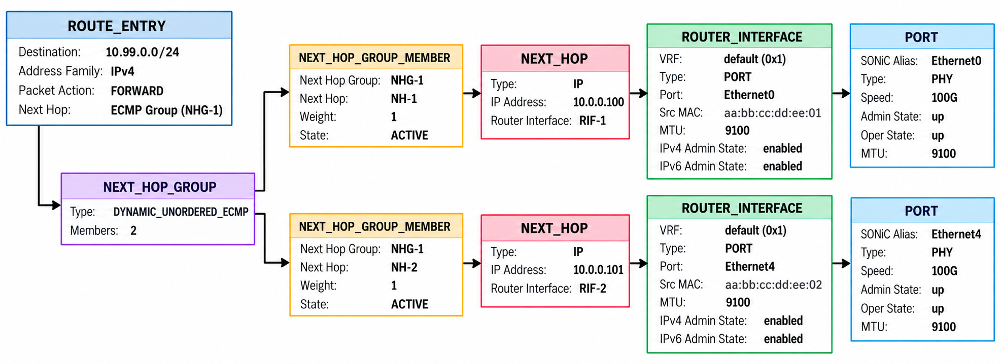

# Load Balancing in SONiC

> **Prerequisites**: [SAI Object Model](14_sai_object_model.md) — understand SAI object types, attribute semantics, and the group+member pattern. [BGP Container](19_bgp_container.md) — understand the FRR integration and `bgpcfgd`.

For a comprehensive treatment of data center fabric load balancing — Equal-Cost Multi-Path (ECMP) fundamentals, hash polarization, adaptive routing, and RDMA-specific constraints — see [DC-Load-Balancing](https://github.com/ManiAm/DC-Load-Balancing). This document focuses on how SONiC implements ECMP-based load balancing end-to-end: which Switch Abstraction Interface (SAI) object types the ASIC exposes, which orchagent modules consume them, and how the control-plane pipeline (FRR (Free Range Routing) → fpmsyncd → APPL_DB → orchagent → SAI) carries routes and weights into hardware.


## Key SAI Objects for Multi-Path Forwarding

Three SAI objects form the foundation of multi-path forwarding in SONiC:

- **Next hop** — represents a single forwarding destination: an IP address reachable through a specific router interface. When a route has only one path, the route entry points directly at a next-hop object.

- **Next-hop group** — represents a set of paths that the ASIC can choose among. A route entry points at a next-hop group instead of a single next hop. The group carries a *type* attribute (e.g., standard ECMP, fine-grain ECMP, class-based) that tells the ASIC how to select a member for each packet.

- **Next-hop group member** — a join object that attaches one next hop to a group. It stores two references: the group's OID (Object Identifier) and the next hop's OID. Adding or removing a member is how SONiC tells the ASIC to add or remove a path from the group.



The creation order matters: next hops must exist before members can reference them, and the group must exist before members can be added to it. For the full SAI object lifecycle see [Parent and Member](14_sai_object_model.md#parent-and-member).


## Hash Configuration

Before any ECMP group type can distribute traffic, the ASIC must hash each packet's header fields to select a group member. For a full treatment of the hash pipeline — how hash fields, seed, offset, and algorithm work together to prevent polarization — see [The ECMP Hash Pipeline](https://github.com/ManiAm/DC-Load-Balancing/blob/master/docs/01_README_LB.md#the-ecmp-hash-pipeline). This section focuses on how SONiC exposes and programs these parameters.

Seed and offset are populated at boot time into `SWITCH_TABLE:switch` in **APPL_DB**, while the hash fields and algorithm are configured through `SWITCH_HASH|GLOBAL` in **CONFIG_DB**. `switchorch` subscribes to both tables and programs the corresponding SAI switch attributes.

| DB | Table | Field | SAI Attribute | Type | Default |
|---|---|---|---|---|---|
| APPL_DB | `SWITCH_TABLE:switch` | `ecmp_hash_seed` | `SAI_SWITCH_ATTR_ECMP_DEFAULT_HASH_SEED` | uint32 | 0 |
| APPL_DB | `SWITCH_TABLE:switch` | `ecmp_hash_offset` | `SAI_SWITCH_ATTR_ECMP_DEFAULT_HASH_OFFSET` | uint8 | 0 |
| CONFIG_DB | `SWITCH_HASH\|GLOBAL` | `ecmp_hash` | `SAI_HASH_ATTR_NATIVE_HASH_FIELD_LIST` | list | ASIC default |
| CONFIG_DB | `SWITCH_HASH\|GLOBAL` | `ecmp_hash_algorithm` | `SAI_SWITCH_ATTR_ECMP_DEFAULT_HASH_ALGORITHM` | enum | CRC |

The `ecmp_hash` field is a comma-separated list of packet header fields the ASIC includes in the hash calculation. Supported values: `SRC_IP`, `DST_IP`, `IP_PROTOCOL`, `L4_SRC_PORT`, `L4_DST_PORT`, `SRC_MAC`, `DST_MAC`, `ETHERTYPE`, `VLAN_ID`, `IN_PORT`, `IPV6_FLOW_LABEL`, and their `INNER_*` variants for tunneled traffic. For guidance on when to customize these fields, see [Advanced Configuration: Customizing the Hash](https://github.com/ManiAm/DC-Load-Balancing/blob/master/docs/01_README_LB.md#advanced-configuration-customizing-the-hash).

Equivalent `lag_hash_seed`, `lag_hash_offset`, `lag_hash`, and `lag_hash_algorithm` fields exist for Link Aggregation Group (LAG) hashing and follow the same pattern.

### Seed and Offset Assignment

Neither value is chosen randomly — both are **deterministic values derived from the switch's role in the fabric**. At image build time, the Jinja2 template `switch.json.j2` (in `dockers/docker-orchagent/`) maps `DEVICE_METADATA.localhost.type` to fixed seed and offset values:

| Device Role | Hash Seed | ECMP Offset | LAG Offset |
|---|---|---|---|
| ToRRouter | 0 | 0 | 0 |
| LeafRouter | 10 | 10 | 10 |
| SpineRouter | 25 | 0 | 0 |
| FabricSpineRouter | 40 | 0 | 0 |
| UpperSpineRouter | 50 | 0 | 0 |
| LowerRegionalHub | 60 | 0 | 0 |
| FabricRegionalHub | 70 | 0 | 0 |
| UpperRegionalHub | 80 | 0 | 0 |

On multi-ASIC platforms, the `namespace_id` is added to the base seed so that each ASIC within the same chassis receives a unique value (`hash_seed_value = hash_seed + namespace_id`).

This role-based scheme guarantees that every tier in the fabric uses a different seed — a ToR, its leaf, and its spine will never produce the same hash for the same packet — without requiring the operator to configure anything manually.

### How switchorch Programs These Values

**Seed and offset** — `switchorch` maintains a static map from `SWITCH_TABLE` field names to SAI attributes. When it receives an APPL_DB update (via `doAppSwitchTableTask`), it looks up the field name, parses the value, and calls `sai_switch_api->set_switch_attribute()`:

```cpp
// switchorch.cpp — attribute map (abridged)
const map<string, sai_switch_attr_t> switch_attribute_map = {
    {"ecmp_hash_seed",   SAI_SWITCH_ATTR_ECMP_DEFAULT_HASH_SEED},
    {"lag_hash_seed",    SAI_SWITCH_ATTR_LAG_DEFAULT_HASH_SEED},
    {"ecmp_hash_offset", SAI_SWITCH_ATTR_ECMP_DEFAULT_HASH_OFFSET},
    {"lag_hash_offset",  SAI_SWITCH_ATTR_LAG_DEFAULT_HASH_OFFSET},
};
```

**Hash fields** — `switchorch` subscribes to `SWITCH_HASH` in CONFIG_DB via `doCfgSwitchHashTableTask`. The comma-separated field names in the `ecmp_hash` value are mapped to `sai_native_hash_field_t` enum values by `SwitchHelper::parseSwHash()` and programmed onto the SAI hash object via `setSwitchHashFieldListSai()`:

```cpp
// switchorch.cpp — programming hash fields into SAI
attr.id = SAI_HASH_ATTR_NATIVE_HASH_FIELD_LIST;
attr.value.s32list.list = hfList.data();
attr.value.s32list.count = static_cast<sai_uint32_t>(hfList.size());
sai_hash_api->set_hash_attribute(oid, &attr);
```

**Algorithm** — read from the same `SWITCH_HASH` table in CONFIG_DB. `SwitchHelper::parseSwHash()` maps the string value (e.g., `"CRC"`, `"XOR"`) to a `sai_hash_algorithm_t` enum and `setSwitchHashAlgorithmSai()` programs it into the ASIC:

```cpp
// switchorch.cpp — programming algorithm into SAI
attr.id = SAI_SWITCH_ATTR_ECMP_DEFAULT_HASH_ALGORITHM;
attr.value.s32 = static_cast<sai_int32_t>(hash.ecmp_hash_algorithm.value);
sai_switch_api->set_switch_attribute(gSwitchId, &attr);
```


## SAI Next-Hop Group Types

The **group type** attribute determines *how the ASIC selects among the members* — whether it hashes the packet and picks a member deterministically (standard ECMP), evaluates members in priority order (ordered ECMP), maps them to fixed bucket positions (fine-grain ECMP), or steers by forwarding class (class-based).

SAI defines the following group types in `sainexthopgroup.h`:

| SAI Group Type | Purpose |
|---|---|
| **Dynamic Unordered ECMP** | Standard ECMP. Members are unordered; the ASIC hashes and selects among them. This is the default type. |
| **Dynamic Ordered ECMP** | Like standard ECMP, but members are **sorted by priority** (via `SAI_NEXT_HOP_GROUP_MEMBER_ATTR_SEQUENCE_ID`). Used when `ordered_ecmp` is enabled and the ASIC advertises support at init time. |
| **Fine-Grain ECMP** | Software-managed, fixed-size bucket array. Supports bank-scoped failover. |
| **Class-Based** | Members are selected by **forwarding class** rather than (or in combination with) hash. Uses a `NEXT_HOP_GROUP_MAP` to map forwarding-class values to member indices. |
| **ECMP With Members** | Group-level member list and weight list in a single bulk SAI call. Used by the P4Runtime path for weighted ECMP (WCMP). |
| **Protection** | Primary/standby failover group with **software-controlled** switchover. |
| **HW Protection** | Primary/standby failover group with **hardware-controlled** switchover. |
| **Bridge Port** | L2 next-hop group for bridge-port forwarding. |

The SAI enum values for each group type are defined in `sainexthopgroup.h`:

```c
typedef enum _sai_next_hop_group_type_t
{
    SAI_NEXT_HOP_GROUP_TYPE_DYNAMIC_UNORDERED_ECMP,
    SAI_NEXT_HOP_GROUP_TYPE_DYNAMIC_ORDERED_ECMP,
    SAI_NEXT_HOP_GROUP_TYPE_FINE_GRAIN_ECMP,
    SAI_NEXT_HOP_GROUP_TYPE_CLASS_BASED,
    SAI_NEXT_HOP_GROUP_TYPE_ECMP_WITH_MEMBERS,
    SAI_NEXT_HOP_GROUP_TYPE_PROTECTION,
    SAI_NEXT_HOP_GROUP_TYPE_HW_PROTECTION,
    SAI_NEXT_HOP_GROUP_TYPE_BRIDGE_PORT,

    SAI_NEXT_HOP_GROUP_TYPE_ECMP = SAI_NEXT_HOP_GROUP_TYPE_DYNAMIC_UNORDERED_ECMP,
} sai_next_hop_group_type_t;
```

The next hops themselves are independent of the group type — the same next-hop object can be referenced by groups of different types. However, some group types require additional attributes on their members. For example, ordered ECMP members carry a `SEQUENCE_ID` for priority, fine-grain ECMP members carry an `INDEX` for bucket position, and protection group members carry a `CONFIGURED_ROLE` (primary or standby). These per-member attributes are covered in each type's [dedicated section](22_nhg_types.md).


### How SONiC Selects the Group Type

SONiC does not have a single "type selector". Instead, each group type is owned by a **dedicated orchestrator module**, and the module is determined by which DB table the configuration or route originates from. The type is hard-coded within each module — there is no runtime negotiation between them.

| Input Table                                  | Orch Module   | Hard-coded SAI Group Type |
|----------------------------------------------|---------------|---------------------------|
| `ROUTE_TABLE` (default path)                 | `routeorch`   | `DYNAMIC_UNORDERED_ECMP` or `DYNAMIC_ORDERED_ECMP` |
| `NEXTHOP_GROUP_TABLE`                        | `nhgorch`     | `DYNAMIC_UNORDERED_ECMP` (always) |
| `FG_NHG` / `FG_NHG_PREFIX` / `FG_NHG_MEMBER` | `fgnhgorch`   | `FINE_GRAIN_ECMP` (always) |
| `CLASS_BASED_NEXT_HOP_GROUP_TABLE`           | `cbfnhgorch`  | `CLASS_BASED` (always) |
| `P4RT_TABLE`                                 | `WcmpManager` | `ECMP_WITH_MEMBERS` (always) |
| `L2_NEXTHOP_GROUP_TABLE`                     | `l2nhgorch`   | `BRIDGE_PORT` (always) |


## Route Programming (routeorch)

This section covers routes that arrive through `ROUTE_TABLE` in APPL_DB. For most multi-path routes, `routeorch` creates **Dynamic Unordered ECMP** or **Dynamic Ordered ECMP** groups directly. If a route's prefix matches a Fine-Grain ECMP configuration, `routeorch` delegates it to `fgnhgorch` instead (see step 3 below). All three types share the same route-ingestion pipeline.

### Route Ingestion (fpmsyncd)

FRR computes multi-path routes and sends them to `fpmsyncd` over a direct TCP connection (zebra's FPM socket). `fpmsyncd` parses these route updates and writes them into APPL_DB (for details on this pipeline, see [fpmsyncd — The Bridge to SONiC](19_bgp_container.md#fpmsyncd--the-bridge-to-sonic)):

```text
ROUTE_TABLE:10.0.0.0/24
    nexthop:  10.1.1.1,10.1.2.1,10.1.3.1
    ifname:   Ethernet0,Ethernet4,Ethernet8
```

This entry tells SONiC: "to reach the `10.0.0.0/24` subnet, there are three equal-cost paths — via next hop `10.1.1.1` on `Ethernet0`, via `10.1.2.1` on `Ethernet4`, and via `10.1.3.1` on `Ethernet8`." The comma-separated lists are positionally paired: the first next hop goes with the first interface, and so on.

At this point the route exists only in Redis — the ASIC does not yet know about it. `routeorch` picks it up and programs the necessary SAI objects into the ASIC so the hardware can forward matching packets at line rate.

### ASIC Programming (routeorch)

`routeorch` subscribes to `ROUTE_TABLE` in APPL_DB. When a multi-path route arrives, it builds the forwarding path bottom-up — the next hops and group must exist in the ASIC before the route entry can reference them:

1. **Parse** — builds a `NextHopGroupKey`, a canonical string that uniquely identifies the set of next hops (e.g., `10.1.1.1@Ethernet0,10.1.2.1@Ethernet4,10.1.3.1@Ethernet8`). If a group with this key already exists, `routeorch` reuses it (see [NHG Reuse](#nhg-reuse)).

2. **Resolve next hops** — resolves each next hop to a SAI next-hop OID (Object Identifier) via `neighOrch`. These next-hop objects must already exist (created when the neighbor was learned).

3. **Select group type** — evaluates a priority chain to determine which module owns the group and what SAI type to use:

```text
Route arrives with multiple next hops
    │
    ├─ Prefix matches an FG_NHG_PREFIX entry?
    │      YES → delegates to fgnhgorch → FINE_GRAIN_ECMP
    │
    ├─ Route carries a nexthop_group field?
    │      YES → delegates to the referenced orch (nhgorch or cbfnhgorch)
    │
    └─ Default → routeorch creates its own NHG
           → DYNAMIC_ORDERED_ECMP if ordered_ecmp == true AND ASIC supports it
           → DYNAMIC_UNORDERED_ECMP otherwise
```

4. **Create NHG** — creates a SAI next-hop group of the selected type.

5. **Add members** — creates a SAI next-hop group member for each path, linking the next-hop OID to the group.

6. **Program route** — creates the route entry in the ASIC's forwarding table (FIB), pointing it at the group OID. From this moment, the ASIC forwards packets matching this prefix through the group.

### NHG Reuse

NHG table entries are a finite ASIC resource. To avoid exhausting them, `routeorch` **reuses** an existing group whenever multiple routes share the same set of next hops.

The `NextHopGroupKey` from step 1 is the lookup key. When a new route arrives, `routeorch` checks its internal map: if a group with that key already exists, it skips steps 3–5 entirely and points the new route entry at the existing group OID. For example:

```text
ROUTE_TABLE:10.0.0.0/24     nexthop: 10.1.1.1,10.1.2.1    ifname: Ethernet0,Ethernet4
ROUTE_TABLE:10.0.1.0/24     nexthop: 10.1.1.1,10.1.2.1    ifname: Ethernet0,Ethernet4
```

Both routes produce the same key (`10.1.1.1@Ethernet0,10.1.2.1@Ethernet4`). The first route creates the group in the ASIC; the second route reuses it:

```text
NHG (group_oid: 0x5000001)
  ├─ member → 10.1.1.1 via Ethernet0
  └─ member → 10.1.2.1 via Ethernet4

Route 10.0.0.0/24 → group_oid 0x5000001
Route 10.0.1.0/24 → group_oid 0x5000001   ← reuses the same group
```

`routeorch` maintains a reference count on each group. The group is only deleted from the ASIC when the last route referencing it is removed.

### Member Lifecycle

The section above describes how groups are **created**. This section covers what happens when paths **change** after initial programming — how members are added, removed, or updated at runtime.

#### What Triggers a Change

A membership change starts in the control plane and propagates through the same pipeline used for initial route programming:

1. **Path goes down** — a BGP neighbor fails or a link drops. FRR withdraws the affected next hop and sends an updated route to `fpmsyncd` with fewer next hops.
2. **Path comes up** — a new BGP neighbor is established or a link recovers. FRR adds the next hop and sends an updated route with more next hops.
3. **Weight changes** — FRR recalculates link-bandwidth values and sends an updated route with new weights.

In all cases, `fpmsyncd` writes the updated `ROUTE_TABLE` entry to APPL_DB. `routeorch` detects the change and must reconcile the ASIC state.

#### routeorch — Group Recreation

`routeorch` does **not** incrementally add or remove individual members. Instead, when a route's next-hop set changes, it uses a **make-before-break** strategy — creating the new group first, swinging the route to it, and only then deleting the old group. This ensures the route always points to a valid forwarding group; there is no window where packets would be dropped due to a missing group.

1. Build a new `NextHopGroupKey` from the updated next-hop list.
2. Check if a group with the new key already exists ([NHG Reuse](#nhg-reuse)) — if so, skip to step 4.
3. **Make** — call `addNextHopGroup()` to create a new NHG and all its members via the SAI bulk API.
4. **Swing** — update the route entry (`sai_route_api->set_route_entry_attribute()`) to point at the new group OID.
5. **Break** — call `decreaseNextHopRefCount()` on the old group. If the reference count reaches zero (no other routes reference it), `removeNextHopGroup()` removes all members (bulk) and deletes the group.

The SAI calls for removing a member and a group:

```c
/* Remove a member from the group */
sai_next_hop_group_api->remove_next_hop_group_member(member_oid);

/* Remove the group itself (only after all members are removed) */
sai_next_hop_group_api->remove_next_hop_group(group_oid);
```

Example — a three-path route loses one path (`10.1.3.1` goes down):

```text
BEFORE (3 paths):

NHG (group_oid_A)
  ├─ member → 10.1.1.1 via Ethernet0
  ├─ member → 10.1.2.1 via Ethernet4
  └─ member → 10.1.3.1 via Ethernet8

Route 10.0.0.0/24 → group_oid_A

FRR withdraws 10.1.3.1 → fpmsyncd updates ROUTE_TABLE with 2 next hops

AFTER (2 paths):

NHG (group_oid_B)
  ├─ member → 10.1.1.1 via Ethernet0
  └─ member → 10.1.2.1 via Ethernet4

Route 10.0.0.0/24 → group_oid_B          group_oid_A (deleted)
```

`routeorch` steps:
1. New key: `10.1.1.1@Ethernet0,10.1.2.1@Ethernet4`
2. No existing group with this key → `addNextHopGroup()` creates group (`group_oid_B`) + 2 members
3. Route entry updated: `10.0.0.0/24 → group_oid_B`
4. `decreaseNextHopRefCount()` on old group (`group_oid_A`) → ref count reaches 0
5. `removeNextHopGroup()` removes 3 members (bulk), then deletes the group

This make-before-break approach guarantees hitless transitions but means every membership change involves creating a new group in the ASIC, even if only one member was added or removed.


## NHG Orch (Explicit Groups)

The sections above describe groups created implicitly by `routeorch` as a side effect of route programming. `nhgorch` takes a fundamentally different approach: it manages groups that are **explicitly defined** through `NEXTHOP_GROUP_TABLE` in APPL_DB, allowing external applications or controllers to create and manage next-hop groups independently of the routing stack.

`nhgorch` always creates `DYNAMIC_UNORDERED_ECMP` groups (it does not use the ordered ECMP path).

### Incremental Member Updates

Unlike `routeorch`, which recreates a group when its membership changes, `nhgorch` **diffs** the old and new member sets and applies only the differences — adding new members, removing missing ones, and updating weights on existing ones — without tearing down the group. This is possible because `nhgorch` manages groups explicitly — the group's identity is defined by its name in `NEXTHOP_GROUP_TABLE`, not derived from the member set.

```c
/* Add a new member to an existing group */
sai_next_hop_group_api->create_next_hop_group_member(&new_member_oid, switch_id, 3, mbr_attrs);

/* Remove a member that is no longer needed */
sai_next_hop_group_api->remove_next_hop_group_member(old_member_oid);

/* Update a member's weight without removing it */
sai_attribute_t weight_attr;
weight_attr.id        = SAI_NEXT_HOP_GROUP_MEMBER_ATTR_WEIGHT;
weight_attr.value.u32 = 5;
sai_next_hop_group_api->set_next_hop_group_member_attribute(member_oid, &weight_attr);
```

This is more efficient for frequent updates but requires tracking individual member OIDs, which `nhgorch` maintains in its internal data structures.

---

**Previous**: [← The Route-Download Benchmark](20_benchmark.md) · **Next**: [SAI Next-Hop Group Types →](22_nhg_types.md)
