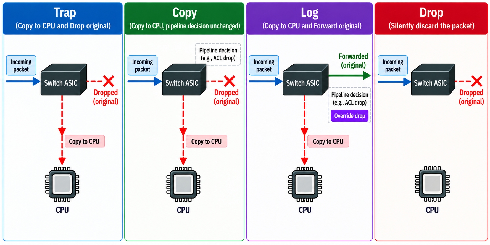
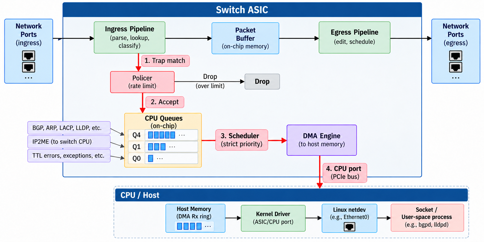
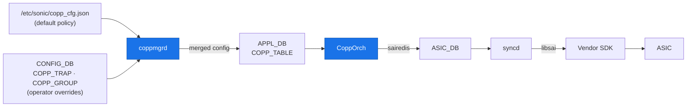
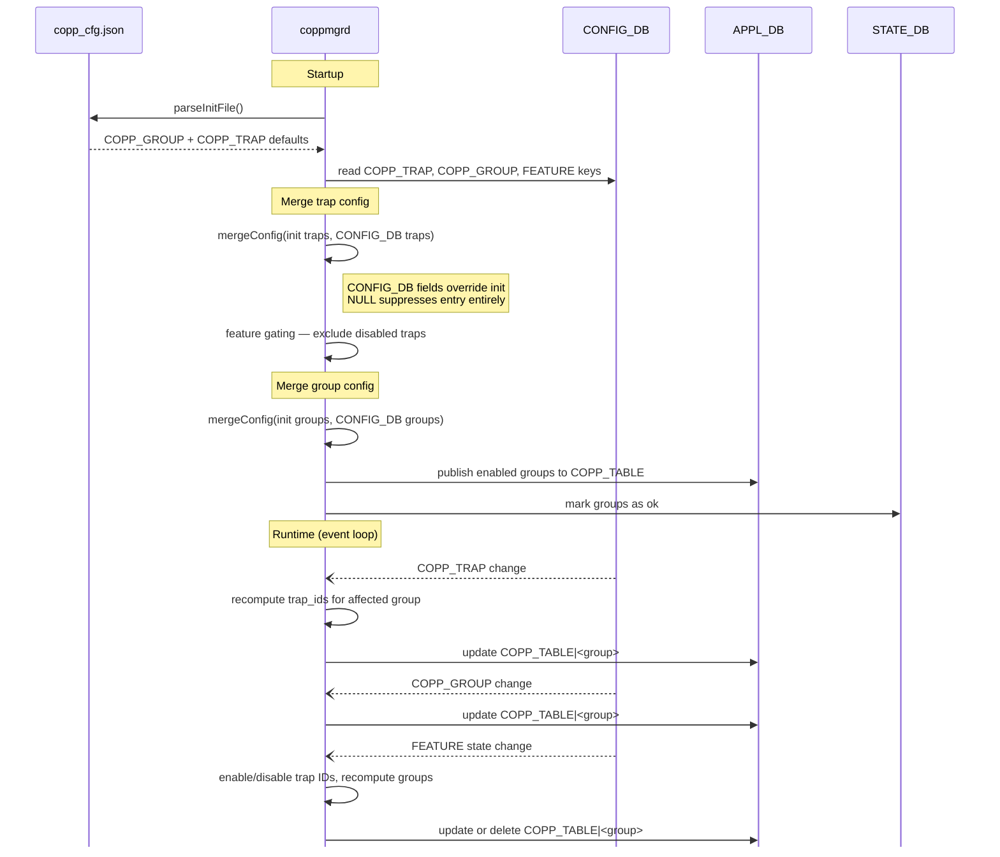
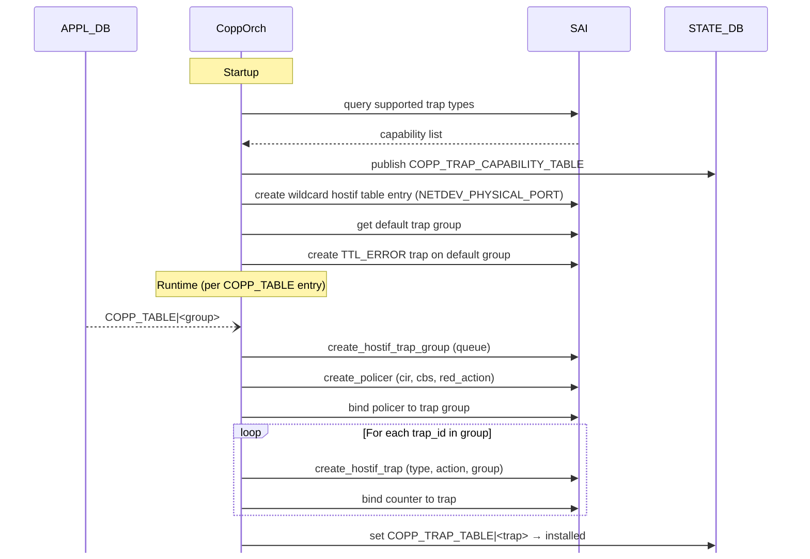

# Punting — Sending Packets from the ASIC to the CPU

> **Prerequisites**: [Ports and Host Interfaces](18_ports_and_host_interfaces.md) — host interfaces and why data-plane traffic never reaches the CPU. [The Forwarding Chain](19_forwarding_chain.md) — the SAI forwarding object chain. [Access Control Lists](20_acl.md) — ACL tables, rules, match fields, and the `COPY` action (used in [ACL-Based Trapping](#acl-based-trapping)).


## Fast Path vs Slow Path

Every packet arriving at a switch port takes one of two paths:

- **Fast path** (data plane) — The ASIC matches the packet against its forwarding tables (routes, ACLs, MAC table) and forwards it out an egress port — entirely in hardware, at line rate, with no CPU involvement. This is the path that millions of packets per second take.

- **Slow path** (control plane) — The ASIC determines that the packet requires software processing and redirects it to the CPU through a [host interface](18_ports_and_host_interfaces.md#host-interfaces). The Linux kernel receives the packet, and a user-space daemon handles it. This path is orders of magnitude slower — a CPU can process thousands to tens of thousands of packets per second, compared to the ASIC's millions.

The slow path exists because certain packets **cannot** be handled in hardware. The ASIC has no BGP implementation, no ARP state machine, no LLDP (Link Layer Discovery Protocol) agent. These protocols run as software daemons on the CPU, and the only way they can receive packets is if the ASIC forwards those packets to the CPU. This redirection from the ASIC to the CPU is called **punting**.


The diagram above shows three traffic types entering a switch through the ingress interface:

- **Data** traffic (e.g., a user's HTTP request being routed through the switch) — the vast majority passes straight through the data plane from ingress to egress, entirely in hardware. The CPU never sees it. However, a small portion of data traffic can be punted to the CPU as exceptions — for example, packets with an expired TTL, no matching route, or MTU exceeded.

- **Control** traffic (e.g., BGP updates, ARP requests, LLDP) — always punted upward to the CPU, because the ASIC has no protocol implementation. Software daemons must process these.

- **Management (in-band)** traffic (e.g., SSH sessions, SNMP queries to the switch itself) — always punted to the CPU, since these are destined for the switch, not being forwarded through it.

> **Out-of-band management traffic is different.** SSH sessions and SNMP queries arriving on the dedicated management port (`eth0`) bypass the ASIC entirely — the management port is wired directly to the CPU, not to the switching chip. No trap rules are needed for this traffic because it never enters the ASIC's forwarding pipeline. The punting rules discussed in this document apply only to traffic entering through the ASIC's front-panel ports.

All punted traffic passes through the **CoPP** policer that rate-limits what reaches the control plane, protecting the CPU from being overwhelmed. This architectural boundary is what the rest of this document explores in detail.

> **Physical note:** On the [Celestica DX010](https://github.com/ManiAm/net-lab-dx010/blob/master/docs/01_README_dx010.md#two-board-pcb-architecture) used in our lab, the data plane and control plane are literally on **separate PCBs** — the upper board carries the Tomahawk ASIC and front-panel ports, while the lower board carries the Intel Atom CPU, RAM, and storage. The two boards communicate over a PCIe interconnect through the CPU port. This two-board design is common in 1U white-box switches but is not universal — some platforms place the CPU and ASIC on the same board, and modular chassis switches use entirely different architectures with line cards and supervisor modules.


## What Gets Punted

The ASIC does not punt packets arbitrarily. Every punt decision is driven by a **trap rule** that the network operating system (NOS) explicitly programs into the ASIC. Without a matching trap rule, the ASIC either forwards the packet in the fast path or drops it — the CPU never sees it. This applies to all three traffic types from the previous section: **control** traffic (BGP, ARP, LLDP) needs trap rules so the ASIC knows to redirect it to the CPU, **data** traffic exceptions (TTL expired, no route) need trap rules to catch the edge cases, and **in-band management** traffic (packets addressed to the switch's own IP) needs a trap rule so the ASIC sends it to the local kernel instead of trying to forward it.

Common categories of punted traffic:

| Traffic class            | Category                        | Examples                       | Why the CPU needs it |
|--------------------------|---------------------------------|--------------------------------|---|
| **Control**              | Routing protocols               | BGP (TCP/179), OSPF, PIM, BFD  | Protocol daemons in FRR must process updates |
| **Control**              | Address resolution              | ARP requests/replies, IPv6 NDP | The kernel must learn or respond to neighbors |
| **Control**              | Link-layer discovery            | LLDP, LACP, STP BPDUs          | Protocol daemons must manage link state |
| **Data** (exception)     | ICMP                            | Ping (echo request), traceroute (TTL expired) | The kernel must generate replies or error messages |
| **Data** (exception)     | Exception packets               | TTL = 1, IP options, MTU exceeded | The kernel must generate ICMP error responses |
| **Data** (exception)     | No forwarding match             | No route, or a route pointing to CPU | The ASIC has no hardware entry, so it falls back to the CPU |
| **Management** (in-band) | Packets addressed to the switch | IP packets with destination = switch's own IP | The kernel must deliver them to the local socket |


## Punt Actions

Not all punted traffic is handled the same way. The ASIC can do different things with a matched packet depending on the action assigned to its trap rule. SAI defines the following actions:

| Action           | SAI Constant                    | To CPU | Original Packet    | What the ASIC Does |
|------------------|---------------------------------|--------|--------------------|---------------------|
| **Trap**         | `SAI_PACKET_ACTION_TRAP`        | Yes    | Dropped            | `Copy + Drop` — sends a copy to the CPU and drops the original |
| **Copy**         | `SAI_PACKET_ACTION_COPY`        | Yes    | Unchanged          | Sends a copy to the CPU without affecting the pipeline action |
| **Log**          | `SAI_PACKET_ACTION_LOG`         | Yes    | Forwarded          | `Copy + Forward` — sends a copy to the CPU and forwards the original |
| **Drop**         | `SAI_PACKET_ACTION_DROP`        | No     | Dropped            | Silently discards the packet |
| **Forward**      | `SAI_PACKET_ACTION_FORWARD`     | No     | Forwarded normally | Forwards the packet — effectively disables the trap |
| **Copy Cancel**  | `SAI_PACKET_ACTION_COPY_CANCEL` | No     | Unchanged          | Cancels a pending copy from an earlier pipeline stage |
| **Deny**         | `SAI_PACKET_ACTION_DENY`        | No     | Dropped            | `Copy Cancel + Drop` — cancels a pending copy and drops |
| **Transit**      | `SAI_PACKET_ACTION_TRANSIT`     | No     | Forwarded normally | `Copy Cancel + Forward` — cancels a pending copy and forwards |

The first three send a copy of the packet to the CPU. The remaining five do not.

- **Trap** — for traffic the CPU must handle exclusively. The ASIC sends a copy to the CPU and drops the original. For example, BGP packets destined to the switch are trapped — the kernel's BGP stack must process them, and they should not be forwarded as regular data. LLDP frames are also trapped because these link-local frames must be consumed by the local daemon and should never be forwarded.

- **Copy** — for traffic where both the hardware and the CPU need visibility. The ASIC sends a copy to the CPU while the original packet continues through the pipeline unchanged. For example, ARP packets use the copy action — the ASIC floods the request (or forwards the reply) normally while the CPU also receives a copy to learn the IP-to-MAC binding.

- **Log** — similar to Copy, but explicitly forwards the original. The ASIC sends a copy to the CPU and forwards the packet normally. This is used when the CPU needs to monitor or record certain traffic without disrupting its forwarding.

In the common case where the packet would already be forwarded, **Copy** and **Log** look identical — both send a copy to the CPU and the original gets forwarded. The difference only matters when another pipeline rule (such as an ACL) would have dropped the packet:

- **Copy** — the original is still dropped. Copy does not interfere with the pipeline decision.
- **Log** — the drop is cancelled and the original is forwarded anyway. Log = Copy + Forward, which overrides a pending drop.



## The Punt Path

The previous sections described *what* gets punted and *what action* the ASIC takes. This section explains *how* a punted packet physically travels from the ASIC to the CPU. Several hardware components work together along this path:



The subsections below walk through each component in order, following a packet from the trap match to the kernel.

### Policer

When the ingress pipeline matches a packet against a trap rule, the packet is not sent to the CPU right away. First, a **policer** decides whether to accept or drop it. A policer is a hardware rate limiter — it enforces a maximum number of packets (or bytes) per second for a given set of traps. Any traffic exceeding the limit is dropped in hardware before it ever reaches the CPU.

This is the first line of defense against CPU overload. Without policers, a flood of ARP requests or ICMP packets could overwhelm the CPU, starving critical protocols like BGP of processing time.

Policers are typically implemented using a **token bucket** algorithm. Two standard metering schemes exist:

- **Single Rate Three Color Marker (srTCM)** — defined in [RFC 2697](https://datatracker.ietf.org/doc/html/rfc2697)
- **Two Rate Three Color Marker (trTCM)** — defined in [RFC 4115](https://datatracker.ietf.org/doc/html/rfc4115)

Both are covered in detail in the [QoS — Ingress Metering and Marking](https://github.com/ManiAm/DC-QOS/blob/master/docs/02_SERVICE_MODELS.md#ingress-metering-and-marking) topic. [CoPP](#copp--control-plane-policing) is responsible for selecting the metering mode and configuring the rate and burst parameters for each policer.

### CPU Queues

After the policer accepts a packet, it enters one of several **CPU queues** inside the ASIC. These are dedicated queues reserved for punted traffic — on the DX010's Tomahawk ASIC, there are **48** such queues. Each punted traffic type is assigned to a specific queue index, which determines its **priority** relative to other punted traffic.

SONiC's default policy on the DX010 assigns:

| Queue | Traffic types                           | Why this priority                            |
|-------|-----------------------------------------|----------------------------------------------|
| Q4    | BGP, LACP, ARP, NDP, LLDP, UDLD         | Critical control-plane protocols             |
| Q1    | ip2me (packets addressed to the switch) | Important but less time-critical             |
| Q0    | TTL errors                              | Best-effort — acceptable to drop under load  |

Queue and policer assignments are organized through [trap groups](#trap-groups), covered in detail below. Each trap group specifies both a queue index and a policer. Multiple groups can share the same queue but maintain separate rate budgets — for example, ARP (600 pps) and BGP (6,000 pps) both land in Q4 but belong to different trap groups, so an ARP flood does not consume the rate budget allocated to BGP.

### Scheduling

A **scheduler** determines the order in which packets are dequeued from the CPU queues. SONiC typically uses **strict priority** scheduling — the highest-numbered non-empty queue is always served first (Q4 before Q1, Q1 before Q0).

This means that under heavy load, lower-priority queues can be starved — ip2me traffic in Q1 may wait while BGP packets in Q4 keep arriving, and TTL errors in Q0 may wait indefinitely. This is intentional: it is better to drop a TTL-expired ICMP error than to delay a BGP keepalive that could cause a route withdrawal.

### CPU Port

The **CPU port** is a special internal port on the ASIC that faces the management CPU rather than a front-panel connector. It is the boundary between the ASIC and the host system. On most switch platforms, this connection is a **PCIe bus** — the same high-speed serial interface used to connect GPUs, NICs, and SSDs in standard servers.

The CPU port behaves like any other egress port on the ASIC — it has queues, a scheduler, and a bandwidth limit. The difference is that instead of driving a SerDes lane to a front-panel cage, it connects to the ASIC's DMA engine, which transfers packets across the PCIe bus to host memory.

> In SONiC, `PortsOrch` discovers the CPU port at initialization by querying `SAI_SWITCH_ATTR_CPU_PORT` and stores it as a `Port` object with type `Port::CPU`.

### DMA and Ring Buffers

**DMA** (Direct Memory Access) is the mechanism that moves packets between the ASIC and host memory without CPU involvement. The CPU does not fetch each punted packet individually — the ASIC's DMA engine writes packets directly into pre-allocated buffers in host RAM, and the CPU simply reads from those buffers.

The host-side memory is organized as a **ring buffer** (also called a descriptor ring). This is a fixed-size circular array of buffer slots, shared between the DMA engine (which writes) and the kernel driver (which reads):

1. The kernel driver pre-allocates a ring of buffer slots in host memory and gives the DMA engine their addresses.
2. When a packet is dequeued, the DMA engine writes it into the next available slot.
3. The kernel driver detects the new packet (via interrupt or polling) and delivers it to the appropriate [host interface](18_ports_and_host_interfaces.md#host-interfaces) netdev.
4. The driver marks the slot as free, and the DMA engine can reuse it for the next packet.

This ring buffer design allows the ASIC and CPU to work at their own speeds without blocking each other — the ASIC can burst packets into the ring while the kernel drains them at its own pace, as long as the ring does not fill up.

> **Deep dive:** DMA, ring buffers, descriptors, and interrupt handling are general Linux networking concepts shared by all NICs — not specific to switch ASICs. For a thorough treatment, see [Linux Networking — DMA and Ring Buffers](https://github.com/ManiAm/dpdk-labnet/blob/master/Linux_Networking.md#direct-memory-access-dma).


## Trap Types

A **trap type** is a SAI-defined identifier that tells the ASIC which specific traffic pattern to match. Each trap type corresponds to a single protocol or exception:

| SAI Constant                              | Enum Value | What It Matches                    |
|-------------------------------------------|------------|------------------------------------|
| `SAI_HOSTIF_TRAP_TYPE_BGP`                | `0x4003`   | BGP packets (TCP/179)              |
| `SAI_HOSTIF_TRAP_TYPE_ARP_REQUEST`        | `0x2000`   | ARP request broadcasts             |
| `SAI_HOSTIF_TRAP_TYPE_LACP`               | `0x0001`   | LACP PDUs for link aggregation     |
| `SAI_HOSTIF_TRAP_TYPE_LLDP`               | `0x0003`   | LLDP neighbor discovery frames     |
| `SAI_HOSTIF_TRAP_TYPE_IP2ME`              | `0x4000`   | Packets addressed to the switch IP |
| `SAI_HOSTIF_TRAP_TYPE_TTL_ERROR`          | `0x6001`   | Packets with expired TTL           |
| `SAI_HOSTIF_TRAP_TYPE_SAMPLEPACKET`       | `0x000a`   | sFlow sampled packets              |

SAI defines trap types as an enum (`sai_hostif_trap_type_t`) in its [host interface header](https://github.com/opencomputeproject/SAI/blob/master/inc/saihostif.h). The enum is organized into ranges by category:

| Range       | Category         | Examples                                      |
|-------------|------------------|-----------------------------------------------|
| `0x0000–`   | Switch / L2      | STP, LACP, EAPOL, LLDP, UDLD, sFlow sample    |
| `0x2000–`   | Router / L3      | ARP, DHCP, OSPF, PIM, VRRP, NDP               |
| `0x4000–`   | Local IP         | ip2me, SSH, SNMP, BGP, BFD, LDP               |
| `0x6000–`   | Exceptions       | L3 MTU error, TTL error, static FDB move      |
| `0x7000–`   | Pipeline discard | Egress buffer, WRED, router discard           |
| `0x8000–`   | MPLS             | MPLS TTL error, label miss, router alert      |

Not every ASIC supports every trap type — support depends on the vendor's SAI implementation. At startup, CoppOrch queries the hardware for its supported set and publishes the result to STATE_DB (see [What CoppOrch Does](#what-copporch-does)).

### How the ASIC Matches Traffic

Each trap type implies a specific set of packet-header fields that the ASIC must inspect. SAI defines *what* to match — the vendor SDK translates that into the ASIC's native hardware mechanism.

For **L2 traps**, the ASIC matches on destination MAC address and/or EtherType:

| Trap type  | Match criteria                                                        |
|------------|-----------------------------------------------------------------------|
| STP        | Dst MAC = `01:80:C2:00:00:00`                                         |
| LACP       | Dst MAC = `01:80:C2:00:00:02`, EtherType = `0x8809` (Slow Protocols)  |
| LLDP       | Dst MAC = `01:80:C2:00:00:0E`, EtherType = `0x88CC`                   |
| EAPOL      | EtherType = `0x888E`                                                  |

For **L3 traps**, the ASIC typically matches on IP protocol number and/or well-known multicast addresses:

| Trap type     | Match criteria                                                  |
|---------------|-----------------------------------------------------------------|
| ARP request   | EtherType = `0x0806`, ARP opcode = request                      |
| OSPF          | IP protocol = 89, dst = `224.0.0.5` / `224.0.0.6`               |
| PIM           | IP protocol = 103                                               |
| NDP           | ICMPv6 type = 133–137                                           |

For **Local IP traps**, the ASIC matches on TCP/UDP port numbers *and* verifies the destination IP belongs to the switch:

| Trap type | Match criteria                                                       |
|-----------|----------------------------------------------------------------------|
| BGP       | TCP src port == 179 **or** TCP dst port == 179, to local router IP   |
| SSH       | TCP dst port == 22, to local router IP                               |
| SNMP      | UDP dst port == 161, to local router IP                              |
| BFD       | UDP dst port == 3784 **or** 4784, to local router IP                 |
| DHCP      | UDP ports 67/68, L3 broadcast or unicast to local router IP          |
| ip2me     | Any IP packet whose route next-hop points to the CPU port            |

For **exception traps**, the match is not based on header fields but on pipeline events:

| Trap type       | Trigger                                                      |
|-----------------|--------------------------------------------------------------|
| TTL error       | TTL reaches 0 during L3 forwarding                           |
| L3 MTU error    | Packet exceeds the egress interface's MTU                    |
| Neighbor miss   | Subnet route exists but no neighbor entry (ARP not resolved) |

These matching criteria are defined in the SAI spec comments in [`saihostif.h`](https://github.com/opencomputeproject/SAI/blob/master/inc/saihostif.h). The vendor SDK implements them using the ASIC's native mechanisms — for example, Broadcom's Tomahawk uses **Field Processor (FP)** TCAM (Ternary Content-Addressable Memory) entries, while NVIDIA's Spectrum uses a fixed **HPKT register table**. In both cases, matching happens entirely in hardware at line rate.


## Trap Groups

A **trap group** is a container that bundles one or more related traps together and assigns them shared properties — specifically a **policer** (rate limiter) and a **CPU queue** index.

Without grouping, every individual trap would need its own policer and queue assignment. Trap groups simplify this: protocols with similar importance and rate requirements are placed in the same group, so they share a single policer budget and land in the same queue.

For example, SONiC's default configuration defines groups like:

- **queue4_group1** — contains BGP, BGPv6, LACP, and EAPoL traps. These are critical control-plane protocols that share the same rate limit (6,000 pps) and the highest CPU queue (Q4).
- **queue4_group3** — contains LLDP, UDLD, DHCP, and DHCPv6 traps. These are lower-rate protocols that share a tighter rate limit (100 pps) in the same CPU queue.

Each trap is assigned to exactly one group. The group determines *how fast* traffic is accepted (via the policer) and *at what priority* it is processed (via the queue). The [What CoppOrch Does](#what-copporch-does) section covers how trap groups are programmed into the ASIC.


## CoPP — Control Plane Policing

CoPP (Control Plane Policing) is the framework that configures trap groups and their rate limits. It builds on the [policer](#policer) mechanism described earlier — each trap group gets its own rate budget, ensuring that a flood in one traffic class (such as ARP broadcasts) cannot starve another (such as BGP keepalives).

### The CoPP Configuration File

CoPP policy is defined in `/etc/sonic/copp_cfg.json`, which is **generated at boot** from a Jinja2 template. A systemd oneshot service (`copp-config.service`) runs before SWSS starts:

```bash
# /usr/bin/copp-config.sh
sonic-cfggen -d -t /usr/share/sonic/templates/copp_cfg.j2 > /etc/sonic/copp_cfg.json
```

The template (`copp_cfg.j2`) can vary rates based on device metadata. For example, management-type devices get a higher DHCP rate (300 pps) than leaf/spine devices (100 pps). The rendered JSON is then loaded into CONFIG_DB.

### JSON Structure

The JSON has two top-level objects:

- **`COPP_GROUP`** — defines [trap groups](#trap-groups). Each group specifies a CPU queue, a punt action, and a rate-limiting policer.
- **`COPP_TRAP`** — binds specific [trap types](#trap-types) to a group. Each entry lists one or more trap type names and the group they belong to.

```json
{
    "COPP_GROUP": {
        "queue4_group1": {
            "queue": "4",
            "trap_action": "trap",
            "trap_priority": "4",

            "mode": "sr_tcm",
            "meter_type": "packets",
            "cir": "6000",
            "cbs": "6000",
            "red_action": "drop"
        }
    },
    "COPP_TRAP": {
        "bgp": {
            "trap_ids": "bgp,bgpv6",  // trap types
            "trap_group": "queue4_group1"
        }
    }
}
```

In this example, BGP packets (IPv4 and IPv6) are assigned to `queue4_group1` and rate-limited to 6,000 packets per second. Packets exceeding that rate are dropped by the ASIC before reaching the CPU.

#### COPP_GROUP Entries

Each `COPP_GROUP` entry starts with a queue assignment and a punt action:

| Property        | Values                                   | Description |
|-----------------|------------------------------------------|-----------------------------------|
| `queue`         | Unsigned integer (default `0`)           | CPU receive queue index — higher numbers are served first by the strict-priority scheduler |
| `trap_action`   | Any SAI packet action (see [Punt Actions](#punt-actions)) | Punt action applied to matched packets |
| `trap_priority` | Unsigned integer (default `0`)           | Priority when multiple trap rules match the same packet — higher wins |

> **Note:** `trap_priority` is not supported on Mellanox and Marvell platforms — `CoppOrch` silently skips it on those ASICs.

The remaining fields configure the token-bucket policer attached to the group. All fields are optional — if omitted, no policer is created and traffic is not rate-limited.

| Property        | Values                      | Description |
|-----------------|-----------------------------|-------------|
| `mode`          | `sr_tcm`, `tr_tcm`, `storm` | Token bucket algorithm — `sr_tcm` ([RFC 2697](https://datatracker.ietf.org/doc/html/rfc2697)) is used by default |
| `meter_type`    | `packets`, `bytes`          | Unit for rate measurement — packets per second or bytes per second |
| `color`         | `aware`, `blind`            | Policer color source — `blind` ignores incoming color marking, `aware` respects it |
| `cir`           | Unsigned integer (default `0`) | **Committed Information Rate** — the sustained rate allowed |
| `cbs`           | Unsigned integer (default `0`) | **Committed Burst Size** — must be ≥ `cir`; requires `cir > 0` |
| `pir`           | Unsigned integer             | **Peak Information Rate** — only valid with `tr_tcm` mode; must be ≥ `cir` |
| `pbs`           | Unsigned integer             | **Peak Burst Size** — valid with `sr_tcm` (maps to EBS) and `tr_tcm`; must be ≥ `cbs` |
| `green_action`  | Any SAI packet action (see [Punt Actions](#punt-actions)) | Action for conforming packets (green); default: `forward` |
| `yellow_action` | Any SAI packet action | Action for packets exceeding CIR but within PIR (yellow); default: `forward` |
| `red_action`    | Any SAI packet action | Action for packets exceeding the rate (red); default: `forward` |

The default CoPP policy uses only `cir`, `cbs`, and `red_action` with `sr_tcm` mode — a simplified two-color (pass/drop) policer with no excess burst. See the [QoS — Ingress Metering and Marking](https://github.com/ManiAm/DC-QOS/blob/master/docs/02_SERVICE_MODELS.md#ingress-metering-and-marking) topic for the full srTCM and trTCM algorithms.

#### COPP_TRAP Entries

Each `COPP_TRAP` entry binds one or more SAI trap types to a group:

| Property         | Description |
|------------------|-------------|
| `trap_ids`       | Comma-separated list of SAI trap type names (e.g., `bgp,bgpv6`) |
| `trap_group`     | The `COPP_GROUP` name this trap belongs to |
| `always_enabled` | If `"true"`, the trap is installed regardless of feature state (see [Feature Gating](#feature-gating)) |

> **Note:** The `trap_ids` values are SONiC-specific short names, not SAI constants. CoppOrch translates these strings to SAI enum values (e.g., `bgp` → `SAI_HOSTIF_TRAP_TYPE_BGP`) using an internal mapping table (`trap_id_map` in `copporch.cpp`). The full set of recognized names and their corresponding [trap types](#trap-types) is defined there.

### The Programming Pipeline

CoPP configuration follows the standard SONiC pipeline:



- **`coppmgrd`** (manager daemon in SWSS) — reads the default policy directly from `copp_cfg.json` and merges it with any operator overrides in CONFIG_DB. The merged result is written to APPL_DB's `COPP_TABLE`.

- **`CoppOrch`** (orchagent module) — consumes `COPP_TABLE`, creates the SAI trap groups, policers, and trap objects, and binds them together.

### What coppmgrd Does



#### Config Merge and Override

`coppmgrd` does not blindly copy the JSON into APPL_DB. At startup it reads both the init file (`copp_cfg.json`) and any existing `COPP_GROUP|*` / `COPP_TRAP|*` keys in CONFIG_DB. The merge logic works as follows:

- **Override** — if the same key exists in both the init file and CONFIG_DB, the CONFIG_DB fields take precedence. This is how an operator customizes rates without editing the template.
- **Suppress** — setting a CONFIG_DB key to `NULL` suppresses the init entry entirely, preventing that group or trap from being published.
- **Restore** — when a CONFIG_DB override is deleted, `coppmgrd` re-creates the entry from the original init file values.

#### Feature Gating

Not every trap in the JSON is installed into the ASIC. A trap name is only published to APPL_DB if one of two conditions is met:

1. The trap's JSON entry has `"always_enabled": "true"` — for example, `lacp`, `arp`, `udld`, `ip2me`, and `neighbor_miss` are always enabled regardless of any feature state.

2. The CONFIG_DB `FEATURE|<name>` table has `state` set to `enabled` or `always_enabled` — for example, `bgp`, `lldp`, `dhcp_relay`, and `sflow` are only installed when their corresponding feature is enabled.

If neither condition is met, `coppmgrd` excludes that trap's IDs from the group's `trap_ids` list in APPL_DB. For example, the default template includes MACsec (EAPoL) and NAT traps, but if those features are not enabled, no SAI trap object is ever created for them.

When a feature is later enabled or disabled at runtime, `coppmgrd` recomputes the trap ID list for the affected group and updates APPL_DB. If disabling a feature leaves a trap group with zero enabled traps, the group is removed from APPL_DB entirely.

### What CoppOrch Does



When `CoppOrch` starts, it performs three initialization steps before processing any APPL_DB entries:

1. **Trap capability query** — `CoppOrch` asks the SAI vendor library which trap types the hardware supports by calling `sai_query_attribute_enum_values_capability()`. If the query fails (not all vendors implement it), it falls back to a hardcoded list of ~45 common trap types. The supported set is published to STATE_DB's `COPP_TRAP_CAPABILITY_TABLE`. Any trap type not in the supported set is silently skipped when processing APPL_DB entries.

2. **Default hostif table entry** — `CoppOrch` creates a wildcard host interface table entry that routes all trapped packets through the `NETDEV_PHYSICAL_PORT` channel:

    ```c
    attr.value.s32 = SAI_HOSTIF_TABLE_ENTRY_TYPE_WILDCARD;
    /* ... */
    attr.value.s32 = SAI_HOSTIF_TABLE_ENTRY_CHANNEL_TYPE_NETDEV_PHYSICAL_PORT;
    ```

    This entry tells the ASIC driver: deliver every trapped packet to the Linux **netdev** that corresponds to the **physical port the packet arrived on**. For example, if a BGP packet enters on front-panel port `Ethernet8`, the driver delivers it to the `Ethernet8` netdev in Linux. The kernel then routes it from there to bgpd's TCP socket on port 179. Without this entry, the kernel would not know which interface received the trapped packet. The sFlow group overrides this per-trap with a `GENETLINK` channel (see below).

3. **Default trap group and TTL_ERROR** — `CoppOrch` fetches the switch's built-in default trap group (via `SAI_SWITCH_ATTR_DEFAULT_TRAP_GROUP`) and hardcodes `SAI_HOSTIF_TRAP_TYPE_TTL_ERROR` onto it. This happens outside of `coppmgrd`'s control — TTL errors are always trapped regardless of the JSON configuration.

After initialization, `CoppOrch` processes each `COPP_TABLE` entry from APPL_DB: it creates or updates the SAI trap group (with the queue index), creates a policer (with the cir/cbs/red_action values), and creates one SAI trap object per trap type in the group's `trap_ids` list.

### Genetlink Channel for sFlow

Most trapped packets reach user space through the **netdev channel** — they appear as packets on the per-port Linux network devices. sFlow is the exception.

The sFlow trap group carries `genetlink_name=psample` and `genetlink_mcgrp_name=packets` in the config. **Genetlink** is a kernel messaging mechanism that allows user-space programs to receive structured data from the kernel without going through the normal network stack. When `CoppOrch` sees these fields, it creates a `SAI_HOSTIF_TYPE_GENETLINK` host interface and per-trap table entries with `CHANNEL_TYPE_GENETLINK`. This causes sFlow sample packets to bypass the netdev path and go directly to the kernel's `psample` genetlink family, where the sFlow agent reads them.

### STATE_DB Feedback

Three STATE_DB tables provide operational verification that CoPP is programmed:

| Table | Written by | What it confirms |
|---|---|---|
| `COPP_GROUP_TABLE\|<group>` | `coppmgrd` | `state=ok` — the group was published to APPL_DB |
| `COPP_TRAP_TABLE\|<trap>` | `coppmgrd` + `CoppOrch` | `state=ok` from coppmgrd; `hw_status=installed` after SAI accepts the trap |
| `COPP_TRAP_CAPABILITY_TABLE\|traps` | `CoppOrch` | The list of trap IDs the vendor SAI supports |

These tables let an operator confirm which traps are actually installed in hardware, and which were skipped because the feature was disabled or the vendor SAI does not support them.

### Default CoPP Policy

SONiC ships with a default CoPP policy that covers all standard protocols. The defaults are designed to protect the CPU under normal and adversarial conditions while ensuring critical protocols (BGP, LACP) always have enough bandwidth:

| Group           | Queue | Trap IDs                           | Rate (pps) | Action |
|-----------------|-------|------------------------------------|------------|---|
| `queue4_group1` | 4     | bgp, bgpv6, lacp, eapol            | 6000       | trap |
| `queue4_group2` | 4     | arp_req, arp_resp, neigh_discovery | 600        | copy |
| `queue4_group3` | 4     | lldp, udld, dhcp, dhcpv6           | 100        | trap |
| `queue2_group1` | 2     | sample_packet (sFlow)              | 1000       | trap |
| `queue1_group1` | 1     | ip2me                              | 6000       | trap |
| `queue1_group2` | 1     | src_nat_miss, dest_nat_miss        | 600        | trap |
| `queue1_group3` | 1     | neighbor_miss                      | 200        | trap |
| `default`       | 0     | (TTL error, hardcoded by CoppOrch) | 600        | — |

All policers use `meter_type=packets`, `mode=sr_tcm`, `red_action=drop`. The `queue4` groups share the highest CPU queue (4) because BGP, ARP, and LLDP are the most operationally critical. The `queue1` groups handle switch-addressed traffic (ip2me), NAT misses, and neighbor discovery misses at a lower priority. The `default` group at queue 0 has the lowest priority and catches exception traffic.

Operators can customize rates by applying a CONFIG_DB patch (which overrides the init file as described in [Config Merge and Override](#config-merge-and-override)) and running `config reload`.

### Verifying Installed Traps

After the CoPP pipeline runs, the installed traps are spread across three Redis databases. Checking each one manually is tedious, so this repository includes a helper script that queries all three and presents the result in a single report:

```bash
bash scripts/show_copp_traps.sh
```

> **Source:** [`scripts/show_copp_traps.sh`](../scripts/show_copp_traps.sh)

The script produces three sections:

**Section 1 — CoPP Policy (APPL_DB).** Shows the trap groups that `coppmgrd` published after merging the default `copp_cfg.json` with any CONFIG_DB overrides. Each row is one trap group with its queue assignment, punt action, member trap IDs, and policer rate. This is the **policy intent** — what the operator asked for.

```
TRAP GROUP          QUEUE  ACTION  TRAP IDs                                CIR (pps)   CBS (pkts)
──────────────────  ─────  ──────  ──────────────────────────────────────  ──────────  ──────────
default             0      -       -                                       600         600
queue1_group1       1      trap    ip2me                                   6000        6000
queue4_group1       4      trap    bgp,bgpv6,lacp                          6000        6000
queue4_group2       4      copy    arp_req,arp_resp,neigh_discovery        600         600
queue4_group3       4      trap    lldp,udld                               100         100
```

**Section 2 — Combined Trap View (ASIC_DB).** Shows the individual SAI trap objects that `CoppOrch` created in ASIC_DB — one row per SAI trap type, with the resolved queue, policer rate, and action. This is the **hardware reality** — what `syncd` will push (or has pushed) to the vendor SDK.

```
QUEUE  SAI TRAP TYPE                 ACTION  PRIO  CIR (pps)   CBS (pkts)  RED ACTION
─────  ────────────────────────────  ──────  ────  ──────────  ──────────  ──────────
Q4     ARP_REQUEST                   COPY    4     600         600         DROP
Q4     ARP_RESPONSE                  COPY    4     600         600         DROP
Q4     BGP                           TRAP    4     6000        6000        DROP
Q4     BGPV6                         TRAP    4     6000        6000        DROP
Q4     IPV6_NEIGHBOR_DISCOVERY       COPY    4     600         600         DROP
Q4     LACP                          TRAP    4     6000        6000        DROP
Q4     LLDP                          TRAP    4     100         100         DROP
Q4     UDLD                          TRAP    4     100         100         DROP

Q1     IP2ME                         TRAP    1     6000        6000        DROP

Q0     TTL_ERROR                     TRAP    0     600         600         DROP
```

Notice that Section 1 has 5 groups but Section 2 has 10 SAI trap objects — each group expands its `trap_ids` into individual SAI traps (e.g., the `arp` group with `arp_req,arp_resp,neigh_discovery` becomes three separate SAI objects). Also notice that `TTL_ERROR` appears in Section 2 but not in Section 1: `CoppOrch` hardcodes it onto the switch's default trap group at startup, bypassing `coppmgrd` entirely, so TTL errors are always trapped regardless of the JSON configuration.

**Section 3 — Installation Status (STATE_DB).** Lists every individual trap ID that was expected to be programmed — those that passed [feature gating](#feature-gating) and were published to APPL_DB. Each row is one trap ID with its STATE_DB confirmation. Trap IDs whose features are disabled are summarized separately at the bottom.

```
  TRAP ID                         STATUS
  ──────────────────────────────  ──────────
  arp_req                         ok
  arp_resp                        ok
  bgp                             ok
  bgpv6                           ok
  ip2me                           ok
  lacp                            ok
  lldp                            ok
  neigh_discovery                 ok
  ttl_error                       ok
  udld                            ok

  Disabled (feature not enabled): dest_nat_miss, dhcp, dhcpv6, eapol, sample_packet, src_nat_miss
```

The 6 disabled trap IDs (`dest_nat_miss`, `dhcp`, `dhcpv6`, `eapol`, `sample_packet`, `src_nat_miss`) never reached APPL_DB or ASIC_DB because their corresponding features (NAT, DHCP relay, MACsec, sFlow) are not enabled on this switch.

### Trap Counters

`CoppOrch` binds a SAI generic counter to each trap object via `SAI_HOSTIF_TRAP_ATTR_COUNTER_ID` and registers it with the flex counter infrastructure. This populates `COUNTERS_TRAP_NAME_MAP` in COUNTERS_DB, enabling per-trap packet and byte counters. The counters are polled every 10 seconds by default.

## ACL-Based Trapping

Everything discussed so far uses CoPP — a predefined set of trap types built into SAI. CoPP covers well-known protocols (BGP, ARP, LLDP, etc.) and pipeline exceptions (TTL error, MTU error), and the operator's control is limited to adjusting rates, queues, and actions for those fixed trap types. But what if you need to punt traffic that doesn't match any predefined SAI trap type?

This is where **ACL-based trapping** comes in. SONiC allows operators to write ACL rules with a `PACKET_ACTION` of `COPY` (or `REDIRECT`), which tells the ASIC to punt matching packets to the CPU — using fully custom match criteria.

### How It Differs from CoPP

|                    | CoPP                                                                              | ACL-Based Trapping                      |
|--------------------|-----------------------------------------------------------------------------------|-----------------------------------------|
| **Match criteria** | Fixed by SAI — each trap type has predefined matching logic (e.g., BGP = TCP/179) | Fully custom — any combination of L2/L3/L4 header fields the operator defines |
| **Configured via** | `copp_cfg.json` or CONFIG_DB `COPP_GROUP`/`COPP_TRAP`                             | CONFIG_DB `ACL_TABLE` + `ACL_RULE` |
| **Programmed by**  | `CoppOrch` → `create_hostif_trap()`                                               | `AclOrch` → `create_acl_entry()` with `SAI_PACKET_ACTION_COPY` |
| **Rate limiting**  | Built-in — each trap group has a policer                                          | Not automatic — requires a separate policer or mirror session |
| **TCAM usage**     | Vendor-dependent (may or may not use TCAM)                                        | Always consumes ACL TCAM entries |

### When to Use ACL-Based Trapping

CoPP is the right choice for standard protocols — it's simpler, rate-limited by default, and doesn't consume user-facing TCAM resources. ACL-based trapping is needed when:

- **Custom traffic patterns** — you need to punt traffic that no predefined SAI trap type covers. For example, trapping packets with a specific DSCP value, a particular source prefix, or a non-standard UDP port.
- **Selective trapping** — you want to trap only a subset of a protocol's traffic. CoPP traps are global (all BGP traffic on all ports), but an ACL rule can match more specific criteria.
- **Debugging and monitoring** — temporarily copying specific flows to the CPU for analysis without modifying the CoPP policy.

### How It Works in SONiC

An operator creates an ACL table and rule in CONFIG_DB:

```json
{
    "ACL_TABLE": {
        "MY_PUNT_TABLE": {
            "type": "L3",
            "stage": "ingress",
            "ports": ["Ethernet0", "Ethernet4"]
        }
    },
    "ACL_RULE": {
        "MY_PUNT_TABLE|RULE_1": {
            "SRC_IP": "10.0.0.0/24",
            "PACKET_ACTION": "COPY"
        }
    }
}
```

`AclOrch` processes this and calls the SAI ACL API to create an ACL entry with `SAI_PACKET_ACTION_COPY`. The ASIC then sends a copy of any matching packet to the CPU while forwarding the original normally. Unlike CoPP traps, ACL rules can be scoped to specific ports and use arbitrary match fields.

> **Note:** SONiC's standard ACL rules support `FORWARD`, `DROP`, and `COPY` as packet actions. The `COPY` action is the ACL equivalent of punting — it sends a copy to the CPU. SAI also supports `SAI_ACL_ENTRY_ATTR_ACTION_SET_USER_TRAP_ID`, which links an ACL rule to a user-defined trap object with its own trap group, policer, and CPU queue — but this is primarily used in P4-programmable pipelines and is not part of the standard SONiC ACL workflow.

---

**Previous**: [← Access Control Lists](20_acl.md) · **Next**: [The BGP Container and FRR →](22_bgp_container.md)
