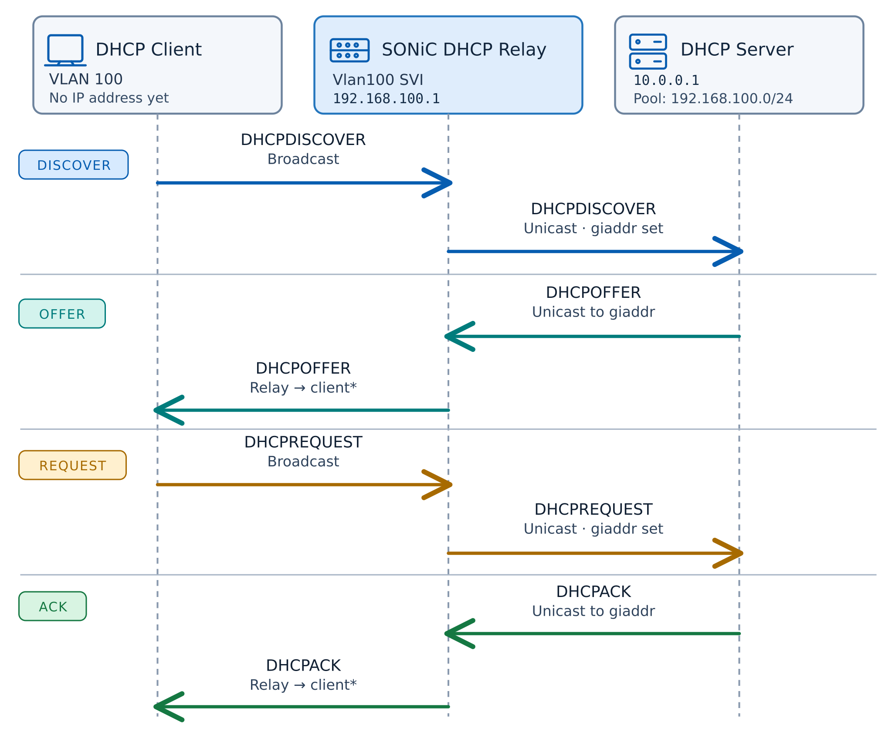

# The DHCP Relay Container

The DHCP relay container (`dhcp_relay`) runs relay agents that forward DHCP messages between clients on a local VLAN and DHCP servers on other subnets. DHCP depends on broadcast, and broadcasts do not cross routers. Without a relay, a client can only get an address from a server on its own VLAN.

> **Prerequisites**: [Container Run Time](05_container_run_time.md) (systemd lifecycle and service dependencies), [Core Redis Databases](08_redis_databases.md) (`CONFIG_DB` tables and the subscription model), and [Punting](21_punting.md) (how the ASIC traps packets to the CPU).

## Why a Relay Agent Is Needed

A device that boots without an IP address cannot send a normal unicast packet, because it has no source address and does not know where the server is. Instead, it sends a **DHCP Discover** as a Layer 2 broadcast. Every device on the same VLAN receives that broadcast, but a router does not forward it to other subnets.

In a data center, the DHCP server almost never sits on the same VLAN as its clients. Servers usually live on a management or infrastructure network, while clients sit on tenant VLANs behind leaf switches.

A **DHCP relay agent** closes this gap. Running on the switch that acts as the client VLAN's gateway, it:

1. Receives the client's broadcast on the VLAN interface.
2. Writes its own VLAN interface IP address into the packet's **gateway address field (`giaddr`)**. The server uses `giaddr` to choose which subnet to allocate an address from, and as the destination for its reply.
3. Sends the packet as a **unicast** to each configured DHCP server, across the routed network.
4. Receives the server's reply and delivers it to the client on the original VLAN.

All four DHCP messages (**DORA**: Discover, Offer, Request, Ack) pass through the relay:



The relay delivers the Offer and Ack to the client as a broadcast or a unicast, depending on the broadcast flag the client set in its request.

## How DHCP Packets Reach the Relay

The relay agents are ordinary Linux processes running on the switch CPU. Data-plane traffic, however, is forwarded entirely by the ASIC and normally never reaches the CPU. For the relay to see DHCP messages, the ASIC must **punt** them — divert them from the hardware forwarding path to the CPU.

SONiC installs trap rules in the ASIC that match DHCP traffic: UDP ports 67 and 68 for DHCPv4, and UDP ports 546 and 547 for DHCPv6. A matching packet is sent to the CPU through the host interface, where it appears on the corresponding Linux netdev (for example, `Vlan100`). The relay agent is listening on that interface and receives the packet.

This is the mechanism described in [Punting](21_punting.md). The `dhcp` and `dhcpv6` trap IDs belong to the `queue4_group3` trap group and are installed only when the `dhcp_relay` feature is enabled in the `FEATURE` table. When the feature is disabled, the traps are not installed, DHCP broadcasts are simply flooded within the VLAN by the ASIC, and no relaying takes place.

## Container Startup and Dependencies

The `dhcp_relay` container starts late in the boot sequence (see the [dependency graph](05_container_run_time.md#dependency-graph)). Each dependency exists for a specific reason:

| Dependency | Type | Why it is needed |
|------------|------|------------------|
| `syncd` | `After=` (ordering) | The DHCP trap rules must be programmed into the ASIC. Until they are, DHCP packets never reach the CPU. |
| `teamd` | `After=` (ordering) | The relay sends traffic toward servers over upstream interfaces, which are often port channels (LAGs). Those interfaces must exist before the relay binds to them. |
| `config-setup` | `Requires=` (fate-coupled) | The VLAN and DHCP server configuration must be loaded into `CONFIG_DB` before the relay reads it. If `config-setup` fails, `dhcp_relay` is stopped. |

When the container starts, its startup script renders the supervisord configuration from `CONFIG_DB`. This step decides which relay processes to run and with which arguments, such as one DHCPv4 relay per VLAN that has servers configured. supervisord then launches those processes.

## CONFIG_DB Tables

DHCP relay configuration lives in two `CONFIG_DB` tables: `VLAN` and `DHCP_RELAY`.

### `VLAN` Table — DHCPv4 Servers

The DHCPv4 server addresses for each VLAN are stored in that VLAN's entry:

```json
{
    "VLAN|Vlan100": {
        "vlanid": "100",
        "dhcp_servers": ["10.0.0.1", "10.0.0.2"]
    }
}
```

| Field | Meaning |
|-------|---------|
| `dhcp_servers` | List of IPv4 DHCP server addresses for this VLAN. |

When a VLAN has more than one server, the relay forwards each client request to **all** of them. Every server may respond with an Offer. The client typically accepts the first Offer it receives and names the chosen server in its Request.

### `DHCP_RELAY` Table — DHCPv6 Servers and Options

DHCPv6 relay settings are stored per VLAN in the `DHCP_RELAY` table:

```json
{
    "DHCP_RELAY|Vlan100": {
        "dhcpv6_servers": ["fc02::1"],
        "rfc6939_support": "true",
        "interface_id": "true"
    }
}
```

| Field | Meaning |
|-------|---------|
| `dhcpv6_servers` | List of IPv6 DHCP server addresses for this VLAN. |
| `rfc6939_support` | Insert the Client Link-Layer Address option (RFC 6939), which gives the server the client's MAC address. |
| `interface_id` | Insert the Interface-ID option, which identifies the interface the client request arrived on. |

> Older SONiC releases stored DHCPv6 servers as a `dhcpv6_servers` field in the `VLAN` table. Newer releases use the `DHCP_RELAY` table shown above.

### Related Tables

- **`DHCP_SERVER`** — a global list of DHCP server addresses, typically populated from minigraph. The relay forwards based on the per-VLAN lists above.
- **`DHCP_SERVER_IPV4*`** — configuration for SONiC's built-in DHCP server, which runs in the separate `dhcp_server` container. When this feature is enabled, the relay forwards client requests to that local server. The two containers communicate over normal IP packets, not through Redis or shared memory.

## Configuration via CLI

DHCP relay is managed with the standard SONiC CLI:

```bash
# Show configured relay servers
show dhcp_relay ipv4 helper
show dhcp_relay ipv6 destination

# Add or remove a DHCPv4 server on VLAN 100
sudo config vlan dhcp_relay add 100 10.0.0.1
sudo config vlan dhcp_relay del 100 10.0.0.1

# Add or remove a DHCPv6 server on VLAN 100
sudo config vlan dhcp_relay add 100 fc02::1
sudo config vlan dhcp_relay del 100 fc02::1

# Enable or disable the feature (and its container)
sudo config feature state dhcp_relay enabled
sudo config feature state dhcp_relay disabled
```

`config vlan dhcp_relay add` and `del` detect from the address format whether it is an IPv4 or an IPv6 server. Exact command names vary slightly across SONiC releases; run `config vlan dhcp_relay --help` to see what your image supports.

Adding or removing a server updates `CONFIG_DB` and then **restarts the `dhcp_relay` service**. A restart is required because the list of relay processes and their arguments is generated only when the container starts. The [Generic Config Updater](30_configuration_management.md) behaves the same way: after a patch changes DHCP relay configuration, its validator restarts `dhcp_relay`.

## What Runs Inside the Container

supervisord manages these processes inside the container:

| Process | Role |
|---------|------|
| `isc-dhcpv4-relay-<VLAN>` | ISC `dhcrelay`, the DHCPv4 relay agent. One instance runs for each VLAN that has at least one DHCPv4 server configured. |
| `dhcp6relay` | SONiC's own DHCPv6 relay agent. A single process serves all VLANs. |
| `dhcpmon-<VLAN>` | A monitor that counts DHCP packets on each relayed VLAN and logs a warning if requests arrive but are not forwarded. |
| `dhcprelayd` | Present in newer images. Manages relay processes for SONiC's built-in DHCP server feature. |

The container uses the host network namespace, so all of these processes see the switch's real interfaces (`Vlan100`, `PortChannel0001`, and so on) directly.

### DHCPv4 Relay — ISC `dhcrelay`

For IPv4, SONiC uses the widely deployed ISC `dhcrelay` program. Each instance:

1. Listens on its VLAN interface (for example, `Vlan100`) for client messages, and on the upstream interfaces for server replies.
2. Sets `giaddr` to the VLAN interface's IP address so the server knows which subnet the client belongs to.
3. Inserts **Option 82** (Relay Agent Information). Its Circuit ID suboption records the switch hostname and the port the request arrived on. Servers can use this information for logging or for per-port address policies.
4. Sends the packet as a unicast to every configured server.
5. When a server replies, removes Option 82 and delivers the reply to the client on the original VLAN.

### DHCPv6 Relay — `dhcp6relay`

For IPv6, SONiC uses its own `dhcp6relay` implementation. DHCPv6 relaying works differently from DHCPv4 (see RFC 8415):

- Instead of editing the client's message, the relay **wraps** it inside a **Relay-Forward** message (message type 12). The wrapper includes a link-address field, set to an address of the client-facing interface, which tells the server what link the client is on.
- Depending on the `DHCP_RELAY` settings, the relay also adds the Interface-ID option and the Client Link-Layer Address option.
- The server answers with a **Relay-Reply** message (message type 13). The relay unwraps it and delivers the inner message to the client.

## VRF-Aware Relay

Virtual Routing and Forwarding (VRF) splits the switch's routing table into isolated instances. On a switch that uses VRFs, the relay must send packets toward the server using the routing table of the VRF the server is reachable in. If it uses the wrong table, the server is unreachable and relaying silently fails.

With VRF-aware relaying, a single SONiC switch can relay DHCP for several isolated tenants, each with its own servers. How much VRF support is available (for example, whether the client VLAN and the server may be in different VRFs) depends on the SONiC release, so check the release notes for your image.

## Warm Reboot Considerations

During a [warm reboot](33_warm_reboot.md), the `dhcp_relay` container is stopped and later started again with the new software. While the container is down, DHCP messages are not relayed, but this has little impact on clients:

1. **Existing leases are unaffected.** Leases typically last hours or days, so clients that already have an address keep using it. The data plane continues forwarding their traffic throughout the warm reboot.
2. **New requests are retried.** A client that sends a Discover or a renewal during the outage gets no reply and retries automatically. DHCP clients are designed to tolerate a briefly unavailable server or relay.
3. **No state needs to be restored.** The relay is stateless: it keeps no lease or forwarding state between messages. After restarting, it rebuilds its configuration from `CONFIG_DB` and resumes relaying immediately.

Unlike `swss` and `syncd`, `dhcp_relay` has no ASIC state to reconcile.

---

**Previous**: [← SAI Next-Hop Group Types](25_nhg_types.md) · **Next**: [The PMON Container →](27_pmon_container.md)
