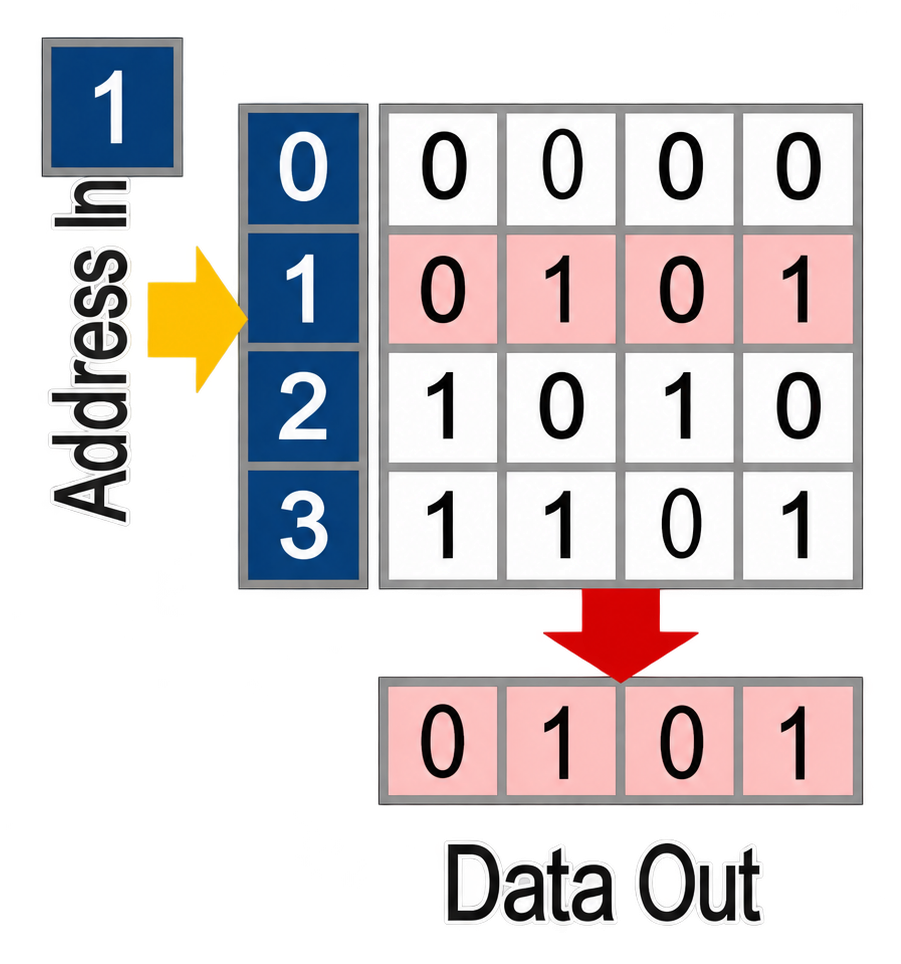
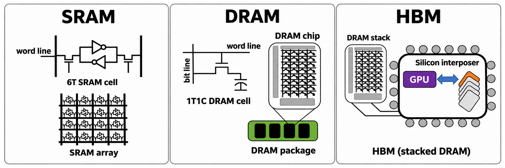
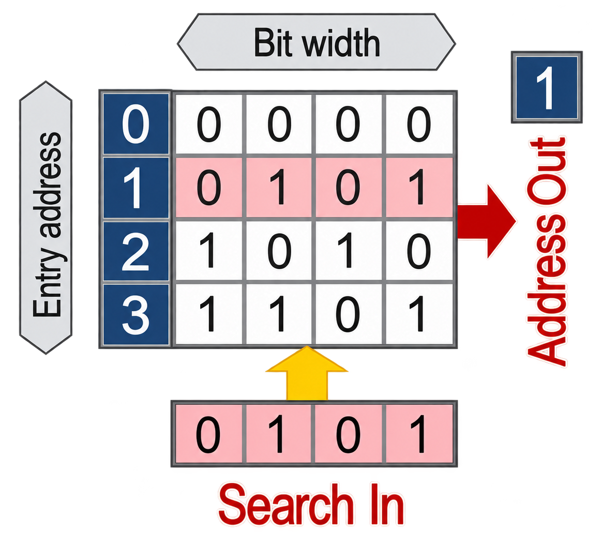
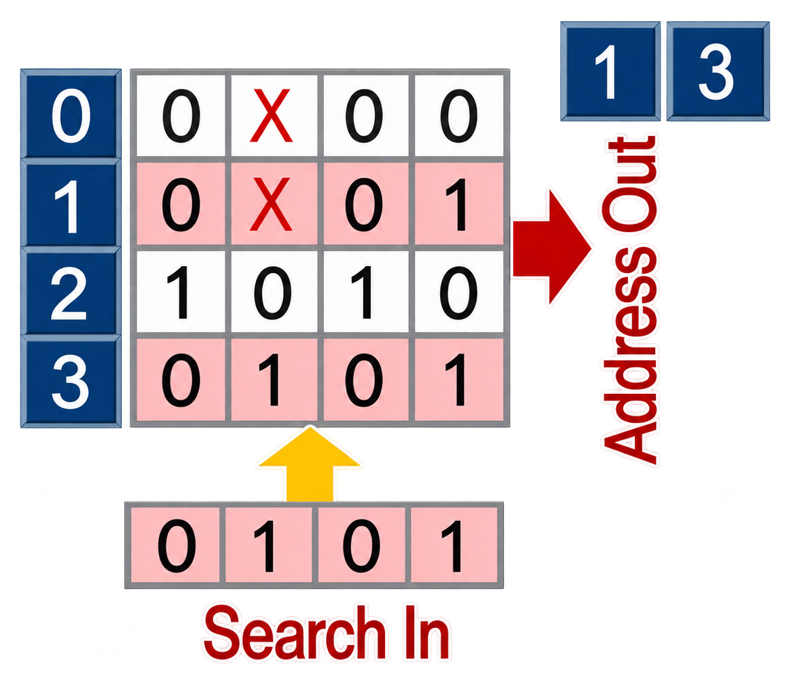

# Appendix A — Memory Types in Networking Hardware

> This appendix provides background on the memory technologies referenced throughout the guide — SRAM, DRAM, TCAM, and others. Understanding how each type works and where it is used helps explain why certain resources (like TCAM entries) are scarce and why different lookup operations have different performance characteristics.

## Addressable Memory

Addressable memory is accessed by specifying a numeric **address**. The system says "give me the value stored at address X," and the memory returns it. This is the most common memory model — used across CPUs, ASICs, GPUs, and storage devices.

Addressable memory comes in two families: **volatile** (loses data when power is removed) and **non-volatile** (retains data without power).

### Volatile Addressable Memory

Volatile memory loses all of its contents the moment power is removed. Think of it like a whiteboard — fast and convenient to work with, but everything is erased when you turn off the lights. The memories below are all volatile: they need a constant power supply to hold data.

#### SRAM (Static Random-Access Memory)

SRAM stores each bit in a flip-flop circuit (a small latch that stays in one of two stable states: 0 or 1). Because flip-flops hold their state without periodic refreshing, SRAM delivers extremely fast, low-latency reads with consistent timing.

**Where it is used:** CPU caches, ASIC pipeline registers, on-chip lookup tables, metadata buffers — anywhere deterministic nanosecond-level access is critical.

**Trade-off:** Each SRAM cell requires six transistors (compared to one transistor + one capacitor for DRAM), making it roughly 6× larger per bit and more power-hungry. This is why ASICs contain only a limited amount of on-chip SRAM.

#### DRAM (Dynamic Random-Access Memory)

DRAM stores each bit as a charge in a tiny capacitor. The capacitor leaks over time, so a memory controller must **refresh** every cell periodically (typically every 64 ms). This makes DRAM slower and less predictable than SRAM.

In practice, the DRAM in modern systems is **DDR SDRAM** (Double Data Rate Synchronous DRAM). "Synchronous" means it runs off a clock shared with the memory controller; "double data rate" means it transfers data on both edges of each clock cycle. DDR4 and DDR5 are successive generations, and variants such as LPDDR (low power) and GDDR (high bandwidth) use the same DRAM cells with different interfaces.

**Where it is used:** Main system RAM in computers and network devices, external packet buffers on switches or NICs that need deep queues.

**Trade-off:** Much denser and cheaper than SRAM — the single-transistor cell design enables large capacities (gigabytes) at low cost. The penalty is higher latency and variable access times due to refresh cycles.

#### HBM (High-Bandwidth Memory)

HBM is a 3D-stacked DRAM technology. Multiple DRAM dies are stacked vertically and connected through wide, high-speed TSVs (Through-Silicon Vias), delivering enormous bandwidth — far beyond what conventional DRAM can provide.

**Where it is used:** GPUs, AI accelerators, and advanced networking ASICs with workloads that require massive parallelism and deep buffering.

**Trade-off:** Still volatile like DRAM, but provides bandwidth levels that neither SRAM nor conventional DRAM can match. More expensive than standard DRAM due to the 3D packaging.

### Non-Volatile Addressable Memory

These memory types retain their contents without power. They are arranged below from oldest and least flexible to newest and most practical.

#### ROM (Read-Only Memory)

ROM is permanently programmed during manufacturing and cannot be modified afterward. It stores bootloader code, firmware, and essential microcode for hardware initialization. Because the contents are hard-wired, ROM is extremely reliable but completely inflexible — updating it requires replacing the chip.

#### PROM (Programmable ROM)

PROM ships blank and can be programmed **once** using special equipment. After programming, the data is permanent. Historically used for device firmware that needed customization after fabrication but not ongoing updates.

#### EPROM (Erasable Programmable ROM)

EPROM improves on PROM by allowing the stored data to be erased using **ultraviolet light**, after which it can be reprogrammed. Slow and inconvenient by modern standards, but a milestone — it enabled firmware updates without replacing physical chips.

#### EEPROM (Electrically Erasable Programmable ROM)

EEPROM can be erased and reprogrammed **electrically** at the byte level, making it far more practical than EPROM.

**Where it is used:** BIOS settings, SFP transceiver metadata (accessed via [I²C/TWI](https://en.wikipedia.org/wiki/I%C2%B2C)), and small configuration stores.

**Trade-off:** Byte-level access is flexible but slow, and endurance is limited (typically 100K–1M write cycles per cell) — sufficient for data that changes infrequently.

#### Flash Memory

Flash is a type of EEPROM optimized for **block-level** erasure rather than byte-level updates. This makes it far more scalable and cheaper, enabling high-density storage.

**Where it is used:** SSDs, embedded controllers, and switch/router boot storage.

**Trade-off:** Much faster and denser than byte-level EEPROM, but blocks must be erased before they can be rewritten, and each block has a limited number of erase cycles (typically 10K–100K for NAND flash).

## Content-Addressable Memory (CAM)

All of the memories above are *address-based* — you provide an address and get back data. Content-Addressable Memory (CAM) works in reverse: you provide **data** (a search key) and the memory tells you **where** (or whether) it matches. Every entry is compared **in parallel**, producing a result in a single clock cycle regardless of table size. This makes CAM extremely fast for lookups, but also expensive and power-hungry — each cell needs its own comparison logic.

CAM comes in two forms: **Binary CAM** (exact match only) and **Ternary CAM** (wildcard match).

### Binary CAM (BCAM)

Binary CAM supports only two bit states — **0** and **1** — so every lookup is an exact match. There is no way to express "don't care" bits, which means BCAM cannot do prefix matching or wildcard rules.

**Where BCAM is used in networking:**

| Use Case | Why BCAM Fits |
|----------|--------------|
| **MAC address table (L2 forwarding)** | A destination MAC is looked up as an exact 48-bit value to find the output port. Modern switch ASICs normally hold the main table in SRAM hash tables, with BCAM as a small overflow stage |
| **ARP / NDP cache** | IP-to-MAC mappings are exact key-value pairs; like MAC tables, these are normally stored in SRAM hash tables with BCAM as a fallback |
| **Exact-match ACL rules** | Rules that require full equality on every field are more efficient in BCAM than TCAM (lower power, smaller cells) |
| **Hash collision resolution** | When a hash-based L2/L3 table produces collisions, BCAM is often used in the secondary stage to find the exact entry |

### Ternary CAM (TCAM)

TCAM extends Binary CAM by adding a third bit state: **X** (don't care / wildcard). This allows a single entry to match a **range** of values. TCAM adds a critical feature on top of parallel lookup: **priority order**. When multiple entries match a search key, the highest-priority match wins.

In the picture, the search key `0101` is compared against all four entries at once. Entry 1 (`0X01`) matches because its X bit accepts either value, and entry 3 (`0101`) matches exactly. Entries 0 and 2 do not match. When multiple entries match, a **priority encoder** selects the one with the lowest index. Here, entry 1 wins, so the TCAM returns address **1**.

The TCAM itself returns only this address. The associated result — such as a next hop or an ACL action — is stored in a separate SRAM table at the same index.

Because the lowest index wins, software must place entries in the right order when it writes them. The two most common uses of TCAM in a switch, route lookup and ACLs, both depend on this ordering.

**Where TCAM is used in networking:**

| Use Case | Why TCAM Fits |
|----------|--------------|
| **ACLs (Access Control Lists)** | ACL rules almost always include wildcards (e.g., "any port," "match subnet /16") |
| **Longest Prefix Match (LPM) routing** | IPv4/IPv6 routing tables use prefix masks (/24, /48, etc.); TCAM evaluates and prioritizes all prefixes in parallel. Depending on the ASIC, LPM may instead use algorithmic SRAM structures |
| **QoS classification** | Rules like "match DSCP 46 on 10.0.0.0/8" combine exact fields with masks |
| **Policy-Based Routing (PBR)** | PBR rules match on combinations of source IP, destination IP, ports, and DSCP — often with wildcards |
| **Security filtering** | Matching ranges, subnets, and flexible patterns for firewall-like filters |

Parallel comparison across all entries requires dedicated comparison logic per bit per entry. A typical TCAM cell uses **16 transistors** versus 6 for an SRAM cell, making it roughly **2–3× larger** in area and significantly more power-hungry — the most silicon-expensive memory in a switch. ASICs typically include only enough TCAM for a few thousand to tens of thousands of entries, depending on the platform and how the TCAM is partitioned across features. Networks frequently "run out of TCAM" when many ACLs, VRFs, or routing policies are installed.

#### Longest Prefix Match (LPM)

A routing table often contains several routes that overlap. For example, `10.0.0.0/8`, `10.1.0.0/16`, and `10.1.2.0/24` all contain the address `10.1.2.5`. The routing rule is that the **most specific route wins**: the one with the longest prefix, because it describes the destination most precisely. This rule is called Longest Prefix Match.

TCAM implements LPM directly. Each route is stored as its network bits followed by X for every host bit, and the entries are ordered from longest prefix to shortest:

| Index | Route | Stored as | Result (in SRAM) |
|-------|-------|-----------|------------------|
| 0 | `10.1.2.0/24` | `10.1.2.X` | Next hop A |
| 1 | `10.1.0.0/16` | `10.1.X.X` | Next hop B |
| 2 | `10.0.0.0/8` | `10.X.X.X` | Next hop C |
| 3 | `0.0.0.0/0` (default route) | `X.X.X.X` | Next hop D |

Here each X stands for eight don't-care bits. The switch uses the packet's destination IP address as the search key:

- `10.1.2.5` matches all four entries. Index 0 has the highest priority, so the packet goes to next hop A.
- `10.1.9.9` matches indexes 1, 2, and 3, so it goes to next hop B.
- `192.168.1.1` matches only the default route at index 3, so it goes to next hop D.

Because longer prefixes sit at lower indexes, "highest priority" and "longest prefix" mean the same thing. Adding a route may require shifting existing entries to keep this order. The ASIC's SDK handles that when routes are programmed.

#### Access Control Lists (ACLs)

An ACL is a list of rules that decide what happens to a packet, such as permit, drop, or redirect. Each rule matches on several header fields at once, for example source IP, destination IP, protocol, and destination port. Any field a rule does not specify means "any value". Rules have priorities, and when more than one rule matches, the highest-priority rule decides the action.

To evaluate ACLs in a TCAM, the switch builds the search key by placing the selected header fields side by side. Each rule is stored across that key, with X in every bit the rule does not care about:

| Index | Rule | Source IP | Destination IP | Protocol | Dest. port | Action (in SRAM) |
|-------|------|-----------|----------------|----------|------------|------------------|
| 0 | Allow SSH from the management subnet | `10.0.0.X` | X | TCP | 22 | Permit |
| 1 | Block all other SSH | X | X | TCP | 22 | Drop |
| 2 | Block one untrusted subnet | `192.168.5.X` | X | X | X | Drop |

- A TCP packet from `10.0.0.7` to port 22 matches indexes 0 and 1. Index 0 wins, so the packet is permitted.
- A TCP packet from `172.16.1.1` to port 22 matches only index 1, so it is dropped.
- A UDP packet from `172.16.1.1` to port 53 matches no rule. Nothing is applied, and the packet continues with normal forwarding.

All rules are checked in a single lookup, no matter how many there are, which is why ACLs can be applied at **line rate** (the maximum speed of the port, with no slowdown from processing). One limitation is that a mask can only express prefix-style patterns. A port range such as 1024–65535 cannot be written as a single entry, so it is split into several entries, or handled by dedicated range-check hardware on some ASICs. This is one reason ACLs consume TCAM faster than their rule count suggests. For how SONiC programs ACLs into the ASIC, see [Access Control Lists](20_acl.md).

## Quick Comparison

| Property | SRAM | DRAM | BCAM | TCAM |
|----------|------|------|------|------|
| **Access model** | By address | By address | By content (exact) | By content (wildcard) |
| **Speed** | Fastest | Fast | Single-cycle lookup | Single-cycle lookup |
| **Density** | Low | High | Low | Lowest |
| **Power per bit** | Moderate | Low | High | Highest |
| **Cost per bit** | High | Low | Very high | Very high |
| **Volatile?** | Yes | Yes | Yes | Yes |
| **Typical use in switches** | Caches, pipeline registers | CPU RAM, deep buffers | MAC tables, ARP cache | ACLs, LPM routes, QoS |

---

**Previous**: [← Troubleshooting](36_troubleshooting.md)
