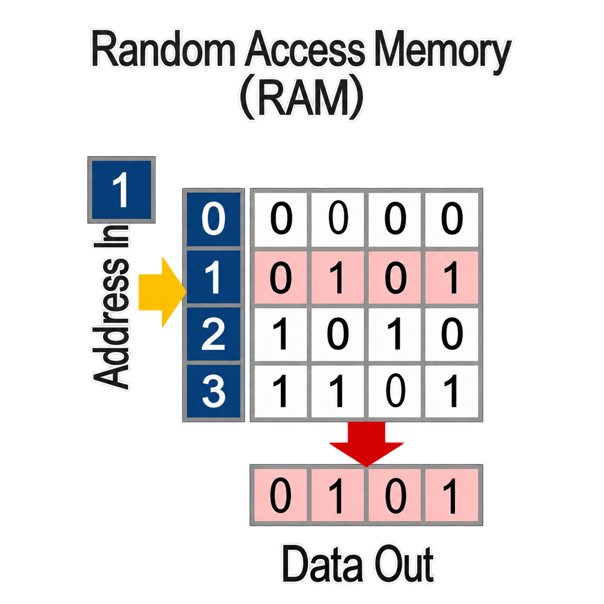
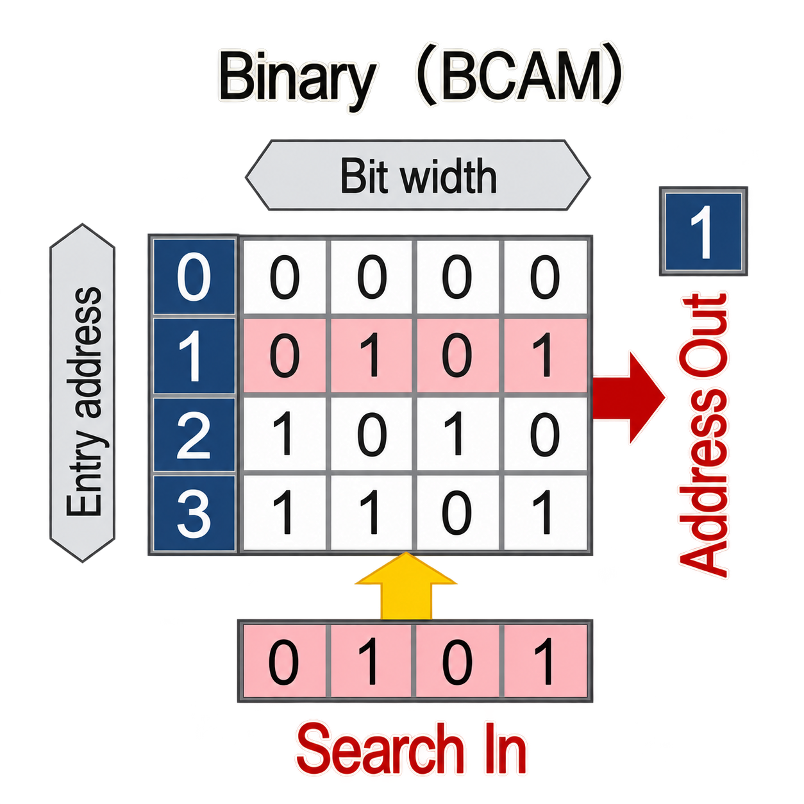
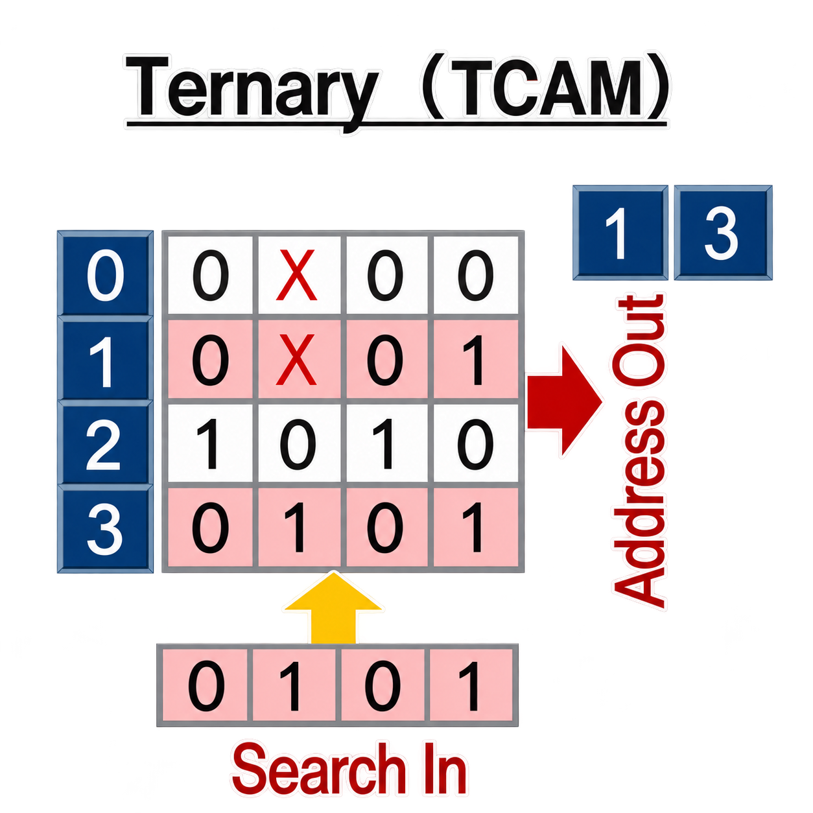

# Appendix A — Memory Types in Networking Hardware

> This appendix provides background on the memory technologies referenced throughout the guide — SRAM, DRAM, TCAM, and others. Understanding how each type works and where it is used helps explain why certain resources (like TCAM entries) are scarce and why different lookup operations have different performance characteristics.

## Addressable Memory

Addressable memory is accessed by specifying a numeric **address**. The system says "give me the value stored at address X," and the memory returns it. This is the most common memory model — used across CPUs, ASICs, GPUs, and storage devices.

Addressable memory comes in two families: **volatile** (loses data when power is removed) and **non-volatile** (retains data without power).

### Volatile Addressable Memory

#### SRAM (Static Random-Access Memory)

SRAM stores each bit in a flip-flop circuit (a small latch that stays in one of two stable states: 0 or 1). Because flip-flops hold their state without periodic refreshing, SRAM delivers extremely fast, low-latency reads with consistent timing.

**Where it is used:** CPU caches, ASIC pipeline registers, on-chip lookup tables, metadata buffers — anywhere deterministic nanosecond-level access is critical.

**Trade-off:** Each SRAM cell requires six transistors (compared to one transistor + one capacitor for DRAM), making it roughly 6× larger per bit and more power-hungry. This is why ASICs contain only a limited amount of on-chip SRAM — and why TCAM, which uses even larger cells, is even scarcer (see the [TCAM section](#ternary-cam-tcam) below).

#### DRAM (Dynamic Random-Access Memory)

DRAM stores each bit as a charge in a tiny capacitor. The capacitor leaks over time, so a memory controller must **refresh** every cell periodically (typically every 64 ms). This makes DRAM slower and less predictable than SRAM.

**Where it is used:** Main system RAM in computers and network devices, external packet buffers on switches or NICs that need deep queues.

**Trade-off:** Much denser and cheaper than SRAM — the single-transistor cell design enables large capacities (gigabytes) at low cost. The penalty is higher latency and variable access times due to refresh cycles.

#### HBM (High-Bandwidth Memory)

HBM is a 3D-stacked DRAM technology. Multiple DRAM dies are stacked vertically and connected through wide, high-speed TSVs (Through-Silicon Vias), delivering enormous bandwidth — far beyond what conventional DRAM can provide.

**Where it is used:** GPUs, AI accelerators, and advanced networking ASICs with workloads that require massive parallelism and deep buffering.

**Trade-off:** Still volatile like DRAM, but provides bandwidth levels that neither SRAM nor conventional DRAM can match. More expensive than standard DRAM due to the 3D packaging.

### Non-Volatile Addressable Memory

These memory types retain their contents without power. They are arranged below from oldest and least flexible to newest and most practical.

#### ROM (Read-Only Memory)

ROM is permanently programmed during manufacturing and cannot be modified afterward. It stores bootloader code, firmware, and essential microcode for hardware initialization. Because the contents are hard-wired, ROM is extremely reliable but completely inflexible — updating it requires replacing the chip.

#### PROM (Programmable ROM)

PROM ships blank and can be programmed **once** using special equipment. After programming, the data is permanent. Historically used for device firmware that needed customization after fabrication but not ongoing updates.

#### EPROM (Erasable Programmable ROM)

EPROM improves on PROM by allowing the stored data to be erased using **ultraviolet light**, after which it can be reprogrammed. Slow and inconvenient by modern standards, but a milestone — it enabled firmware updates without replacing physical chips.

#### EEPROM (Electrically Erasable Programmable ROM)

EEPROM can be erased and reprogrammed **electrically** at the byte level, making it far more practical than EPROM. Endurance is limited (typically 100K–1M write cycles per cell) but sufficient for infrequently updated data like BIOS settings, SFP transceiver metadata (via [I²C/TWI](https://en.wikipedia.org/wiki/I%C2%B2C)), and small configuration stores.

#### Flash Memory

Flash is a type of EEPROM optimized for **block-level** erasure rather than byte-level updates. This makes it far more scalable and cheaper, enabling high-density storage. Flash retains data without power and supports many write cycles.

**Where it is used:** SSDs, embedded controllers, and switch/router boot storage.

## Content-Addressable Memory (CAM)

All of the memories above are *address-based* — you provide an address and get back data. Content-Addressable Memory (CAM) works in reverse: you provide **data** (a search key) and the memory tells you **where** (or whether) it matches. Every entry is compared **in parallel**, producing a result in a single clock cycle regardless of table size.

This makes CAM extremely fast for lookups, but also expensive and power-hungry — each cell needs its own comparison logic.

CAM comes in two forms: **Binary CAM** (exact match only) and **Ternary CAM** (wildcard match).

### Binary CAM (BCAM)

Binary CAM supports only two bit states — **0** and **1** — so every lookup is an exact match. There is no way to express "don't care" bits, which means BCAM cannot do prefix matching or wildcard rules.

**Where BCAM is used in networking:**

| Use Case | Why BCAM Fits |
|----------|--------------|
| **MAC address table (L2 forwarding)** | A destination MAC is looked up as an exact 48-bit value to find the output port — the classic BCAM use case |
| **ARP / NDP cache** | IP-to-MAC mappings are exact key-value pairs |
| **Exact-match ACL rules** | Rules that require full equality on every field are more efficient in BCAM than TCAM (lower power, smaller cells) |
| **Hash collision resolution** | When a hash-based L2/L3 table produces collisions, BCAM is often used in the secondary stage to find the exact entry |

### Ternary CAM (TCAM)

TCAM extends Binary CAM by adding a third bit state: **X** (don't care / wildcard). This allows a single entry to match a **range** of values — for example, a /24 prefix sets 24 bits to the specific address and the remaining 8 bits to X, enabling the prefix and wildcard matching that BCAM cannot express.

TCAM entries are evaluated in **priority order**, and the highest-priority match wins. When used for ACLs, the switch presents a packet header and the TCAM compares it against all stored rules in parallel, returning the highest-priority match in a single clock cycle. This is what makes line-rate evaluation possible.

**Where TCAM is used in networking:**

| Use Case | Why TCAM Fits |
|----------|--------------|
| **ACLs (Access Control Lists)** | ACL rules almost always include wildcards (e.g., "any port," "match subnet /16") |
| **Longest Prefix Match (LPM) routing** | IPv4/IPv6 routing tables use prefix masks (/24, /48, etc.); TCAM evaluates and prioritizes all prefixes in parallel |
| **QoS classification** | Rules like "match DSCP 46 on 10.0.0.0/8" combine exact fields with masks |
| **Policy-Based Routing (PBR)** | PBR rules match on combinations of source IP, destination IP, ports, and DSCP — often with wildcards |
| **Security filtering** | Matching ranges, subnets, and flexible patterns for firewall-like filters |

**Why TCAM is scarce.** Parallel comparison across all entries requires dedicated comparison logic per bit per entry. This makes TCAM cells roughly **6× larger** than equivalent SRAM cells and significantly more power-hungry — the most silicon-expensive memory in a switch. ASICs typically include only enough TCAM for a few thousand to tens of thousands of entries, depending on the platform and how the TCAM is partitioned across features. Networks frequently "run out of TCAM" when many ACLs, VRFs, or routing policies are installed.

## Quick Comparison

| Property | SRAM | DRAM | BCAM | TCAM |
|----------|------|------|------|------|
| **Access model** | By address | By address | By content (exact) | By content (wildcard) |
| **Speed** | Fastest | Fast | Single-cycle lookup | Single-cycle lookup |
| **Density** | Low | High | Low | Lowest |
| **Power per bit** | Moderate | Low | High | Highest |
| **Cost per bit** | High | Low | Very high | Very high |
| **Volatile?** | Yes | Yes | Yes | Yes |
| **Typical use in switches** | Caches, pipeline registers | CPU RAM, deep buffers | MAC tables, ARP cache | ACLs, LPM routes, QoS |
